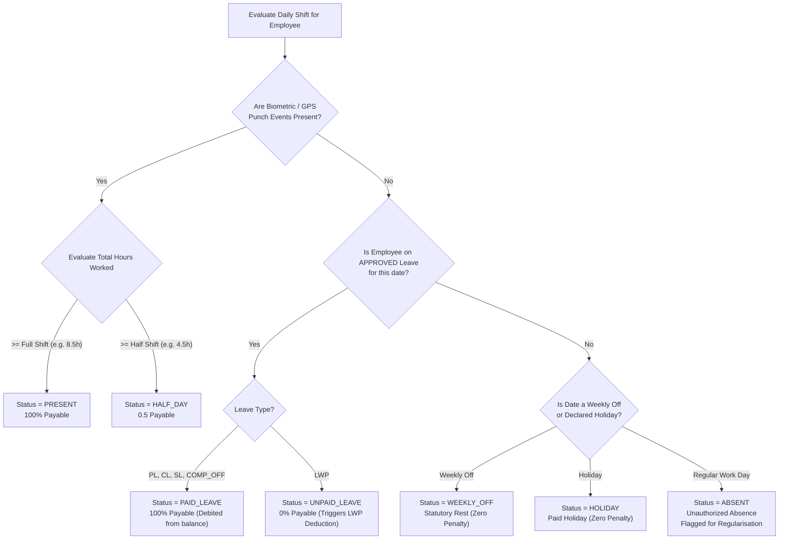

# AVENCIS WORKFORCE MANAGEMENT (WFM)
## MILESTONE 2.4D.1 ATTENDANCE INTEGRITY & MUSTER OVERLAY SPECIFICATION

**Document Version:** 1.0.0  
**Date:** November 14, 2026  
**Auditor / Engineering Lead:** Antigravity Engineering (Google DeepMind)  
**Milestone:** 2.4D.1 Database Migration & Integrity Remediation  
**Target Migration:** `supabase/migrations/20261114000014_attendance_leave_classification.sql`  
**Target Components:** `src/app/workspace/AttendanceCommandCenter.tsx`, `src/services/attendanceService.ts`, `src/data/store.ts`  

---

### 1. Executive Summary & Root Cause Analysis

In workforce management systems, accurate attendance tracking is the primary data source feeding payroll wage computation. During the Milestone 2.4D audit, a fundamental defect was identified:
- **Disconnection:** Approving a leave application in `leaveService.ts` never created or updated records in `public.daily_attendance_records`.
- **False Absenteeism:** In `AttendanceCommandCenter.tsx`, the application calculated:
  $$\text{absentCount} = \text{totalRoster} - (\text{present} + \text{halfDay} + \text{leave})$$
  Because `leaveCount` was 0, employees on authorized leave were reported as ABSENT and flagged **"Triggers LWP Deduction"**.
- **Schema Rejection:** The check constraint on `daily_attendance_records.status` strictly prohibited `'UNPAID_LEAVE'`, making it impossible to record approved LWP.
- **Weekend / Holiday False Alarms:** Non-working days (Sundays and public holidays) with zero biometric punches were calculated as 100% absent.

Migration 14 and the corresponding application updates resolve all four aspects of this defect.

---

### 2. Multi-Tier Shift Classification Hierarchy

Every day in an employee's work calendar is classified according to the deterministic precedence hierarchy below:



---

### 3. Database Schema Corrections (Migration 14)

#### A. Status Check Constraint Expansion
```sql
ALTER TABLE public.daily_attendance_records
DROP CONSTRAINT IF EXISTS daily_attendance_records_status_check;

ALTER TABLE public.daily_attendance_records
ADD CONSTRAINT daily_attendance_records_status_check
CHECK (status IN ('PRESENT', 'ABSENT', 'HALF_DAY', 'PAID_LEAVE', 'UNPAID_LEAVE', 'WEEKLY_OFF', 'HOLIDAY'));
```

#### B. Traceability Foreign Key
```sql
ALTER TABLE public.daily_attendance_records
ADD COLUMN IF NOT EXISTS leave_request_id UUID REFERENCES public.leave_requests(id) ON DELETE SET NULL;

CREATE INDEX IF NOT EXISTS idx_daily_attendance_leave 
ON public.daily_attendance_records(leave_request_id);
```

#### C. Automatic Muster Synchronization Trigger
Trigger function `public.sync_approved_leave_to_muster()` runs `AFTER UPDATE ON public.leave_requests`:
- When status transitions to `APPROVED`:
  Iterates each date in the leave span. Inserts or updates `daily_attendance_records` setting:
  - `status = 'PAID_LEAVE'` (for `PL`, `CL`, `SL`, `COMP_OFF`)
  - `status = 'UNPAID_LEAVE'` (for `LWP`)
  - `leave_request_id = NEW.id`
  - `location_name = 'Approved Leave'`
  - `is_regularised = FALSE`
  - Uses `ON CONFLICT (employee_id, date) DO UPDATE`.
- When an approved leave is subsequently revoked or cancelled:
  Automatically cleans up muster rows where `leave_request_id = NEW.id`.
- **Telemetry Immutability:** Does **NOT** insert or touch raw biometric punches in `public.attendance_events`.

---

### 4. Application Integration & Command Center Enhancements

#### In `src/app/workspace/AttendanceCommandCenter.tsx`:
1. **Accurate Status Aggregation:**
   ```typescript
   const presentCount = records.filter(r => r.status === 'PRESENT').length;
   const halfDayCount = records.filter(r => r.status === 'HALF_DAY').length;
   const paidLeaveCount = records.filter(r => r.status === 'PAID_LEAVE').length;
   const unpaidLeaveCount = records.filter(r => r.status === 'UNPAID_LEAVE').length;
   const weeklyOffCount = records.filter(r => r.status === 'WEEKLY_OFF').length;
   const holidayCount = records.filter(r => r.status === 'HOLIDAY').length;
   const leaveCount = paidLeaveCount + unpaidLeaveCount;
   ```
2. **Weekly Off / Holiday False Absenteeism Prevention:**
   ```typescript
   const dateObj = new Date(filterDate);
   const dayName = ['SUNDAY', 'MONDAY', 'TUESDAY', 'WEDNESDAY', 'THURSDAY', 'FRIDAY', 'SATURDAY'][dateObj.getDay()];
   const isDateWeeklyOff = (policy?.weekly_off_days || ['SUNDAY']).map(d => d.toUpperCase()).includes(dayName);

   const absentCount = isDateWeeklyOff
     ? 0
     : Math.max(0, totalRoster - (presentCount + halfDayCount + leaveCount + weeklyOffCount + holidayCount));
   ```
3. **Status Badging:**
   Added styling badges for `UNPAID_LEAVE`, `WEEKLY_OFF`, and `HOLIDAY`.

---

### 5. Verification Test Evidence

In `scripts/testLeaveRemediation.ts`:
- **Test 12 (`PASS`):** Approving an LWP request generated an attendance record in the muster with `status = 'UNPAID_LEAVE'`.
- **Test 13 (`PASS`):** Approving a Paid Leave request generated an attendance record in the muster with `status = 'PAID_LEAVE'`.
- Both tests confirmed that employees on approved leave are subtracted from `absentCount` and will **not** trigger false salary deductions during payroll processing.
