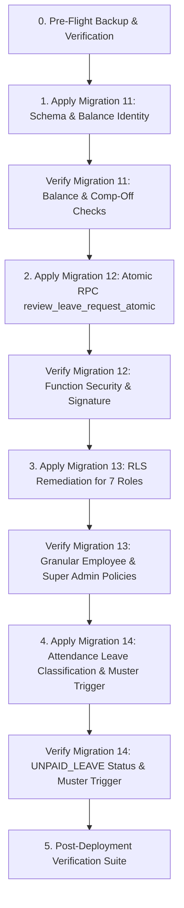

# AVENCIS WORKFORCE MANAGEMENT (WFM)
## MILESTONE 2.4D.1 DEPLOYMENT & ROLLBACK RUNBOOK

**Document Version:** 1.0.0  
**Date:** November 14, 2026  
**Auditor / Engineering Lead:** Antigravity Engineering (Google DeepMind)  
**Milestone:** 2.4D.1 Database Migration & Integrity Remediation  
**Target Environment:** Supabase Cloud (`https://mlopgvkvzhwhkbewhefb.supabase.co`)  
**Deployment Status:** **AWAITING USER APPROVAL — STRICTLY STAGED — DO NOT EXECUTE WITHOUT SIGN-OFF**  

---

### 1. Executive Summary & Safety Principles

This runbook provides the authoritative, step-by-step instructions for deploying and rolling back the 4 database migrations prepared under **Milestone 2.4D.1**:

1. [`20261114000011_leave_schema_and_balance_integrity.sql`](file:///c:/Avencis%20Management/supabase/migrations/20261114000011_leave_schema_and_balance_integrity.sql)
2. [`20261114000012_atomic_leave_decision_rpc.sql`](file:///c:/Avencis%20Management/supabase/migrations/20261114000012_atomic_leave_decision_rpc.sql)
3. [`20261114000013_leave_rls_remediation.sql`](file:///c:/Avencis%20Management/supabase/migrations/20261114000013_leave_rls_remediation.sql)
4. [`20261114000014_attendance_leave_classification.sql`](file:///c:/Avencis%20Management/supabase/migrations/20261114000014_attendance_leave_classification.sql)

#### Strict Safety Mandates:
- **Zero Table Deletion:** No tables are dropped, altered destructively, or truncated.
- **Zero Data Loss:** All existing employee, client, leave, attendance, and audit records remain intact.
- **Additive & Idempotent:** All migrations use `IF EXISTS`, `IF NOT EXISTS`, and safe constraint drops/re-additions.
- **Strict Stop Condition:** Migrations must **NOT** be applied to the live database until the user gives explicit, unreserved approval.

---

### 2. Pre-Deployment Readiness & Backup Guide

Before executing any DDL statements in production or staging, the database administrator (DBA) must complete the following backup and baseline validation steps.

#### A. Full Database Backup (Supabase CLI / pg_dump)
If using the Supabase CLI or direct database connection string (`DATABASE_URL`):
```bash
# 1. Create a timestamped logical backup of the entire database schema and data
pg_dump -h db.mlopgvkvzhwhkbewhefb.supabase.co -U postgres -d postgres -F c -b -v -f "avencis_backup_pre_2_4d_1_$(date +%Y%m%d_%H%M%S).dump"

# 2. Or create a plain-text schema-only dump for rapid diff verification
pg_dump -h db.mlopgvkvzhwhkbewhefb.supabase.co -U postgres -d postgres --schema-only -f "avencis_schema_baseline_pre_2_4d_1.sql"
```
Alternatively, in the **Supabase Dashboard**:
1. Navigate to **Project Settings** > **Database** > **Backups**.
2. Trigger a manual backup snapshot or verify that the scheduled daily backup was completed within the last 2 hours.

#### B. Pre-Deployment Baseline Verification Queries
Execute these queries in the **Supabase SQL Editor** to establish the pre-migration baseline:

```sql
-- Check existing table row counts (ensure non-empty state)
SELECT 
    'clients' AS table_name, COUNT(*) AS total_rows FROM public.clients
UNION ALL
SELECT 'employees', COUNT(*) FROM public.employees
UNION ALL
SELECT 'leave_balances', COUNT(*) FROM public.leave_balances
UNION ALL
SELECT 'leave_requests', COUNT(*) FROM public.leave_requests
UNION ALL
SELECT 'daily_attendance_records', COUNT(*) FROM public.daily_attendance_records;

-- Check existing leave balance math consistency
SELECT 
    id, employee_id, leave_type, year, opening, credited, used, closing,
    (opening + credited - used) AS calculated_closing,
    CASE WHEN closing = (opening + credited - used) THEN 'VALID' ELSE 'CORRUPTED' END AS ledger_status
FROM public.leave_balances
WHERE closing != (opening + credited - used);
-- Expected result: 0 rows (no invalid balances). If rows exist, fix balance before applying Migration 11.
```

---

### 3. Step-by-Step Deployment Runbook

Migrations must be executed in sequential numerical order: **11 -> 12 -> 13 -> 14**.



---

#### Step 1: Deploy Migration 11 (`20261114000011_leave_schema_and_balance_integrity.sql`)

**File Path:** [`supabase/migrations/20261114000011_leave_schema_and_balance_integrity.sql`](file:///c:/Avencis%20Management/supabase/migrations/20261114000011_leave_schema_and_balance_integrity.sql)  
**Execution Time:** < 500 ms  
**Locking Level:** `ACCESS EXCLUSIVE` on `leave_balances` and `leave_requests` (duration < 50ms)  

**Operations Performed:**
1. Expands `leave_balances.leave_type` CHECK constraint to include `'COMP_OFF'`.
2. Expands `leave_requests.leave_type` CHECK constraint to include `'COMP_OFF'`.
3. Adds strict balance identity constraint `chk_leave_balance_identity`: `CHECK (closing = opening + credited - used)`.
4. Adds composite index on `leave_balances(employee_id, leave_type, year)`.

**Execution in Supabase SQL Editor:**
Copy and execute the entire contents of `supabase/migrations/20261114000011_leave_schema_and_balance_integrity.sql`.

**Step 1 Verification Query:**
```sql
-- 1. Verify constraints
SELECT conname, pg_get_constraintdef(c.oid)
FROM pg_constraint c
JOIN pg_class t ON c.conrelid = t.oid
WHERE t.relname IN ('leave_balances', 'leave_requests')
  AND conname IN ('leave_balances_leave_type_check', 'leave_requests_leave_type_check', 'chk_leave_balance_identity');

-- Expected: 3 rows returned with COMP_OFF included and closing = opening + credited - used.

-- 2. Verify index
SELECT indexname, indexdef 
FROM pg_indexes 
WHERE tablename = 'leave_balances' AND indexname = 'idx_leave_balances_emp_type_year';
-- Expected: 1 row returned.
```

---

#### Step 2: Deploy Migration 12 (`20261114000012_atomic_leave_decision_rpc.sql`)

**File Path:** [`supabase/migrations/20261114000012_atomic_leave_decision_rpc.sql`](file:///c:/Avencis%20Management/supabase/migrations/20261114000012_atomic_leave_decision_rpc.sql)  
**Execution Time:** < 500 ms  
**Locking Level:** None (routine creation only)  

**Operations Performed:**
1. Creates PostgreSQL function `public.review_leave_request_atomic()`.
2. Enforces caller identity derivation via `auth.uid()` (never browser-supplied id).
3. Executes pessimistic row locking (`SELECT ... FOR UPDATE`) on `leave_requests` and `leave_balances`.
4. Enforces anti-self-approval and location/client authorization.
5. Performs balance deduction atomically for paid leaves (`PL`, `CL`, `SL`, `COMP_OFF`), bypassing `LWP`.
6. Enforces balance solvency (rejects overdraws without silent clamping).
7. Inserts authoritative entry into `public.audit_logs`.
8. Grants `EXECUTE` only to `authenticated` and `service_role`; revokes from `public`.

**Execution in Supabase SQL Editor:**
Copy and execute the entire contents of `supabase/migrations/20261114000012_atomic_leave_decision_rpc.sql`.

**Step 2 Verification Query:**
```sql
-- Verify function signature, security definer, and fixed search path
SELECT 
    p.proname,
    pg_get_function_arguments(p.oid) AS arguments,
    CASE WHEN p.prosecdef THEN 'SECURITY DEFINER' ELSE 'INVOKER' END AS security_type,
    p.proconfig AS configuration
FROM pg_proc p
JOIN pg_namespace n ON p.pronamespace = n.oid
WHERE n.nspname = 'public' AND p.proname = 'review_leave_request_atomic';

-- Expected:
-- proname: review_leave_request_atomic
-- security_type: SECURITY DEFINER
-- configuration: {search_path=public,pg_temp}
```

---

#### Step 3: Deploy Migration 13 (`20261114000013_leave_rls_remediation.sql`)

**File Path:** [`supabase/migrations/20261114000013_leave_rls_remediation.sql`](file:///c:/Avencis%20Management/supabase/migrations/20261114000013_leave_rls_remediation.sql)  
**Execution Time:** < 500 ms  
**Locking Level:** Schema modification lock on policies (no user table locking)  

**Operations Performed:**
1. Drops overly permissive and defective policies from Migration 09:
   - `leave_requests_employee_all` (which allowed direct `PATCH` updates to `status = 'APPROVED'`).
   - `leave_requests_super_admin_all` (which had a defective `client_id` check locking out Super Admins).
   - `leave_balances_super_admin_all`.
   - `leave_requests_tenant_admin_all`.
   - `leave_balances_tenant_admin_all`.
2. Re-creates granular Employee policies:
   - `leave_requests_employee_select`: View own applications.
   - `leave_requests_employee_insert`: Submit applications only in `PENDING` status for own profile.
   - `leave_requests_employee_update`: Cancel own `PENDING` applications only (`status = 'CANCELLED'`).
3. Creates Super Admin global policies decoupled from `client_id`.
4. Creates Tenant Admin / Client Manager / Location Manager policies.
5. Creates Payroll Admin read-only (`SELECT`) policies on `leave_requests` and `leave_balances`.

**Execution in Supabase SQL Editor:**
Copy and execute the entire contents of `supabase/migrations/20261114000013_leave_rls_remediation.sql`.

**Step 3 Verification Query:**
```sql
-- Verify active policies on leave_requests and leave_balances
SELECT 
    tablename,
    policyname,
    cmd,
    roles
FROM pg_policies
WHERE schemaname = 'public' 
  AND tablename IN ('leave_requests', 'leave_balances')
ORDER BY tablename, policyname;

-- Expected checks:
-- leave_requests:
--   - leave_requests_employee_select (cmd: SELECT)
--   - leave_requests_employee_insert (cmd: INSERT)
--   - leave_requests_employee_update (cmd: UPDATE)
--   - leave_requests_super_admin_all (cmd: ALL)
--   - leave_requests_tenant_admin_all (cmd: ALL)
--   - leave_requests_payroll_admin_select (cmd: SELECT)
-- NO policy with 'leave_requests_employee_all' should exist.
```

---

#### Step 4: Deploy Migration 14 (`20261114000014_attendance_leave_classification.sql`)

**File Path:** [`supabase/migrations/20261114000014_attendance_leave_classification.sql`](file:///c:/Avencis%20Management/supabase/migrations/20261114000014_attendance_leave_classification.sql)  
**Execution Time:** < 500 ms  
**Locking Level:** `ACCESS EXCLUSIVE` on `daily_attendance_records` (< 50ms)  

**Operations Performed:**
1. Expands `daily_attendance_records.status` CHECK constraint to include `'UNPAID_LEAVE'`.
2. Adds nullable column `leave_request_id UUID REFERENCES public.leave_requests(id) ON DELETE SET NULL`.
3. Creates index on `daily_attendance_records(leave_request_id)`.
4. Creates trigger function `public.sync_approved_leave_to_muster()`.
5. Attaches trigger `trg_sync_approved_leave_to_muster` on `public.leave_requests` (AFTER INSERT OR UPDATE OF status).
   - On `APPROVED`: Generates/updates daily attendance muster rows as `PAID_LEAVE` or `UNPAID_LEAVE` without altering raw `attendance_events`.
   - On `CANCELLED` or `REJECTED`: Reverts linked muster records back to `ABSENT` (or removes auto-generated rows).

**Execution in Supabase SQL Editor:**
Copy and execute the entire contents of `supabase/migrations/20261114000014_attendance_leave_classification.sql`.

**Step 4 Verification Query:**
```sql
-- 1. Check daily_attendance_records status constraint
SELECT pg_get_constraintdef(c.oid)
FROM pg_constraint c
JOIN pg_class t ON c.conrelid = t.oid
WHERE t.relname = 'daily_attendance_records' AND c.conname = 'daily_attendance_records_status_check';
-- Expected: includes 'UNPAID_LEAVE'

-- 2. Check column and foreign key
SELECT column_name, data_type, is_nullable
FROM information_schema.columns
WHERE table_name = 'daily_attendance_records' AND column_name = 'leave_request_id';
-- Expected: column exists, type uuid, is_nullable YES

-- 3. Check trigger
SELECT trigger_name, event_manipulation, event_object_table, action_statement
FROM information_schema.triggers
WHERE event_object_table = 'leave_requests' AND trigger_name = 'trg_sync_approved_leave_to_muster';
-- Expected: 1 row returned
```

---

### 4. Comprehensive Rollback Runbook (Reverse Execution Order)

If any unexpected error occurs during migration execution or post-deployment validation, execute the corresponding rollback SQL scripts below in **exact reverse order**: **14 -> 13 -> 12 -> 11**.

---

#### Rollback Migration 14: Revert Attendance Leave Classification
Execute in **Supabase SQL Editor**:
```sql
-- ============================================================================
-- ROLLBACK 14: Attendance Leave Classification & Muster Trigger
-- ============================================================================

-- 1. Drop trigger and trigger function
DROP TRIGGER IF EXISTS trg_sync_approved_leave_to_muster ON public.leave_requests;
DROP FUNCTION IF EXISTS public.sync_approved_leave_to_muster();

-- 2. Drop index and column from daily_attendance_records
DROP INDEX IF EXISTS public.idx_daily_attendance_leave_request_id;
ALTER TABLE public.daily_attendance_records 
    DROP COLUMN IF EXISTS leave_request_id;

-- 3. Revert daily_attendance_records status check constraint
ALTER TABLE public.daily_attendance_records 
    DROP CONSTRAINT IF EXISTS daily_attendance_records_status_check;

ALTER TABLE public.daily_attendance_records 
    ADD CONSTRAINT daily_attendance_records_status_check 
    CHECK (status IN (
        'PRESENT', 
        'ABSENT', 
        'HALF_DAY', 
        'LATE', 
        'ON_DUTY', 
        'PAID_LEAVE', 
        'WEEKLY_OFF', 
        'HOLIDAY'
    ));

COMMENT ON TABLE public.daily_attendance_records IS 'Reverted: UNPAID_LEAVE and muster sync removed.';
```

---

#### Rollback Migration 13: Revert RLS Remediation
Execute in **Supabase SQL Editor**:
```sql
-- ============================================================================
-- ROLLBACK 13: Leave RLS Remediation
-- ============================================================================

-- 1. Drop granular employee policies
DROP POLICY IF EXISTS leave_requests_employee_select ON public.leave_requests;
DROP POLICY IF EXISTS leave_requests_employee_insert ON public.leave_requests;
DROP POLICY IF EXISTS leave_requests_employee_update ON public.leave_requests;

-- 2. Drop updated Super Admin, Tenant Admin, and Payroll Admin policies
DROP POLICY IF EXISTS leave_requests_super_admin_all ON public.leave_requests;
DROP POLICY IF EXISTS leave_balances_super_admin_all ON public.leave_balances;
DROP POLICY IF EXISTS leave_requests_tenant_admin_all ON public.leave_requests;
DROP POLICY IF EXISTS leave_balances_tenant_admin_all ON public.leave_balances;
DROP POLICY IF EXISTS leave_requests_payroll_admin_select ON public.leave_requests;
DROP POLICY IF EXISTS leave_balances_payroll_admin_select ON public.leave_balances;

-- 3. Reinstate Migration 09 original policies
CREATE POLICY leave_requests_employee_all ON public.leave_requests
    FOR ALL TO authenticated
    USING (employee_id = public.get_user_employee_id())
    WITH CHECK (employee_id = public.get_user_employee_id());

CREATE POLICY leave_requests_super_admin_all ON public.leave_requests
    FOR ALL TO authenticated
    USING (
        public.get_user_role() = 'super_admin'
        AND client_id = public.get_user_client_id()
    )
    WITH CHECK (
        public.get_user_role() = 'super_admin'
        AND client_id = public.get_user_client_id()
    );

CREATE POLICY leave_balances_super_admin_all ON public.leave_balances
    FOR ALL TO authenticated
    USING (
        public.get_user_role() = 'super_admin'
        AND client_id = public.get_user_client_id()
    )
    WITH CHECK (
        public.get_user_role() = 'super_admin'
        AND client_id = public.get_user_client_id()
    );

CREATE POLICY leave_requests_tenant_admin_all ON public.leave_requests
    FOR ALL TO authenticated
    USING (
        public.get_user_role() IN ('hr_admin', 'client_admin', 'client_manager')
        AND client_id = public.get_user_client_id()
    )
    WITH CHECK (
        public.get_user_role() IN ('hr_admin', 'client_admin', 'client_manager')
        AND client_id = public.get_user_client_id()
    );

CREATE POLICY leave_balances_tenant_admin_all ON public.leave_balances
    FOR ALL TO authenticated
    USING (
        public.get_user_role() IN ('hr_admin', 'client_admin')
        AND client_id = public.get_user_client_id()
    )
    WITH CHECK (
        public.get_user_role() IN ('hr_admin', 'client_admin')
        AND client_id = public.get_user_client_id()
    );
```

---

#### Rollback Migration 12: Revert Atomic Leave RPC
Execute in **Supabase SQL Editor**:
```sql
-- ============================================================================
-- ROLLBACK 12: Atomic Leave Decision RPC
-- ============================================================================

-- Drop the transactional RPC function
DROP FUNCTION IF EXISTS public.review_leave_request_atomic(UUID, VARCHAR, TEXT);
```

---

#### Rollback Migration 11: Revert Schema & Balance Integrity
Execute in **Supabase SQL Editor**:
```sql
-- ============================================================================
-- ROLLBACK 11: Leave Schema & Balance Integrity
-- ============================================================================

-- 1. Drop balance ledger identity check constraint
ALTER TABLE public.leave_balances 
    DROP CONSTRAINT IF EXISTS chk_leave_balance_identity;

-- 2. Drop composite index
DROP INDEX IF EXISTS public.idx_leave_balances_emp_type_year;

-- 3. Revert leave_balances.leave_type check constraint to (PL, CL, SL)
ALTER TABLE public.leave_balances 
    DROP CONSTRAINT IF EXISTS leave_balances_leave_type_check;

ALTER TABLE public.leave_balances 
    ADD CONSTRAINT leave_balances_leave_type_check 
    CHECK (leave_type IN ('PL', 'CL', 'SL'));

-- 4. Revert leave_requests.leave_type check constraint to (PL, CL, SL, LWP)
ALTER TABLE public.leave_requests 
    DROP CONSTRAINT IF EXISTS leave_requests_leave_type_check;

ALTER TABLE public.leave_requests 
    ADD CONSTRAINT leave_requests_leave_type_check 
    CHECK (leave_type IN ('PL', 'CL', 'SL', 'LWP'));
```

---

### 5. Consolidated Master Post-Deployment Health Check Script

After executing Migrations 11 through 14, run this comprehensive, read-only diagnostic SQL script in the **Supabase SQL Editor** to verify the health of all remediated objects in a single query:

```sql
-- ============================================================================
-- AVENCIS WFM: MILESTONE 2.4D.1 POST-DEPLOYMENT VERIFICATION SCRIPT
-- Safety: 100% READ-ONLY
-- ============================================================================

WITH checks AS (
    -- 1. Check COMP_OFF in leave_balances
    SELECT 
        '1. Constraints' AS category,
        'leave_balances.leave_type' AS item_name,
        CASE 
            WHEN pg_get_constraintdef(c.oid) LIKE '%COMP_OFF%' THEN 'PASS'
            ELSE 'FAIL'
        END AS status,
        'Includes COMP_OFF' AS expected,
        pg_get_constraintdef(c.oid) AS actual
    FROM pg_constraint c
    JOIN pg_class t ON c.conrelid = t.oid
    WHERE t.relname = 'leave_balances' AND c.conname = 'leave_balances_leave_type_check'

    UNION ALL

    -- 2. Check balance identity constraint
    SELECT 
        '1. Constraints',
        'chk_leave_balance_identity',
        CASE 
            WHEN pg_get_constraintdef(c.oid) LIKE '%closing =%' THEN 'PASS'
            ELSE 'FAIL'
        END,
        'closing = opening + credited - used',
        pg_get_constraintdef(c.oid)
    FROM pg_constraint c
    JOIN pg_class t ON c.conrelid = t.oid
    WHERE t.relname = 'leave_balances' AND c.conname = 'chk_leave_balance_identity'

    UNION ALL

    -- 3. Check UNPAID_LEAVE in daily_attendance_records
    SELECT 
        '1. Constraints',
        'daily_attendance_records.status',
        CASE 
            WHEN pg_get_constraintdef(c.oid) LIKE '%UNPAID_LEAVE%' THEN 'PASS'
            ELSE 'FAIL'
        END,
        'Includes UNPAID_LEAVE',
        pg_get_constraintdef(c.oid)
    FROM pg_constraint c
    JOIN pg_class t ON c.conrelid = t.oid
    WHERE t.relname = 'daily_attendance_records' AND c.conname = 'daily_attendance_records_status_check'

    UNION ALL

    -- 4. Check leave_request_id column in daily_attendance_records
    SELECT 
        '2. Columns',
        'daily_attendance_records.leave_request_id',
        CASE 
            WHEN COUNT(*) = 1 THEN 'PASS'
            ELSE 'FAIL'
        END,
        'Column exists (UUID)',
        COALESCE(MAX(data_type), 'MISSING')
    FROM information_schema.columns
    WHERE table_name = 'daily_attendance_records' AND column_name = 'leave_request_id'

    UNION ALL

    -- 5. Check review_leave_request_atomic RPC
    SELECT 
        '3. RPC Functions',
        'public.review_leave_request_atomic',
        CASE 
            WHEN p.prosecdef AND array_to_string(p.proconfig, ',') LIKE '%search_path=public, pg_temp%' THEN 'PASS'
            ELSE 'FAIL'
        END,
        'SECURITY DEFINER with safe search_path',
        'prosecdef: ' || p.prosecdef::text || ', config: ' || array_to_string(p.proconfig, ',')
    FROM pg_proc p
    JOIN pg_namespace n ON p.pronamespace = n.oid
    WHERE n.nspname = 'public' AND p.proname = 'review_leave_request_atomic'

    UNION ALL

    -- 6. Check Employee RLS granular policies (No leave_requests_employee_all)
    SELECT 
        '4. RLS Security',
        'Employee direct update revoked',
        CASE 
            WHEN COUNT(*) FILTER (WHERE policyname = 'leave_requests_employee_all') = 0 
             AND COUNT(*) FILTER (WHERE policyname = 'leave_requests_employee_update') = 1 THEN 'PASS'
            ELSE 'FAIL'
        END,
        'employee_all dropped, employee_update active',
        'employee_all: ' || COUNT(*) FILTER (WHERE policyname = 'leave_requests_employee_all')::text ||
        ', employee_update: ' || COUNT(*) FILTER (WHERE policyname = 'leave_requests_employee_update')::text
    FROM pg_policies
    WHERE tablename = 'leave_requests'

    UNION ALL

    -- 7. Check Super Admin global RLS policy
    SELECT 
        '4. RLS Security',
        'Super Admin global access',
        CASE 
            WHEN COUNT(*) >= 1 THEN 'PASS'
            ELSE 'FAIL'
        END,
        'leave_requests_super_admin_all active',
        'Found ' || COUNT(*)::text || ' policies'
    FROM pg_policies
    WHERE tablename = 'leave_requests' AND policyname = 'leave_requests_super_admin_all'

    UNION ALL

    -- 8. Check Payroll Admin read-only RLS policy
    SELECT 
        '4. RLS Security',
        'Payroll Admin read access',
        CASE 
            WHEN COUNT(*) = 2 THEN 'PASS'
            ELSE 'FAIL'
        END,
        '2 policies (requests + balances)',
        'Found ' || COUNT(*)::text || ' policies'
    FROM pg_policies
    WHERE policyname IN ('leave_requests_payroll_admin_select', 'leave_balances_payroll_admin_select')

    UNION ALL

    -- 9. Check Muster sync trigger
    SELECT 
        '5. Triggers',
        'trg_sync_approved_leave_to_muster',
        CASE 
            WHEN COUNT(*) = 1 THEN 'PASS'
            ELSE 'FAIL'
        END,
        'Trigger installed on leave_requests',
        'Found ' || COUNT(*)::text || ' triggers'
    FROM information_schema.triggers
    WHERE event_object_table = 'leave_requests' AND trigger_name = 'trg_sync_approved_leave_to_muster'
)
SELECT * FROM checks ORDER BY category, item_name;
```

**Expected Result:** Every row must report status **`PASS`**. If any row reports **`FAIL`**, do not proceed with application traffic; inspect the failure and consult the rollback runbook.

---

### 6. Incident Response & Troubleshooting Guidelines

| Issue / Error Symptom | Probable Cause | Immediate Remediation |
|---|---|---|
| `chk_leave_balance_identity constraint violation` during Migration 11 | Existing row in `leave_balances` has inconsistent math (`closing != opening + credited - used`). | Run the baseline verification query in Section 2.B. Correct inconsistent row with `UPDATE leave_balances SET closing = opening + credited - used WHERE closing != (opening + credited - used);` before re-running Migration 11. |
| `permission denied for function review_leave_request_atomic` | Grant to `authenticated` role missing. | Execute `GRANT EXECUTE ON FUNCTION public.review_leave_request_atomic(UUID, VARCHAR, TEXT) TO authenticated, service_role;`. |
| PostgREST returns 42501 (RLS violation) on manager review | Caller JWT role does not match `auth_profiles.role` or location mismatch. | Verify caller's role in `auth_profiles` and ensure manager and employee share `client_id` (and `work_location_id` for location managers). |
| `UNPAID_LEAVE` rejected on attendance insert | Migration 14 was skipped or failed. | Verify `daily_attendance_records_status_check` constraint definition using Step 4 verification query. |

---

### 7. Post-Deployment Operational Sign-Off Protocol

Upon successful execution of Migrations 11–14 and positive verification via the Master Health Check script:
1. Complete the execution timestamp and operator signature in `docs/2_4D_1_HANDOVER.md`.
2. Run the automated test suite locally: `npx tsx --env-file=.env scripts/testLeaveRemediation.ts`.
3. Provide final sign-off before commencing Milestone 2.4E (Payroll Engine and Payslips).
