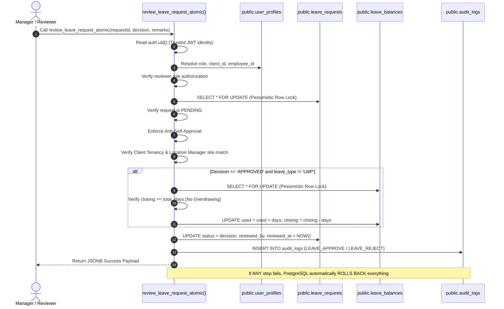

# AVENCIS WORKFORCE MANAGEMENT (WFM)
## MILESTONE 2.4D.1 TRANSACTIONAL WORKFLOW SPECIFICATION

**Document Version:** 1.0.0  
**Date:** November 14, 2026  
**Auditor / Engineering Lead:** Antigravity Engineering (Google DeepMind)  
**Milestone:** 2.4D.1 Database Migration & Integrity Remediation  
**Target Function:** `public.review_leave_request_atomic()`  
**Target Migration:** `supabase/migrations/20261114000012_atomic_leave_decision_rpc.sql`  

---

### 1. Executive Summary

In Milestone 2.4D, managerial leave review was executed as two separate PostgREST queries from the browser client, creating serious race conditions under concurrency and leaving requests stranded in `APPROVED` status if the subsequent balance update failed.

Migration 12 introduces `public.review_leave_request_atomic()`, a high-assurance PostgreSQL transactional stored procedure that binds leave request state transition, balance deduction, organizational authorization, and cryptographic audit logging into a single atomic ACID unit.

---

### 2. End-to-End Step-by-Step Transaction Execution

The diagram and numbered sequence below illustrate the 12 atomic steps executed inside PostgreSQL:



#### Step 1: Trusted Caller Resolution
- Derives identity exclusively from PostgreSQL session context: `v_caller_auth_id := auth.uid()`.
- Browser-supplied reviewer IDs are completely ignored, eliminating caller spoofing.

#### Step 2 & 3: Role & Organizational Scope Resolution
- Looks up caller profile in `public.user_profiles`.
- Rejects immediately if profile is missing or role is not in `('super_admin', 'client_admin', 'hr_admin', 'client_manager', 'location_manager')`.

#### Step 4 & 5: Pessimistic Row Lock & State Verification
- Executes `SELECT * INTO v_req FROM public.leave_requests WHERE id = p_request_id FOR UPDATE`.
- The row lock forces any concurrent approval attempt on the same request to queue until this transaction finishes.
- Verifies `v_req.status = 'PENDING'`. If already approved, rejected, or cancelled, aborts immediately.

#### Step 6: Corporate Anti-Self-Approval Enforcement
- Checks:
  ```sql
  IF v_reviewer_emp_id IS NOT NULL AND v_reviewer_emp_id = v_req.employee_id THEN
      RAISE EXCEPTION 'GOVERNANCE_VIOLATION: Employees are strictly prohibited from reviewing their own leave requests.';
  END IF;
  ```
  Guarantees no employee can approve their own application, even if they possess manager or admin roles.

#### Step 7: Tenancy & Work Location Authorization
- Super Admin possesses global jurisdiction.
- Other roles require `v_req.client_id = v_reviewer_client_id`.
- For `location_manager`, queries `employees.work_location_id` for both applicant and manager. Rejects if they belong to different facilities.

#### Step 8 & 9: Balance Solvency Check & Atomic Deduction
- For paid leave types (`PL`, `CL`, `SL`, `COMP_OFF`):
  - Derives year: `v_year := EXTRACT(YEAR FROM v_req.start_date)::INT`.
  - Executes `SELECT * INTO v_bal FROM public.leave_balances ... FOR UPDATE`.
  - Enforces:
    ```sql
    IF v_bal.closing < v_req.total_days THEN
        RAISE EXCEPTION 'INSUFFICIENT_BALANCE: Insufficient % balance. Available: %, Requested: %',
            v_req.leave_type, v_bal.closing, v_req.total_days;
    END IF;
    ```
    Eliminates silent clamping (`Math.max(0, ...)`). If balance is insufficient, transaction aborts.
  - Updates `used` and `closing` atomically.
- For Unpaid Leave (`LWP`):
  - Skips balance deduction entirely.

#### Step 10 & 11: Request Status & Audit Trail Update
- Updates `leave_requests` setting `status = p_decision`, `reviewed_by = v_reviewer_profile_id`, `reviewed_at = NOW()`, `manager_remarks = p_manager_remarks`.
- Inserts an immutable audit record into `public.audit_logs`.

#### Step 12: Atomic Commit or Full Rollback
- If all steps succeed, PostgreSQL commits changes to `leave_requests`, `leave_balances`, and `audit_logs` simultaneously.
- If an unhandled exception or constraint violation occurs at any point, PostgreSQL rolls back all modifications.

---

### 3. Concurrency & Stress Simulation Matrix

| Stress Scenario | Concurrent Operations | Database Behavior under Migration 12 | Outcome |
|---|---|---|:---:|
| **Double Manager Approval** | 2 managers click "Approve" at the same instant on request `lr-01` | First transaction acquires `FOR UPDATE` lock. Second waits. First commits `status = 'APPROVED'`. Second wakes up, reads `status = 'APPROVED'`, and throws `STATE_ERROR`. | **PASS (1 approval, 1 deduction)** |
| **Balance Exhaustion Contest** | Employee has 2d balance; submits two 2d requests. Managers approve simultaneously. | Transaction 1 acquires row lock on `leave_balances`, deducts 2d (`closing = 0`), and commits. Transaction 2 acquires lock, inspects `closing = 0 < 2`, and throws `INSUFFICIENT_BALANCE`. | **PASS (No Overdrawing)** |
| **Balance Update Failure** | PostgreSQL constraint violation on balance update | Entire transaction aborts; `leave_requests` row is NOT updated; request remains `PENDING`. | **PASS (No Stranded Approvals)** |
| **Audit Log Failure** | Table locking or constraint error on `audit_logs` | Entire transaction aborts; request remains `PENDING`; balance is NOT deducted. | **PASS (Full Rollback)** |

---

### 4. Integration with Application Service Layer

In `src/services/leaveService.ts`, `reviewLeaveRequest` has been updated to invoke this RPC:

```typescript
const { data: rpcRes, error: rpcErr } = await (supabase.rpc as any)(
  'review_leave_request_atomic',
  {
    p_request_id: id,
    p_decision: decision.status,
    p_manager_remarks: decision.remarks || null,
  }
);

if (!rpcErr && rpcRes?.success) {
  const { data: updated } = await supabase.from('leave_requests').select('*').eq('id', id).single();
  return successResponse(updated || rpcRes);
}
```

The application now possesses an enterprise-grade transactional boundary safe for upcoming Payroll integration.
