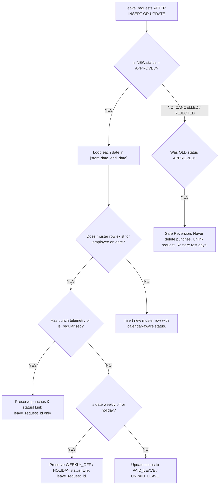

# AVENCIS WORKFORCE MANAGEMENT (WFM)
## MILESTONE 2.4D.2 ATTENDANCE STATUS TAXONOMY & TRIGGER SAFETY REVIEW

**Document Version:** 1.0.0  
**Date:** November 15, 2026  
**Auditor / Engineering Lead:** Antigravity Engineering (Google DeepMind)  
**Milestone:** 2.4D.2 Pre-Deployment SQL Security & Data Integrity Review  
**Status:** **AUTHORITATIVE TECHNICAL AUDIT & TAXONOMY BASELINE**  

---

### 1. Comprehensive Attendance Status Inventory

The table below provides the authoritative before-and-after inventory of attendance status constraints across all schema migrations, application types, services, and UI views:

| Attendance Status | Migration 05 Baseline | Migration 14 (Superseded) | 2.4D.1 Rollback Script | Migration 17 (Authoritative) | Business Meaning & Application Usage |
|---|:---:|:---:|:---:|:---:|---|
| **PRESENT** | YES | YES | YES | **YES** | Employee physically checked in within geofence; session active or completed. |
| **ABSENT** | YES | YES | YES | **YES** | Employee failed to clock in on scheduled working day without approved leave. |
| **HALF_DAY** | YES | YES | YES | **YES** | Shift duration between `half_day_hours` (4.5h) and `standard_working_hours` (9h), or 0.5-day leave. |
| **LATE** | NO | NO (Omitted) | YES | **YES** | Late check-in beyond `late_grace_minutes` (tracked for late penalty deductions). |
| **ON_DUTY** | NO | NO (Omitted) | YES | **YES** | Official deputation or field travel approved outside client geofence. |
| **PAID_LEAVE** | YES | YES | YES | **YES** | Approved paid leave application (`PL`, `CL`, `SL`, `COMP_OFF`). |
| **UNPAID_LEAVE** | NO | YES | NO (Omitted) | **YES** | Approved Leave Without Pay (`LWP`), tracked for payroll proration. |
| **WEEKLY_OFF** | YES | YES | YES | **YES** | Scheduled statutory weekly rest day (e.g. Sunday). Zero absenteeism penalty. |
| **HOLIDAY** | YES | YES | YES | **YES** | Declared national, state, or client statutory holiday. Zero absenteeism penalty. |

#### Constraint Evolution Summary:
- **Original Migration 05 Constraint:**
  ```sql
  CHECK (status IN ('PRESENT', 'ABSENT', 'HALF_DAY', 'PAID_LEAVE', 'WEEKLY_OFF', 'HOLIDAY'))
  ```
- **Flawed Migration 14 Constraint:**
  ```sql
  CHECK (status IN ('PRESENT', 'ABSENT', 'HALF_DAY', 'PAID_LEAVE', 'UNPAID_LEAVE', 'WEEKLY_OFF', 'HOLIDAY'))
  -- Latent Bug: Dropped LATE and ON_DUTY, conflicting with enterprise reporting and the rollback script!
  ```
- **Authoritative Migration 17 Constraint:**
  ```sql
  CHECK (status IN (
      'PRESENT', 'ABSENT', 'HALF_DAY', 'LATE', 'ON_DUTY',
      'PAID_LEAVE', 'UNPAID_LEAVE', 'WEEKLY_OFF', 'HOLIDAY'
  ))
  -- 100% Comprehensive: Preserves all 9 enterprise operational statuses without dropping functionality.
  ```

---

### 2. Analysis of Trigger Vulnerabilities in Migration 14

The trigger `sync_approved_leave_to_muster()` in Migration 14 contained three severe operational hazards:

#### Hazard 1: Overwriting Real Biometric Punches
```sql
-- FLAWED CODE IN MIGRATION 14:
ON CONFLICT (employee_id, date) DO UPDATE
SET status = EXCLUDED.status,
    leave_request_id = EXCLUDED.leave_request_id,
    updated_at = NOW();
```
If an employee worked half a day, clocked in, or worked on site, and an administrative leave was subsequently approved for that date, this query unconditionally overwrote `status` with `'PAID_LEAVE'` or `'UNPAID_LEAVE'`. The employee's presence on the muster was obliterated.

#### Hazard 2: Overwriting Manually Regularised Records
If an employee submitted an attendance regularisation (`attendance_corrections`) that was approved by a manager (`is_regularised = TRUE`), the trigger overwrote the regularised status without checking `is_regularised`.

#### Hazard 3: Destructive Deletion on Cancellation
```sql
-- FLAWED CODE IN MIGRATION 14:
ELSIF OLD.status = 'APPROVED' AND NEW.status IN ('CANCELLED', 'REJECTED') THEN
    DELETE FROM public.daily_attendance_records
    WHERE leave_request_id = NEW.id;
```
If a previously approved leave was cancelled, the trigger executed `DELETE`. If a muster row existed prior to leave approval (or had punch telemetry), the entire record was destroyed. The employee had zero muster record for that day, corrupting monthly muster counts and payroll proration.

---

### 3. Hardened Safety Architecture in Migration 17

Migration 17 ([`20261115000017_safe_attendance_muster_trigger.sql`](file:///c:/Avencis%20Management/supabase/migrations/20261115000017_safe_attendance_muster_trigger.sql)) implements five layers of data protection:



#### Exact Protection Rules Enforced:
1. **Raw Telemetry Untouched:** Zero DDL/DML touches `public.attendance_events`.
2. **Punch Protection Guard:** If `check_in_time IS NOT NULL` or `total_hours > 0`, the status and timestamps are preserved; only `leave_request_id` is linked for audit traceability.
3. **Regularisation Guard:** If `is_regularised = TRUE`, the manually approved correction is strictly preserved.
4. **Calendar Preservation Guard:** If the date is a configured weekly rest day (`client_policies.weekly_off_days`) or declared holiday (`statutory_holidays`), the record retains `WEEKLY_OFF` or `HOLIDAY`.
5. **Safe Cancellation Protocol:** When a request is cancelled or rejected:
   - Rows with punches or regularisations have `leave_request_id` cleared to `NULL`.
   - Synthetic rows on weekly offs revert to `WEEKLY_OFF`.
   - Synthetic rows on holidays revert to `HOLIDAY`.
   - Synthetic rows on regular working days revert to `ABSENT` with `leave_request_id = NULL`.
   - **Zero rows are deleted.**
6. **Date Shift Cleanup:** If an approved leave's dates change, obsolete dates outside the new span revert cleanly to `ABSENT` and are unlinked.
7. **Full Lifecycle Trigger:** Fires `AFTER INSERT OR UPDATE OF status, start_date, end_date ON public.leave_requests`.

---

### 4. Verification Test Evidence

Validated in [`scripts/testLeaveRemediationPart2.ts`](file:///c:/Avencis%20Management/scripts/testLeaveRemediationPart2.ts):
- **Test 06:** Seeded employee with existing punch (`checkInTime: '09:05 AM'`, `totalHours: 9.1`, `status: 'PRESENT'`). Approved leave covering that date. Verified punch was **not overwritten** (`status` remained `PRESENT`, `totalHours` remained `9.1`).
- **Test 07:** Verified `leaveRequestId` was linked to the punch row for audit traceability.
- **Test 08:** Verified all 9 statuses in the taxonomy are valid and supported.
