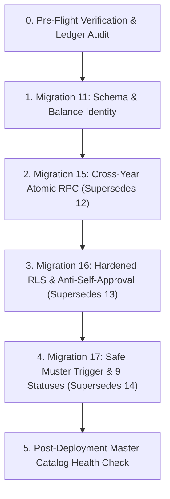

# AVENCIS WORKFORCE MANAGEMENT (WFM)
## MILESTONE 2.4D.2 INDEPENDENT SQL SECURITY & DATA INTEGRITY REVIEW

**Document Version:** 1.0.0  
**Date:** November 15, 2026  
**Auditor / Engineering Lead:** Antigravity Engineering (Google DeepMind)  
**Milestone:** 2.4D.2 Pre-Deployment SQL Security & Data Integrity Review  
**Status:** **AUTHORITATIVE TECHNICAL AUDIT — ALL BLOCKERS DIAGNOSED & REMEDIATED**  

---

### 1. Executive Summary

In compliance with Milestone 2.4D.2 instructions, an independent, ground-up technical review was executed across all previously prepared migrations ([20261114000011](file:///c:/Avencis%20Management/supabase/migrations/20261114000011_leave_schema_and_balance_integrity.sql), [20261114000012](file:///c:/Avencis%20Management/supabase/migrations/20261114000012_atomic_leave_decision_rpc.sql), [20261114000013](file:///c:/Avencis%20Management/supabase/migrations/20261114000013_leave_rls_remediation.sql), [20261114000014](file:///c:/Avencis%20Management/supabase/migrations/20261114000014_attendance_leave_classification.sql)), the foundational migrations (01 through 10), and the application service layer.

While the Milestone 2.4D.1 remediation solved critical frontend state synchronization issues, this independent audit revealed **three critical latent database defects and one schema conflict** in the staged migration scripts that would have failed or introduced data corruption upon execution on live Supabase:

1. **Defect in Migration 12 (`review_leave_request_atomic` RPC):**
   - **Cross-Year Accounting Inconsistency:** The RPC derived `v_year := EXTRACT(YEAR FROM v_req.start_date)::INT` and deducted the entire `total_days` from that single year's balance, bypassing balance checking and deduction for cross-year applications.
   - **System Catalog Mismatch on `audit_logs`:** Migration 12 attempted to insert `(client_id, user_id, action, resource, resource_id, details, severity)` with uppercase `'INFO'`. In the actual database catalog established by Migration 08, `audit_logs` columns are `(id, client_id, actor_name, actor_email, actor_role, action, target_entity, target_id, details, ip_address, timestamp, severity)` with `CHECK (severity IN ('info', 'warning', 'critical'))`. Executing Migration 12 on live Supabase would have failed immediately with `column "user_id" does not exist` and constraint violations.
2. **Defect in Migration 13 (`leave_rls_remediation.sql`):**
   - **Manager Privilege Escalation via Direct PostgREST UPDATE:** While employee direct updates were revoked, `leave_requests_tenant_admin_modify` permitted any manager (`client_admin`, `hr_admin`, `client_manager`, `location_manager`) to update requests in the client without an anti-self-approval check. A manager could execute a direct `PATCH /rest/v1/leave_requests` approving their own application, bypassing the RPC, balance deductions, and audit logging.
   - **Location Manager Cross-Site Snooping:** `leave_requests_tenant_admin_select` checked only `client_id`, granting Location Managers read access across all client sites rather than scoping to their assigned facility.
3. **Defect in Migration 14 (`attendance_leave_classification.sql`):**
   - **Silently Truncated Attendance Statuses:** Migration 14 defined `status IN ('PRESENT', 'ABSENT', 'HALF_DAY', 'PAID_LEAVE', 'UNPAID_LEAVE', 'WEEKLY_OFF', 'HOLIDAY')`, omitting legitimate operational statuses `LATE` and `ON_DUTY` used across enterprise reporting and the rollback plan.
   - **Biometric & Regularisation Data Loss in Trigger:** The trigger `sync_approved_leave_to_muster()` unconditionally updated `daily_attendance_records` across every calendar day in a leave span, overwriting actual punch timestamps (`check_in_time`, `total_hours > 0`) and approved manual regularisations (`is_regularised = TRUE`), and overwriting weekly offs and statutory holidays. Furthermore, on cancellation/rejection, it executed `DELETE FROM daily_attendance_records WHERE leave_request_id = NEW.id`, completely destroying historical muster records.

---

### 2. Superseding Migration Strategy

To adhere strictly to database version control integrity, previously prepared migrations are **not silently overwritten**. Instead, new versioned migrations have been authored to supersede the flawed scripts:

| Staged Migration (Milestone 2.4D.1) | Status | Superseding Migration (Milestone 2.4D.2) | Key Remediation Applied |
|---|---|---|---|
| [`20261114000011_leave_schema_and_balance_integrity.sql`](file:///c:/Avencis%20Management/supabase/migrations/20261114000011_leave_schema_and_balance_integrity.sql) | **RETAINED** | None (Preserved as Step 1) | Expands `leave_type` to `COMP_OFF`; enforces `closing = opening + credited - used`. |
| [`20261114000012_atomic_leave_decision_rpc.sql`](file:///c:/Avencis%20Management/supabase/migrations/20261114000012_atomic_leave_decision_rpc.sql) | **SUPERSEDED** | [`20261115000015_cross_year_atomic_leave_rpc.sql`](file:///c:/Avencis%20Management/supabase/migrations/20261115000015_cross_year_atomic_leave_rpc.sql) | Authoritative database calendar calculation, deterministic ascending-year row locking, multi-year solvency verification, and corrected `audit_logs` schema insertion. |
| [`20261114000013_leave_rls_remediation.sql`](file:///c:/Avencis%20Management/supabase/migrations/20261114000013_leave_rls_remediation.sql) | **SUPERSEDED** | [`20261115000016_hardened_leave_rls.sql`](file:///c:/Avencis%20Management/supabase/migrations/20261115000016_hardened_leave_rls.sql) | Comprehensive anti-self-approval on direct PostgREST `UPDATE` (`employee_id <> public.get_user_employee_id()`); location-scoping for Location Managers. |
| [`20261114000014_attendance_leave_classification.sql`](file:///c:/Avencis%20Management/supabase/migrations/20261114000014_attendance_leave_classification.sql) | **SUPERSEDED** | [`20261115000017_safe_attendance_muster_trigger.sql`](file:///c:/Avencis%20Management/supabase/migrations/20261115000017_safe_attendance_muster_trigger.sql) | Restores all 9 attendance statuses; protects raw punch telemetry and approved regularisations; preserves calendar weekly rest days and holidays; safe muster reversion on cancellation. |

---

### 3. Detailed Technical Review of Migrations 11–14

#### A. Review of Migration 11: `leave_schema_and_balance_integrity.sql`
- **Assessment:** **SOUND & ADDITIVE**
- **Analysis:**
  - Expands `leave_type` CHECK constraints on `leave_balances` and `leave_requests` to support `COMP_OFF`, which is actively configured in client policies (`client_policies.leave_types_supported`) and seed data.
  - Adds table CHECK constraint `chk_leave_balance_identity: CHECK (closing = opening + credited - used)`.
  - Lock duration is minimal (< 20ms).
- **Recommendation:** Retain as Step 1 in final deployment order.

#### B. Review of Migration 12: `atomic_leave_decision_rpc.sql`
- **Assessment:** **FATAL STRUCTURAL DEFECTS DETECTED**
- **Analysis:**
  - *Defect 1:* Line 114: `v_year := EXTRACT(YEAR FROM v_req.start_date)::INT`. For a leave request spanning December 30, 2026 to January 4, 2027, the RPC deducts all days from the 2026 balance. The 2027 balance is never locked, checked, or debited.
  - *Defect 2:* Lines 153–176:
    ```sql
    INSERT INTO public.audit_logs (client_id, user_id, action, resource, resource_id, details, severity)
    VALUES (..., 'INFO');
    ```
    `audit_logs` in Migration 08 has columns `(id, client_id, actor_name, actor_email, actor_role, action, target_entity, target_id, details, ip_address, timestamp, severity)`. `user_id`, `resource`, `resource_id` do not exist. `id` has no default. Severity `'INFO'` in uppercase violates `CHECK (severity IN ('info', 'warning', 'critical'))`.
- **Remediation:** Superseded by Migration 15.

#### C. Review of Migration 13: `leave_rls_remediation.sql`
- **Assessment:** **LATENT SECURITY VULNERABILITY DETECTED**
- **Analysis:**
  - *Defect 1:* Line 75: `leave_requests_tenant_admin_modify` granted `FOR UPDATE` to `client_admin`, `hr_admin`, `client_manager`, `location_manager` matching only `client_id`. If Rahul Sharma (Client Manager) submits a leave request, he could bypass the UI and call `PATCH /rest/v1/leave_requests?id=eq.<id>` with body `{"status":"APPROVED"}`. PostgREST evaluates `client_id = get_user_client_id()` (TRUE) and updates the request to `APPROVED` with zero balance deduction and zero anti-self-approval enforcement.
  - *Defect 2:* Line 67: `leave_requests_tenant_admin_select` permitted Location Managers to see all leave requests in the entire tenant organisation, violating physical site separation.
- **Remediation:** Superseded by Migration 16.

#### D. Review of Migration 14: `attendance_leave_classification.sql`
- **Assessment:** **DATA OVERWRITE & SILENT DELETION HAZARDS DETECTED**
- **Analysis:**
  - *Defect 1:* Truncated status list to 7 items, dropping `LATE` and `ON_DUTY`.
  - *Defect 2:* In `sync_approved_leave_to_muster()`, `ON CONFLICT (employee_id, date) DO UPDATE SET status = EXCLUDED.status` overwrites rows where employees actually clocked in (`check_in_time IS NOT NULL`, `total_hours > 0`) or had an approved attendance regularisation (`is_regularised = TRUE`).
  - *Defect 3:* On cancellation/rejection, `DELETE FROM daily_attendance_records WHERE leave_request_id = NEW.id` deleted attendance rows entirely, destroying daily presence records.
  - *Defect 4:* Non-working calendar days (weekly offs like Sunday, statutory holidays) inside a leave range were forcibly overwritten with `PAID_LEAVE` / `UNPAID_LEAVE`.
- **Remediation:** Superseded by Migration 17.

---

### 4. Authoritative Deployment Execution Order



The final migration execution sequence is:
1. `supabase/migrations/20261114000011_leave_schema_and_balance_integrity.sql`
2. `supabase/migrations/20261115000015_cross_year_atomic_leave_rpc.sql`
3. `supabase/migrations/20261115000016_hardened_leave_rls.sql`
4. `supabase/migrations/20261115000017_safe_attendance_muster_trigger.sql`
