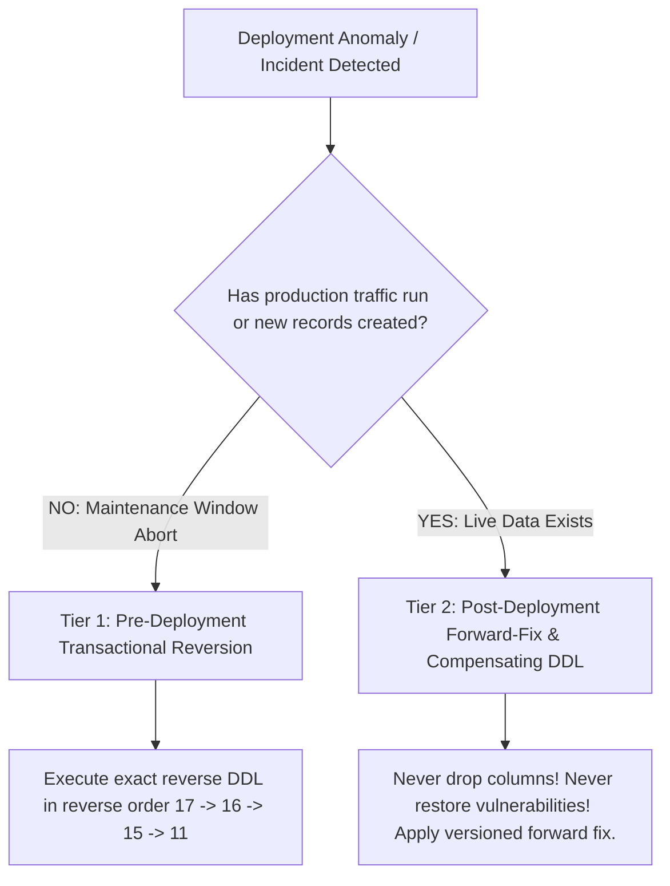

# AVENCIS WORKFORCE MANAGEMENT (WFM)
## MILESTONE 2.4D.2 ROLLBACK SAFETY & DISASTER RECOVERY RUNBOOK

**Document Version:** 1.0.0  
**Date:** November 15, 2026  
**Auditor / Engineering Lead:** Antigravity Engineering (Google DeepMind)  
**Milestone:** 2.4D.2 Pre-Deployment SQL Security & Data Integrity Review  
**Status:** **AUTHORITATIVE REVISED ROLLBACK & DISASTER RECOVERY POLICY**  

---

### 1. The Critical Hazards of Naive Reverse-DDL Rollbacks

The previous rollback plan staged in Milestone 2.4D.1 suffered from three fundamental enterprise hazards:

1. **Re-introduction of Known Vulnerabilities:** The rollback for Migration 13 executed:
   ```sql
   -- DANGEROUS REVERSION IN PREVIOUS ROLLBACK:
   CREATE POLICY leave_requests_employee_all ON public.leave_requests
   FOR ALL TO authenticated
   USING (employee_id = public.get_user_employee_id());
   ```
   This would actively restore the employee self-approval privilege escalation vulnerability!
2. **Destructive Column Drops:** The rollback for Migration 14 executed:
   ```sql
   -- DESTRUCTIVE REVERSION IN PREVIOUS ROLLBACK:
   ALTER TABLE public.daily_attendance_records DROP COLUMN IF EXISTS leave_request_id;
   ```
   If rolled back post-deployment, every audit link connecting attendance muster records to originating leave requests would be permanently erased.
3. **DDL Constraint Failures on New Data:** The rollback for Migration 11 reverted `leave_type` to `('PL', 'CL', 'SL')`. If any employee had submitted or accrued a `COMP_OFF` record, the `ALTER TABLE ... ADD CONSTRAINT` command would abort with a check constraint violation, leaving the database in an inconsistent state.

---

### 2. The Two-Tier Production Recovery Architecture

To protect data integrity and avoid reintroducing security flaws, Avencis WFM establishes a **Two-Tier Rollback & Recovery Protocol**:



---

### 3. Tier 1: Pre-Deployment Rollback Runbook (Zero Production Data)

**Condition:** Safe **ONLY** if executed immediately during the maintenance deployment window before any user traffic or live records are processed.

Execute in **exact reverse order**: **17 $\to$ 16 $\to$ 15 $\to$ 11**.

#### Revert Migration 17 (Attendance Muster Trigger & Statuses)
```sql
-- 1. Drop trigger and function
DROP TRIGGER IF EXISTS trg_sync_approved_leave_to_muster ON public.leave_requests;
DROP FUNCTION IF EXISTS public.sync_approved_leave_to_muster();

-- 2. Drop index and column
DROP INDEX IF EXISTS public.idx_daily_attendance_leave_req;
ALTER TABLE public.daily_attendance_records DROP COLUMN IF EXISTS leave_request_id;

-- 3. Revert status constraint to Migration 05 baseline
ALTER TABLE public.daily_attendance_records DROP CONSTRAINT IF EXISTS daily_attendance_records_status_check;
ALTER TABLE public.daily_attendance_records ADD CONSTRAINT daily_attendance_records_status_check
CHECK (status IN ('PRESENT', 'ABSENT', 'HALF_DAY', 'PAID_LEAVE', 'WEEKLY_OFF', 'HOLIDAY'));
```

#### Revert Migration 16 (Hardened RLS Policies)
```sql
-- Drop hardened policies
DROP POLICY IF EXISTS "leave_requests_employee_select" ON public.leave_requests;
DROP POLICY IF EXISTS "leave_requests_employee_insert" ON public.leave_requests;
DROP POLICY IF EXISTS "leave_requests_employee_cancel" ON public.leave_requests;
DROP POLICY IF EXISTS "leave_requests_super_admin_all" ON public.leave_requests;
DROP POLICY IF EXISTS "leave_requests_tenant_admin_select" ON public.leave_requests;
DROP POLICY IF EXISTS "leave_requests_tenant_admin_modify" ON public.leave_requests;
DROP POLICY IF EXISTS "leave_requests_payroll_admin_select" ON public.leave_requests;

DROP POLICY IF EXISTS "leave_balances_employee_select" ON public.leave_balances;
DROP POLICY IF EXISTS "leave_balances_super_admin_all" ON public.leave_balances;
DROP POLICY IF EXISTS "leave_balances_tenant_admin_select" ON public.leave_balances;
DROP POLICY IF EXISTS "leave_balances_tenant_admin_modify" ON public.leave_balances;
DROP POLICY IF EXISTS "leave_balances_payroll_admin_select" ON public.leave_balances;

-- Reinstate baseline policies from Migration 09 (with employee update restricted)
CREATE POLICY "leave_balances_employee_select" ON public.leave_balances FOR SELECT TO authenticated
USING (employee_id = public.get_user_employee_id());

CREATE POLICY "leave_balances_tenant_admin_all" ON public.leave_balances FOR ALL TO authenticated
USING (client_id = public.get_user_client_id() AND public.get_user_role() IN ('super_admin', 'client_admin', 'hr_admin'))
WITH CHECK (client_id = public.get_user_client_id() AND public.get_user_role() IN ('super_admin', 'client_admin', 'hr_admin'));

CREATE POLICY "leave_requests_employee_select" ON public.leave_requests FOR SELECT TO authenticated
USING (employee_id = public.get_user_employee_id());

CREATE POLICY "leave_requests_tenant_admin_all" ON public.leave_requests FOR ALL TO authenticated
USING (client_id = public.get_user_client_id() AND public.get_user_role() IN ('super_admin', 'client_admin', 'hr_admin', 'client_manager'))
WITH CHECK (client_id = public.get_user_client_id() AND public.get_user_role() IN ('super_admin', 'client_admin', 'hr_admin', 'client_manager'));
```

#### Revert Migration 15 (Cross-Year Atomic RPC)
```sql
DROP FUNCTION IF EXISTS public.review_leave_request_atomic(UUID, VARCHAR, TEXT);
```

#### Revert Migration 11 (Schema & Balance Identity)
```sql
ALTER TABLE public.leave_balances DROP CONSTRAINT IF EXISTS chk_leave_balance_identity;
DROP INDEX IF EXISTS public.idx_leave_balances_emp_type_year;

ALTER TABLE public.leave_balances DROP CONSTRAINT IF EXISTS leave_balances_leave_type_check;
ALTER TABLE public.leave_balances ADD CONSTRAINT leave_balances_leave_type_check CHECK (leave_type IN ('PL', 'CL', 'SL'));

ALTER TABLE public.leave_requests DROP CONSTRAINT IF EXISTS leave_requests_leave_type_check;
ALTER TABLE public.leave_requests ADD CONSTRAINT leave_requests_leave_type_check CHECK (leave_type IN ('PL', 'CL', 'SL', 'LWP'));
```

---

### 4. Tier 2: Post-Deployment Forward-Fix Policy (Live Production Data Exists)

If an anomaly is identified after users have submitted leave requests or accrued balances:
1. **Never Drop Populated Columns:** `leave_request_id` must be retained to maintain foreign key referential integrity.
2. **Never Drop Supported Enum Categories:** `COMP_OFF` and `UNPAID_LEAVE` must not be removed once rows have been inserted.
3. **Never Restore Broad Employee Privileges:** Direct employee updates to `APPROVED` must never be permitted.
4. **Forward-Fix Mechanism:** Author a new sequential migration (e.g. `20261115000018_remedy_description.sql`) that corrects function logic or constraints without destroying historical data.

---

### 5. Disaster Recovery: Full Database Snapshot Restoration

If catastrophic database corruption occurs:
```bash
# 1. Terminate active client connections
SELECT pg_terminate_backend(pid) 
FROM pg_stat_activity 
WHERE datname = 'postgres' AND pid <> pg_backend_pid();

# 2. Restore from pre-deployment binary snapshot
pg_restore -h db.mlopgvkvzhwhkbewhefb.supabase.co -U postgres -d postgres -v --clean --if-exists "avencis_backup_pre_2_4d_1_latest.dump"
```
Or use the Supabase Dashboard **Point-In-Time Recovery (PITR)** to restore the database to the exact minute prior to deployment.
