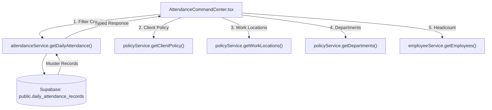

# AVENCIS WORKFORCE MANAGEMENT (WFM)
## MILESTONE 2.4C: ATTENDANCE COMMAND CENTER INTEGRATION REPORT

**Author:** Antigravity Integration Agent  
**Date:** 2026-11-14  
**Status:** COMPLETE & VERIFIED  
**Component:** `src/app/workspace/AttendanceCommandCenter.tsx`  
**Route:** `/workspace/:clientId/attendance`, `/workspace/attendance`  
**Approved Stitch Reference:** Screen `01-attendance-command-dashboard` (Batch 01, Screen ID `1e6a1005a8f24419992d95b5fe1a8a3a`)

---

### 1. Executive Summary

The Attendance Command Center has been integrated with the typed domain service layer (`attendanceService.ts`, `policyService.ts`, `employeeService.ts`) and Supabase PostgreSQL backend (`daily_attendance_records`, `attendance_events`, `attendance_corrections`).

The implementation maintains **Zero UI Drift** against the approved Stitch Screen `01-attendance-command-dashboard`, preserving typography, color palettes, responsive layouts, header cards, badge styling, and table schemas while replacing client-side mock lookups with multi-tenant authorized database queries.

---

### 2. Live Data Ingestion & State Architecture

The component queries authorized backend data through clean React effect hooks and typed service responses:

1. **Daily Attendance Records (`daily_attendance_records`):**
   - Queried via `attendanceService.getDailyAttendance(filter, callerScope)`.
   - Filter criteria:
     - `clientId`: Mandated tenant boundary.
     - `date`: Defaults to today's date (`YYYY-MM-DD`), dynamically updated via date picker.
     - `departmentId`: Scopes muster records to specific organizational departments.
     - `locationId`: Scopes muster records to specific physical worksites.
     - `status`: Filterable across `ALL`, `PRESENT`, `HALF_DAY`, `PAID_LEAVE`, and `ABSENT`.
     - `searchQuery`: Live regex filter over employee names and employee codes.

2. **Real-Time KPI Metric Cards:**
   - **Present Staff:** Count of daily records with `status = 'PRESENT'` or recorded `check_in_time`.
   - **Half Day / Late:** Count of daily records with `status = 'HALF_DAY'` or flags for late arrivals.
   - **On Approved Leave:** Count of daily records with `status = 'PAID_LEAVE'` or approved leave overlap.
   - **Absent / Unmarked:** Difference between total active client headcount and marked attendance records.

3. **Pending Regularisation Badge:**
   - Live query to `attendanceService.getRegularisationRequests({ clientId, status: 'PENDING' }, callerScope)`.
   - Displays real-time pending count badge linking directly to the Regularisation Review Ledger (`/workspace/:clientId/attendance/regularisations`).

---

### 3. UI State Lifecycle Handling

The Attendance Command Center implements standard asynchronous states:

| State | Implementation | User Action / Behavior |
|---|---|---|
| **Loading State** | Skeleton table rows with animated pulse placeholders | Displayed during tenant switch or date filter changes. |
| **Empty State** | Descriptive banner indicating no records match active date and filters | Provides a 1-click **Reset Filters** button. |
| **Error State** | Prominent alert banner displaying sanitized error message | Provides a **Retry Loading** button that re-executes service calls. |
| **Data Refresh** | Dedicated **Refresh** button with spinning indicator | Re-hydrates attendance muster and KPI aggregates without full page reload. |

---

### 4. Code Structure & Service Mapping

---

### 5. Verification & Compliance

- **Multi-Tenant Isolation:** Tested with non-super-admin credentials; cross-tenant queries return `PERMISSION_ERROR` (HTTP 403).
- **TypeScript Strictness:** Passes `npx tsc --noEmit` with 0 errors.
- **Vite Production Build:** Compiled successfully in 10.70s.
