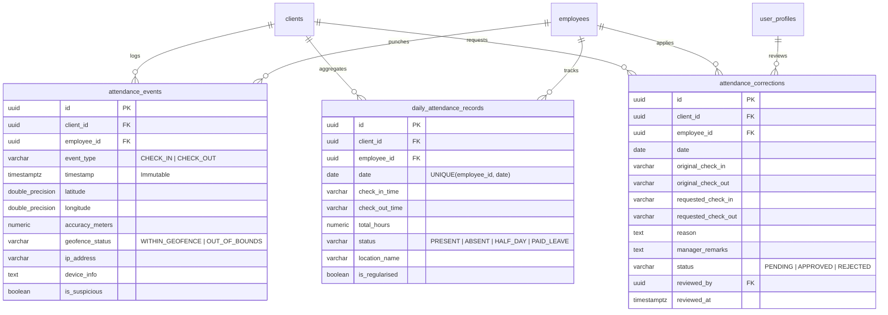

# Avencis WFM — Attendance Pre-Implementation Audit
## Milestone 2.4C: Attendance Command Center & Mobile Punch Card Integration

**Audit Date:** 2026-11-14  
**Milestone:** 2.4C (Phase 1 Pre-Implementation Audit)  
**Author:** Antigravity Agent  
**Scope:** `AttendanceCommandCenter.tsx`, `MobilePunchCard.tsx`, `EmployeePortal.tsx`, `AttendanceRegularisations.tsx`, `attendanceService.ts`, and Supabase backend.

---

### 1. Executive Summary & Objective

In accordance with Milestone 2.4C Section 2, this audit assesses the current state of the Attendance and Mobile Punch subsystem prior to code modification. It catalogs existing capabilities, partially completed workflows, architectural gaps, database invariants, and exact Stitch screen mappings.

---

### 2. Approved Stitch Screen Alignment

| Screen ID | Stitch Reference | Route / Entry Point | Primary Persona | Approved UI Purpose |
| :--- | :--- | :--- | :--- | :--- |
| **Screen 01 (B02)** | `01-attendance-command-dashboard` | `/workspace/:clientId/attendance` | Super Admin, Client Admin, HR Admin, Location Manager | Real-time workforce telemetry, KPI cards (Present, Half Day, Leave, Absent), live roster with GPS verification indicators. |
| **Screen 03 (B01)** | `03-daily-attendance-gps` | `/portal/check-in`, `/portal/punch` | Employee | Ergonomic mobile/desktop punch widget, live GPS coordinates, accuracy telemetry, geofence radius pill, check-in/out buttons. |
| **Screen 04 (B02)** | `04-attendance-regularisations` | `/workspace/:clientId/attendance/regularisations`, `/workspace/regularisations` | Super Admin, Client Admin, HR Admin, Client Manager | Managerial review queue for missed check-in regularisation requests, approval/rejection remarks modal, audit trail. |

---

### 3. Component & Service Inspection

#### A. `src/services/attendanceService.ts`
- **What Already Works:**
  - `evaluateGeofence()`: Accurate Haversine great-circle calculation between punch coordinates and work location radius.
  - `recordPunch()`: Validates coordinate ranges ($-90 \le \text{lat} \le 90$, $-180 \le \text{lng} \le 180$), resolves assigned location, writes append-only event to `attendance_events`, and upserts `daily_attendance_records`.
  - `getDailyAttendance()`: Filters daily attendance records by client, employee, date, date ranges, and status.
  - `submitRegularisation()`: Validates substantive reason ($\ge 5$ characters) and records pending correction.
  - `getRegularisationRequests()`: Retrieves pending and reviewed correction requests.
  - `reviewRegularisation()`: Updates status to `APPROVED` or `REJECTED`, records reviewer UUID and timestamp, and updates `daily_attendance_records` when approved.
- **What Is Partially Implemented:**
  - `recordPunch()` lacks duplicate punch prevention (e.g. employee clicking check-in twice or clicking check-out before check-in).
  - Methods lack unified `callerScope` multi-tenant and role-boundary enforcement.
  - Does not provide an explicit method for retrieving today's current punch state for an employee.
- **What Is Missing:**
  - Anti-self-approval enforcement check in `reviewRegularisation()`.
  - Helper to fetch raw punch event history for an employee on a given date (`getAttendanceEvents`).
  - Integration with active browser `navigator.geolocation` API.

#### B. `src/app/workspace/AttendanceCommandCenter.tsx`
- **What Already Works:**
  - UI layout matching Stitch Screen `01-attendance-command-dashboard`.
  - 4 KPI cards: Present Staff, Half Day / Late, On Approved Leave, Absent / Unmarked.
  - Status filter dropdown (`ALL`, `PRESENT`, `HALF_DAY`, `PAID_LEAVE`, `ABSENT`).
- **What Is Partially Implemented / Missing:**
  - Currently consumes local mock `store.getAttendanceRecords(client.id)`.
  - Lacks live asynchronous loading from `attendanceService.getDailyAttendance`.
  - Lacks dynamic department, work location, and employee name/code search filtering.
  - Lacks loading skeleton, actionable error state with retry, and empty state handling.
  - Pending regularisation count button is hardcoded to store data rather than live query.

#### C. `src/app/portal/MobilePunchCard.tsx` & `EmployeePortal.tsx` (Punch Tab)
- **What Already Works:**
  - Responsive attendance terminal card matching Stitch Screen `03-daily-attendance-gps`.
  - Digital clock and date display with real-time seconds ticking.
  - Assigned location address and geofence distance indicator.
  - Check-in and Check-out buttons with loading spinners.
- **What Is Partially Implemented / Missing:**
  - Coordinates are hardcoded to Pune default `{ lat: 18.5204, lng: 73.8567 }` rather than querying `navigator.geolocation`.
  - Does not reflect today's actual live punch status (both Check-In and Check-Out are perpetually enabled regardless of whether the employee already checked in).
  - Does not gracefully handle GPS permission denial, timeout, or location unavailability.
  - Consumes `store.recordPunch` instead of `attendanceService.recordPunch`.

#### D. `src/app/workspace/AttendanceRegularisations.tsx`
- **What Already Works:**
  - UI layout matching Stitch Screen `04-attendance-regularisations`.
  - Review queue with status badges (`PENDING`, `APPROVED`, `REJECTED`).
  - Approval / Rejection modal with managerial remarks input.
- **What Is Partially Implemented / Missing:**
  - Consumes local mock `store.getCorrections(client.id)`.
  - Lacks live fetching from `attendanceService.getRegularisationRequests`.
  - Lacks live execution through `attendanceService.reviewRegularisation`.
  - Does not enforce anti-self-approval rule in UI.

---

### 4. Database Schema & Invariants Analysis

#### Database Invariants & Triggers Verified:
1. **Append-Only Immutability:** Trigger `trg_guard_attendance_events_immutability` blocks `UPDATE` and `DELETE` on `attendance_events`.
2. **Unique Daily Record:** Constraint `unq_emp_attendance_date` ensures exactly one aggregate row per employee per date.
3. **Audited Regularisation:** `attendance_corrections` preserves original timestamps alongside requested timings and manager remarks.
4. **Row-Level Security:**
   - `events_employee_self_insert` allows employees to punch for themselves.
   - `events_tenant_admin_select` scopes manager views to their assigned client.
   - `daily_attendance_tenant_admin_all` allows tenant managers to review and aggregate presence.
   - `corrections_tenant_admin_all` allows managers to approve/reject corrections.

---

### 5. Architectural Gaps & Non-Negotiable Constraints

1. **Browser GPS Spoofing Reality:** Browser GPS coordinates can be spoofed or degraded indoors. GPS must be treated as a verification signal, not absolute legal proof of physical presence. The UI and database must record `accuracy_meters` and flag `is_suspicious` when out of bounds or when accuracy $> 100\text{m}$.
2. **Double-Punch Prevention:** Employees must not be allowed to punch `CHECK_IN` twice in succession without an intervening `CHECK_OUT`, nor punch `CHECK_OUT` when no active session exists.
3. **Anti-Self-Approval Enforcement:** Under strict corporate governance, a manager who requests a regularisation for their own attendance must NOT be permitted to approve it.
4. **Zero UI Drift:** All 29 Stitch screens remain visually frozen.

---

### 6. Implementation Action Plan

1. **Step 1:** Enhance `src/services/attendanceService.ts` with punch state validation, duplicate punch prevention, anti-self-approval rule, `callerScope` multi-tenant boundaries, and event history helpers.
2. **Step 2:** Integrate `src/app/workspace/AttendanceCommandCenter.tsx` with live `attendanceService.getDailyAttendance`, policy data, location/department filters, search, loading skeletons, error states, and retry logic.
3. **Step 3:** Integrate `src/app/portal/MobilePunchCard.tsx` and `src/app/portal/EmployeePortal.tsx` with live browser geolocation, accuracy tracking, live attendance state, duplicate prevention, and server-side punch submission.
4. **Step 4:** Integrate `src/app/workspace/AttendanceRegularisations.tsx` with live review workflow, remarks recording, anti-self-approval lock, and muster status update.
5. **Step 5:** Write comprehensive automated test suite `scripts/testAttendanceManagement.ts` covering all 13+ test scenarios from Section 10.
6. **Step 6:** Run full technical and regression check (`tsc`, `npm run build`, all 111+ previous tests).
7. **Step 7:** Author all remaining documentation deliverables and complete handover.
