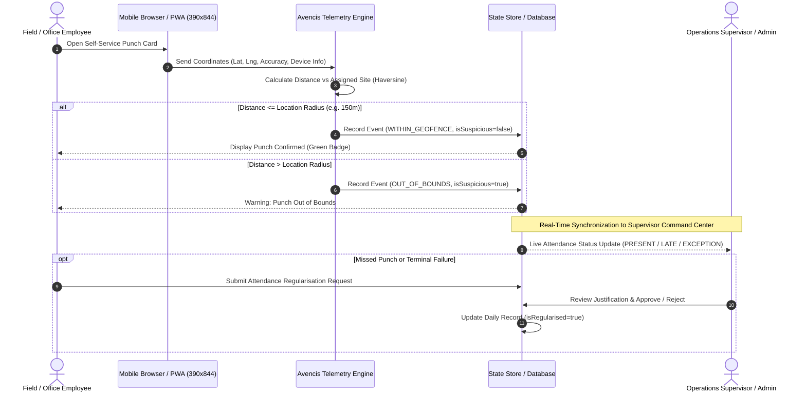

# AVENCIS WORKFORCE MANAGEMENT (MODULE 01)
## ATTENDANCE & GEOFENCING OPERATIONAL WORKFLOW

**Project:** Avencis ERP / Business Management Platform  
**Subsystem:** Real-Time Time & Attendance (GPS / Biometric)  
**Status:** Authoritative Operational Specification & Post-Audit Reconciliation  

> [!NOTE]
> **AUDIT RECONCILIATION NOTICE:**  
> The mathematical Haversine geofence calculation, double-punch logging, and regularisation approval flows are verified working in the frontend state.  
> However:
> 1. Raw `attendanceEvents` and `corrections` reside in JavaScript memory and are **not saved to localStorage**, reverting on browser refresh.
> 2. Physical biometric depot terminal sync is simulated via mock seed records; no physical TCP/IP hardware socket is connected in this web draft.

---

### 1. Daily Attendance Lifecycle Overview

---

### 2. Geofence Distance Calculation Formula

Avencis WFM implements the spherical **Haversine Formula** to determine the exact distance between the employee's GPS device and the assigned client work site:

$$d = 2R \arcsin \left( \sqrt{ \sin^2\left(\frac{\Delta \phi}{2}\right) + \cos(\phi_1) \cos(\phi_2) \sin^2\left(\frac{\Delta \lambda}{2}\right) } \right)$$

Where:
- $R = 6,371,000 \text{ meters}$ (Mean Earth radius)
- $\phi_1, \phi_2$ are device latitude and work site center latitude in radians
- $\Delta \phi = \phi_2 - \phi_1$
- $\Delta \lambda = \lambda_2 - \lambda_1$ (longitude difference in radians)
- If $d \le \text{Site Radius}$ (e.g. $150\text{m}$), status is `WITHIN_GEOFENCE`.
- If $d > \text{Site Radius}$, status is `OUT_OF_BOUNDS`.

---

### 3. Anti-Spoofing & Integrity Controls

1. **Accuracy Threshold Gate:** GPS punches with reported accuracy $> 50\text{m}$ trigger an automatic warning flag.
2. **Device Fingerprint Ledger:** Every punch records user-agent, device screen resolution, client IP address, and platform timestamp.
3. **Strict Geofence Enforcement Mode:** When `enforceStrictGeofence` is enabled in client policy, `OUT_OF_BOUNDS` punches cannot be finalized without formal supervisor regularisation.

---

### 4. Attendance Regularisation Lifecycle

When a worker forgets to punch or biometric depot terminal connectivity drops:
1. **Submission:** Worker files request via `/portal/employee` specifying date, requested check-in time, requested check-out time, and supervisor justification note.
2. **Exception Ledger:** Appears instantly on supervisor's `/workspace/regularisations` desk.
3. **Review & Decision:** Manager inspects justification against gate logs:
   - **Approve:** Daily record is updated with regularised timestamps, status marked `isRegularised: true`, and present day credited.
   - **Reject:** Status marked `REJECTED`, preserving original absent or late status.
4. **Audit Trail:** Manager's remarks and approval timestamp are immutably logged.
