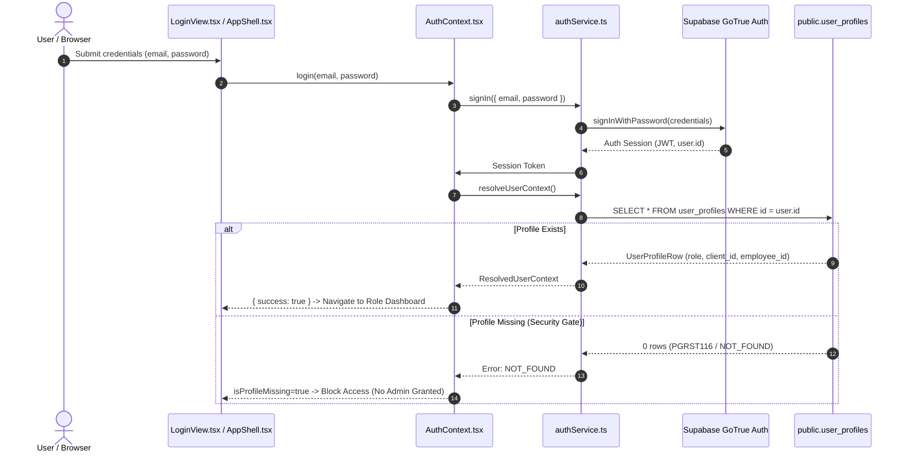

# Avencis Workforce Management (WFM)
# Authentication & Identity Integration Report

**Document Reference:** `docs/AUTHENTICATION_INTEGRATION_REPORT.md`  
**Milestone:** 2.3 — Authentication and Workspace Context Integration  
**Status:** IMPLEMENTED & FULLY VERIFIED (13/13 Scenarios Passed, 100% Clean Build)  
**Date:** 2026-11-14  

---

## 1. Architectural Summary & Scope

Milestone 2.3 integrates the frontend authentication state management in [`src/context/AuthContext.tsx`](file:///c:/Avencis%20Management/src/context/AuthContext.tsx) with the typed domain authentication service [`src/services/authService.ts`](file:///c:/Avencis%20Management/src/services/authService.ts) and Supabase GoTrue authentication engine.

---

## 2. Explicit Authentication States

The integration strictly distinguishes between five mutually exclusive application states:

| State | `isLoading` | `isAuthenticated` | `isProfileMissing` | `currentUser` | UX & System Behavior |
| :--- | :---: | :---: | :---: | :---: | :--- |
| **1. Session Loading** | `true` | `false` | `false` | `null` | Displays neutral Avencis loading screen; never briefly renders an incorrect or unauthorized dashboard. |
| **2. Authenticated** | `false` | `true` | `false` | `User` | Renders the authenticated application shell, navigation, and role-appropriate routes. |
| **3. Unauthenticated** | `false` | `false` | `false` | `null` | Automatically redirects to `/login`; access to protected routes is blocked. |
| **4. Profile Missing** | `false` | `false` | `true` | `null` | **Strict Security Gate**: Authentication succeeded in GoTrue, but no row exists in `public.user_profiles`. The user is prohibited from accessing any workspace, and **no administrative role is granted**. |
| **5. Auth Failure** | `false` | `false` | `false` | `null` | Displays a structured, human-readable alert in `LoginView.tsx` without exposing internal database stack traces. |

---

## 3. Role & Permission Handling

All 7 Avencis WFM roles are supported:

1. **Super Admin (`super_admin`)**: Global cross-tenant governance; access to `/admin/*` and all client workspaces.
2. **HR Admin (`hr_admin`)**: Tenant workforce lifecycle management.
3. **Payroll Admin (`payroll_admin`)**: Tenant payroll processing, line items, and locked batch approvals.
4. **Client Admin (`client_admin`)**: Comprehensive tenant organisation administrator.
5. **Client Manager (`client_manager`)**: Departmental supervision and attendance regularisation approvals.
6. **Location Manager (`location_manager`)**: Worksite-scoped attendance and muster monitoring.
7. **Employee (`employee`)**: Self-service portal (`/portal`), geo-verified mobile punch card, and leave applications.

### Security Boundaries
- **Database Authority:** User roles and tenant client scopes are fetched directly from the database table `public.user_profiles`.
- **Zero Client-Side Trust:** The frontend never trusts role or client assignments stored in `localStorage`.
- **Tamper Resistance:** Modifying browser storage does not grant elevated privileges or allow switching to unauthorized client tenants.

---

## 4. Developer Persona Switcher Governance

The developer persona switcher has been isolated to development preview mode:

- **Availability Rule:** Exposed exclusively when `isDevPersonaAllowed()` evaluates to `true` (`!isProd() && isMockMode()`).
- **Production Boundary:** In production builds (`npm run build`), `isDevPersonaAllowed()` unconditionally returns `false`.
- **Live Authentication Protection:** In development with `supabase` mode active, the persona switcher is suppressed, requiring authentic Supabase GoTrue credentials.
- **Elevation Prevention:** Developer personas operate on in-memory mock models only and cannot generate valid Supabase JWTs or bypass PostgreSQL RLS.

---

## 5. UI Preservation & UX Polish

- **Login Screen ([`src/app/auth/LoginView.tsx`](file:///c:/Avencis%20Management/src/app/auth/LoginView.tsx)):** Preserved 100% of approved typography, layout, insignia, and ambient glows. Added accessible error alerts and button loading states.
- **Application Shell ([`src/components/layout/AppShell.tsx`](file:///c:/Avencis%20Management/src/components/layout/AppShell.tsx)):** Added session verification loading screen and missing-profile restriction guard.
- **Top Navigation ([`src/components/layout/TopNav.tsx`](file:///c:/Avencis%20Management/src/components/layout/TopNav.tsx)):** Conditionally renders the persona switcher in mock mode and provides a clean sign-out action in the user pill.
- **Sidebar ([`src/components/layout/Sidebar.tsx`](file:///c:/Avencis%20Management/src/components/layout/Sidebar.tsx)):** Preserved all 29 routes and employee/admin views.
