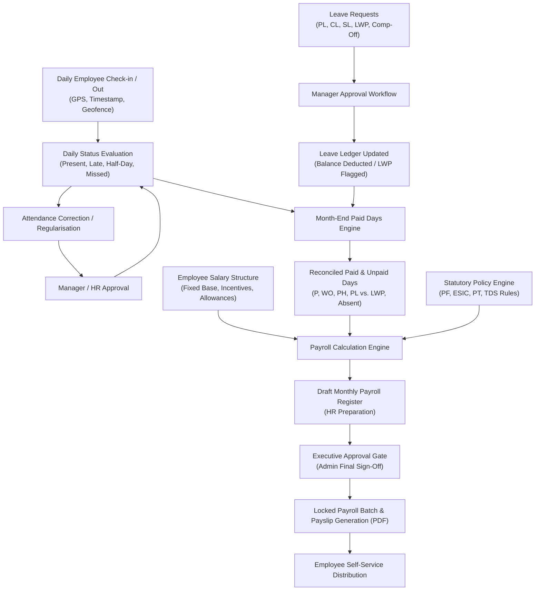
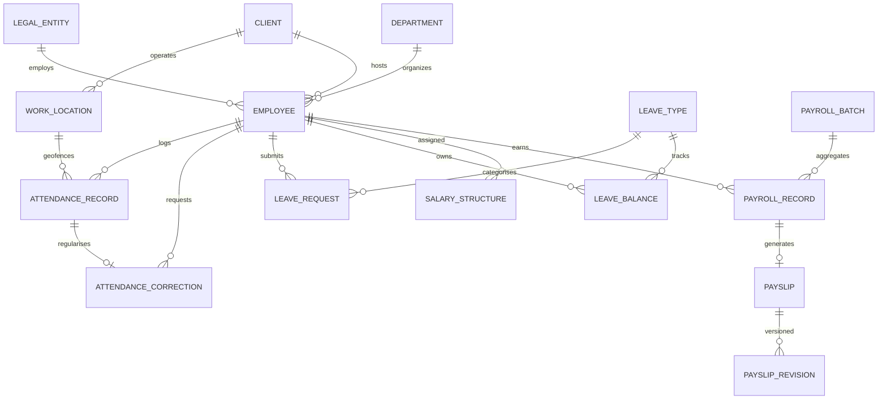

# Avencis Workforce Management (Module 01)
## Original Requirements Analysis & Baseline Specification

---

**Document Reference:** `docs/AVENCIS_ORIGINAL_REQUIREMENTS_ANALYSIS.md`  
**Date of Analysis:** 03 November 2026  
**Source Document:** `Avencis Mgmt tool.md`  
**Location:** `C:\Avencis Management\Avencis Mgmt tool.md`  
**System Module:** Module 01 — Workforce Management (WFM)  
**Parent Platform:** Avencis Enterprise Resource Planning (ERP) / Business Management Platform  

---

## 1. Document Inventory and Source-of-Truth Hierarchy

### 1.1 Document Location and Integrity
- **Original Source File:** `Avencis Mgmt tool.md`
- **Location:** Project root (`C:\Avencis Management\Avencis Mgmt tool.md`).  
  *(Note: While task instructions referenced the `Assets/` directory, inspection of the project tree confirmed the document was placed in the project root. In strict adherence to Section 5 Preservation Rules, this original file has been left completely untouched—not edited, renamed, moved, or deleted).*
- **Integrity Status:** Verified complete (485 lines, 13,761 bytes).

### 1.2 Established Source-of-Truth Hierarchy
In accordance with system governing principles:
1. **Primary Reference:** Original Avencis Management Tool Markdown Document (`Avencis Mgmt tool.md`) — baseline business logic, statutory frameworks, and operational rules.
2. **Authoritative Clarifications:** Subsequent explicit instructions and written directives from product leadership.
3. **Visual & Interaction Reference:** Approved Stitch Screens (e.g., Stitch Project `7110891243283730606`).
4. **Technical Architecture:** Existing application architecture, database schemas, and codebase.

> [!IMPORTANT]
> Discrepancy Protocol: If visual layouts in Stitch screens conflict with business rules in the original document, neither will be altered silently. The conflict will be explicitly reported for administrative sign-off. Missing business rules are not invented.

---

## 2. Product Purpose and Intended Users

### 2.1 Core Purpose
The Avencis Workforce Management (WFM) platform is an enterprise-grade attendance, workforce operations, and payroll management web application. Unlike standard internal attendance applications, it is architected from the foundation for a **multi-client, multi-entity, geographically dispersed workforce**.

### 2.2 Operational Models Supported
The system must natively support four concurrent operating models:
1. **Direct Avencis Core Staff:** Internal personnel working on Avencis payroll at Avencis headquarters/branch offices.
2. **Client-Deployed Avencis Staff:** Employees on Avencis payroll deployed to client sites (staff augmentation/outsourcing).
3. **Client-Managed External Staff:** Employees deployed at client locations under direct client payroll or hybrid management agreements.
4. **Multi-Policy Configuration:** Differing attendance, shift, weekly off, holiday calendar, leave entitlement, and compensation rules per client, location, or employee category.

### 2.3 Intended User Personas & Access Boundaries

| User Role | Core Purpose | Access Boundary & Scope |
| :--- | :--- | :--- |
| **Super Admin** | Complete platform governance and configuration | Unrestricted global access across all legal entities, clients, branches, policies, and audit logs. |
| **HR Admin** | Workforce administration and employee lifecycle | Employee master database, onboarding, attendance monitoring, leave approvals, policy assignments, and HR compliance. |
| **Payroll Admin** | Compensation processing and statutory governance | Salary structures, attendance-linked wage calculations, deduction configurations, payslip generation, and payroll registers. |
| **Location Manager** | Site-level workforce coordination | Attendance and shift verification for employees assigned to their physical branch/work location only. |
| **Client Manager** | External client oversight | Visibility strictly isolated to the deployed workforce assigned to their specific client account. Zero access to commercial overheads, margins, or other clients. |
| **Employee** | Self-service workforce portal | Personal daily check-in/out, GPS capture, leave balance tracking, leave requests, attendance regularisation, and personal payslip retrieval. |

---

## 3. Functional Requirements by Sub-Module

### 3.1 Employee Master Database & Multi-Entity Separation
To accommodate 10 to 50+ diverse client accounts without architecting separate standalone databases, the employee master strictly decouples legal and operational assignments:

* **Key Decoupled Attributes:**
  * `Employee ID`: Unique identifier (e.g., `AV001`).
  * `Employee Name`: Full legal name.
  * `Employer / Payroll Entity`: The legal contracting organization (e.g., Avencis Technologies Pvt Ltd or Client Legal Entity).
  * `Deployed Client`: The operating client account where the worker provides services (e.g., Client A).
  * `Work Location`: Physical geofenced location/site (e.g., Pune Branch, Client Site B).
  * `Department & Reporting Manager`: Operational reporting line.
  * `Joining Date`: Date of commencement.
  * `Fixed Monthly Salary & Variable Incentives`: Base compensation and performance criteria.
  * `Weekly Off & Leave Policy`: Specific policy assignments tied to client or grade.
  * `Attendance Status`: Lifecycle status (Active, Inactive, Terminated, On Notice).

### 3.2 Employee Attendance & Field Verification
The attendance engine is designed for cross-platform web use (desktop and mobile web) without requiring an app store download initially.

* **Check-In / Check-Out Actions:**
  * Prominent dual actions on the employee dashboard.
  * Displays today's live status, assigned work location, check-in time, check-out time, GPS coordinates, and worked hours.
* **Captured Telemetry per Event:**
  1. Employee ID.
  2. Date and high-precision timestamp.
  3. GPS coordinates (Latitude & Longitude).
  4. Geocoded Location Name.
  5. Assigned Client and Work Location ID.
  6. Device telemetry (User Agent, OS, Device Info).
  7. Visual Verification: Optional selfie/photo capture.
  8. Event Type: Check-in, Check-out, Break Start, Break End.
  9. GPS accuracy radius (meters) and verification state (Within geofence vs. Exception).
* **Validation & Integrity Controls:**
  * Single check-in per active working shift session (multi-shift configurable).
  * Sequential validation: Check-out timestamp cannot precede check-in timestamp.
  * Tamper-resistance: Employees are strictly forbidden from modifying raw attendance timestamps or logs.
  * Regularisation/Correction Requests: Missed punches or GPS inaccuracies trigger formal correction workflows requiring reporting manager or HR approval.
  * Immutable Audit Trails: Original raw logs are perpetually retained alongside approved modifications.
  * Geofencing: Configurable radius (meters) around assigned site coordinates, with explicit exception workflows for designated roving/field employees.

### 3.3 Daily Classification & Paid-Days Calculation Engine
Attendance feeds directly into financial payroll by evaluating every calendar day of the pay period:

* **Daily Status Classifications:**
  * **Present (P):** Full paid day.
  * **Half Day (HD):** Configurable fraction of day's wage (e.g., 0.50).
  * **Paid Leave (PL/CL/SL):** Paid day deducted from accumulated leave balance.
  * **Unpaid Leave (LWP):** Loss of pay day (deducted from monthly salary).
  * **Weekly Off (WO):** Paid as per statutory policy / employment terms.
  * **Public Holiday (PH):** Paid as per company/client calendar.
  * **Absent (A):** Unauthorised absence / Loss of pay.
  * **Compensatory Off (CO):** Earned leave credit for approved overtime/holiday work.
  * **Work From Home (WFH):** Paid day subject to manager approval.
  * **Client Holiday (CH):** Based on assigned client calendar vs. parent entity calendar.
* **Month-End Reconciliation Formula:**
  $$\text{Total Calendar Days} = \text{Paid Days} + \text{Unpaid Days}$$
  $$\text{Paid Days} = \text{Present Days} + \text{Paid Leaves} + \text{Weekly Offs} + \text{Public Holidays} + \text{Approved WFH/CO}$$
  $$\text{Unpaid Days} = \text{Absent Days} + \text{Unpaid Leaves (LWP)} + \text{Unapproved Missed Punches}$$
  *Anti-Double-Counting Guard:* The engine must prevent overlapping credits (e.g., when a public holiday coincides with an employee's scheduled weekly off).

### 3.4 Leave Management & Balance Tracking
* **Leave Classifications:**
  * Paid Leave (PL) / Earned Leave (EL): Monthly accrued balance.
  * Casual Leave (CL): Short-term personal leave.
  * Sick Leave (SL): Medical exigency leave.
  * Unpaid Leave / Leave Without Pay (LWP): Triggers salary proration.
  * Compensatory Off (Comp-Off): Credited upon administrative approval for extra hours/weekend shifts.
  * Special Leave: Administrative category (e.g., bereavement, paternity, study).
* **Ledger Mechanics:**
  $$\text{Closing Balance} = \text{Opening Balance} + \text{Monthly Accruals} - \text{Approved Leaves Taken} - \text{Lapsed/Encashed}$$
* **System Capabilities:**
  * Automated periodic monthly credit (default: 2 days/month, configurable).
  * Annual carry-forward rules with configurable maximum accumulation caps.
  * Expiry policies for unused balances.
  * Encashment support at separation or financial year-end.
  * Half-day leave applications (First Half / Second Half).
  * Backdated leave regularisation governed by managerial approval.
* **Approval Workflow:**
  $$\text{Employee Request} \longrightarrow \text{Manager Balance \& Availability Review} \longrightarrow \text{Approval/Rejection} \longrightarrow \text{Ledger Debit} \longrightarrow \text{Payroll Engine Update}$$

### 3.5 Payroll Engine & Compensation Structures
Eliminates standalone spreadsheets by deriving compensation directly from validated attendance and leave data.

* **Salary Structure Anatomy:**
  * **Gross Earnings:** Fixed Monthly Base, Performance Incentives, Special Allowances, HRA/Conveyance.
  * **Statutory & Policy Deductions:** Provident Fund (PF), Employee State Insurance (ESIC), Professional Tax (PT), Tax Deducted at Source (TDS), Unpaid Leave Deductions.
  * **Net Salary Payable:** Gross Earnings minus Total Deductions.
* **Proration Mechanics:**
  $$\text{Payable Base Salary} = \text{Fixed Monthly Salary} \times \left( \frac{\text{Payable Paid Days}}{\text{Configured Salary Divisor}} \right)$$
  *Divisor Flexibility:* Divisor must be configurable per entity or policy (e.g., 26 days, 30 days, or exact calendar days in month).
* **Statutory Compliance Engines (Built-in Architecture):**
  * **Provident Fund (PF):** Employee contribution, Employer contribution, statutory wage thresholds, applicability toggle.
  * **Employee State Insurance (ESIC):** Employee and Employer rate configurations, wage threshold eligibility validation.
  * **Professional Tax (PT):** State-specific slab rules and gender-based exemptions.
  * **TDS (Income Tax):** Projected annual taxable income slabs under applicable tax regimes.

### 3.6 Payslip Generation & Lifecycle
* **Capabilities:**
  * Batch processing across entire client deployments or single employee generation.
  * High-fidelity PDF rendering with company/entity branding.
  * Self-service access on employee portal.
  * Comprehensive revision management: If a salary correction occurs post-generation, the system maintains generation history, archives the original, and increments revision numbers with an audit note.

### 3.7 Executive Dashboard & Operational Reporting
* **Key Performance Indicators (KPIs):**
  * Total Headcount (Active, Deployed, On-Premises).
  * Present Today (Absolute count and percentage).
  * On Leave Today (Approved PL/CL/SL).
  * Absent / Missing Telemetry (Immediate exception tracking).
* **Core Reporting Suite:**
  1. Daily Attendance Verification Report.
  2. Employee-wise Monthly Attendance Summary.
  3. Client-wise Attendance & Workforce Utilisation.
  4. Physical Location / Branch Attendance Audit.
  5. Late Arrival and Early Departure Exception Log.
  6. Leave Accrual & Balance Statement.
  7. Paid vs. Unpaid Days Audit Sheet.
  8. Master Monthly Payroll Register.
  9. Net Salary Payable & Bank Transfer File.
  10. Statutory Compliance Summary (PF, ESIC, PT).
  11. Variable Incentive & Performance Calculation Statement.
  12. Historical Payslip Issuance Register.

---

## 4. Important Business Rules

1. **Strict Legal Entity vs. Client Separation:**
   An employee's payroll entity (legal employer) must never be conflated with the client company where work is physically rendered. This is foundational for contracts, statutory filing, and commercial billing.
2. **Attendance Immutability:**
   Raw GPS stamps, timestamps, and network details cannot be overwritten. Any approved correction creates an annotated overlay record, preserving the original event for forensic audits.
3. **No Unvalidated Deductions:**
   Statutory deductions (PF/ESIC) must evaluate statutory wage ceilings and eligibility flags prior to applying rates; simple checkbox toggles must not trigger non-compliant deductions.
4. **Proration Alignment:**
   Salary deductions for loss-of-pay (LWP) and mid-month joiners must strictly evaluate the policy divisor (26/30/calendar days) established for that employee's contract.
5. **Separation of Duties in Payroll:**
   HR prepares the payroll batch; Admin / Finance reviews and executes final approval before payslips are published and disbursement records locked.

---

## 5. Security, Multi-Tenancy & Audit Requirements

```
                               ┌────────────────────────┐
                               │  Avencis Super Admin   │
                               └───────────┬────────────┘
                                           │ Global Oversight
         ┌─────────────────────────────────┴─────────────────────────────────┐
         ▼                                                                   ▼
┌─────────────────────────────────┐                         ┌─────────────────────────────────┐
│     Client A Workforce          │                         │     Client B Workforce          │
├─────────────────────────────────┤                         ├─────────────────────────────────┤
│ • Client Manager A (Read Only)  │                         │ • Client Manager B (Read Only)  │
│ • Deployed Employees A1..An     │                         │ • Deployed Employees B1..Bn     │
│ • Site Geofences & Policies A   │                         │ • Site Geofences & Policies B   │
│ • Data Isolated via Tenant Keys │                         │ • Data Isolated via Tenant Keys │
└─────────────────────────────────┘                         └─────────────────────────────────┘
```

1. **Client-Level Data Isolation:**
   Client Managers must be restricted by Row-Level Security (RLS) to records matching their assigned `client_id`. They must have zero visibility into other clients' operations or commercial wage rates.
2. **Cryptographic Protection of PII & Compensation:**
   Sensitive financial records (bank accounts, PAN, Aadhaar/Government IDs, basic wage breakdowns) must be encrypted at rest.
3. **Consent-Driven Geolocation:**
   Browser GPS telemetry capture must implement explicit employee consent protocols in compliance with prevailing digital data privacy standards.
4. **Comprehensive System Audit Logging:**
   All mutating operations (attendance regularisation, leave approvals, salary structure modifications, payroll execution, and payslip reissue) must capture:
   `User ID`, `Role`, `Timestamp`, `IP Address`, `Pre-Change State`, `Post-Change State`, `Change Justification`.

---

## 6. Attendance, Leave, and Payroll Data Flow

The following sequence details how telemetry flows through validation into statutory disbursement:



---

## 7. Data Entity Model (Core Entities & Relationships)



### Key Data Entities
1. **`LegalEntity`**: Corporate legal employer responsible for payroll (e.g., Avencis Technologies Pvt Ltd).
2. **`Client`**: Third-party commercial client hosting deployed workers.
3. **`WorkLocation`**: Physical site with GPS coordinates, acceptable geofence radius, and address.
4. **`Employee`**: Master identity linking legal employer, deployed client, reporting manager, and policy profile.
5. **`AttendanceRecord`**: Immutable log of check-in/out timestamps, GPS coordinates, accuracy, and daily classification.
6. **`AttendanceCorrection`**: Regularisation request with audit justification and manager sign-off.
7. **`LeaveType` & `LeaveBalance`**: Categorised balances (PL, CL, SL) tracking accrual, utilization, and carry-forward.
8. **`LeaveRequest`**: Formal leave request with lifecycle states (Submitted, Approved, Rejected, Cancelled).
9. **`SalaryStructure`**: Compensation blueprint detailing gross components, deduction rules, and applicable divisor.
10. **`PayrollBatch` & `PayrollRecord`**: Month-end processing run snapshotting verified days, computed earnings, statutory withholdings, and net payout.
11. **`Payslip` & `PayslipRevision`**: Published document entity with audit history and PDF metadata.

---

## 8. Requirements Requiring Clarification

The following points from `Avencis Mgmt tool.md` (specifically Section 13 and related implementation notes) require formal executive decisions prior to functional baseline completion:

1. **Core Operating Model Clarification (Section 13, Question 1):**
   * *Original Document Statement:* "Will Avencis manage only employees who are legally on Avencis payroll, or will the system also manage employees who are directly on the client's payroll?"
   * *Impact:* If external client employees on direct client payroll are managed, the payroll engine must support distinct client-owned statutory registration numbers (PF Establishment Code, ESIC Code, PT State registrations) and client-specific bank disbursement templates.
2. **Overtime (OT) Policy Rules:**
   * The document lists Overtime as a configurable setting (Enabled/Disabled) but does not define standard calculation formulas (e.g., $1.5\times$ or $2\times$ basic hourly rate, or straight-time compensatory off).
3. **Late Mark & Grace Period Penalties:**
   * Grace period is identified (e.g., 10 minutes), but the penalty progression (e.g., whether 3 late arrivals equal 0.5 day LWP, or if penalty deductions require manager discretion) requires policy formalization.
4. **Shift Configurations & Night Shifts:**
   * Multi-shift capability is mandated. How overnight shifts crossing midnight (e.g., 20:00 to 05:00) map to calendar-day paid days must be formally established.
5. **Visual Verification Mandate:**
   * Photo/selfie capture is noted as "optional". We must establish whether this toggle is configured globally, client-by-client, or location-by-location.

---

## 9. Alignment Analysis: Original Requirements vs. Approved Stitch Screens (Batch 01)

The forthcoming Stitch export (Batch 01, Project `7110891243283730606`) encompasses 15 visual screen designs:
1. `01-employees-directory`
2. `02-executive-workforce-overview`
3. `03-daily-attendance-gps`
4. `04-notifications-user-profile`
5. `05-enterprise-login`
6. `06-payroll-processing`
7. `07-application-shell`
8. `08-organisation-admin-dashboard`
9. `09-organisation-overview`
10. `10-legal-entities`
11. `11-add-employee`
12. `12-client-directory`
13. `13-employee-personal-information`
14. `14-employee-profile-overview`
15. `15-employee-directory`

### 9.1 Areas of High Alignment
* **Multi-Entity Separation:** The presence of separate screens `10-legal-entities`, `12-client-directory`, and `09-organisation-overview` perfectly reflects the core architectural requirement of Section 2 & 10—strictly separating legal employers from operating clients.
* **Attendance & Geolocation:** Screen `03-daily-attendance-gps` maps directly to Section 3 requirements for GPS coordinates, location verification, and daily attendance state tracking.
* **Centralised Payroll Processing:** Screen `06-payroll-processing` matches Section 6 requirements for consolidated month-end calculation, deduction accounting, and batch approvals.
* **Role-Based Views:** Screens `02-executive-workforce-overview`, `08-organisation-admin-dashboard`, and `07-application-shell` align with Section 1 & 9 requirements for role-differentiated dashboard experiences.

### 9.2 Potential Discrepancies & Tension Points to Validate During Export
1. **Screen Redundancy (`01-employees-directory` vs `15-employee-directory`):**
   * *Observation:* Batch 01 contains two similarly named screens (`01-employees-directory` and `15-employee-directory`). We will verify whether one represents an Admin perspective while the other serves Client Managers, or if they represent different density/view states.
2. **Employee Profile Splitting:**
   * *Observation:* Screens `13-employee-personal-information` and `14-employee-profile-overview` appear to split employee details. We must verify that compensation and payroll entity assignments are properly segregated from general personal information to maintain role-based confidentiality.
3. **Mobile Responsive vs Desktop Shell:**
   * *Observation:* The requirements document emphasizes mobile browser execution for field employees. The application shell (`07-application-shell`) must be examined to verify responsive adaptability for mobile viewports alongside desktop enterprise administration.

---

## 10. Architectural Recommendations
*(Clearly distinguished as forward-looking recommendations for implementation)*

1. **Database Multi-Tenancy Architecture (Recommendation):**
   * Utilize PostgreSQL Row-Level Security (RLS) with composite scoping: every record indexed by `legal_entity_id` and `client_id`. This guarantees that even accidental API leaks cannot expose client cross-data.
2. **Automated Monthly Ledger Accruals (Recommendation):**
   * Implement automated background cron jobs (e.g., Supabase pg_cron or serverless scheduled functions) to execute on the 1st of every calendar month to credit leave balances and expire carry-over entitlements without manual HR intervention.
3. **Statutory Calculation Rules Engine (Recommendation):**
   * Maintain statutory rates (PF 12%, ESIC 0.75%/3.25%, State PT slabs) in database configuration tables versioned by effective dates, rather than hardcoded constants in application logic.
4. **Extensible ERP Domain Isolation (Recommendation):**
   * Organize the codebase cleanly under domain modules (e.g., `modules/wfm`, `modules/core`, `modules/shared`), ensuring that future ERP modules (e.g., Invoicing, Inventory, CRM) can mount directly onto the same multi-entity foundation without rewriting authentication or organization schemas.

---

## 11. Analysis Summary & Baseline Confirmation

- **Primary Requirements Source:** `C:\Avencis Management\Avencis Mgmt tool.md` (Fully read, retained, and preserved).
- **Scope Baseline:** Module 01 — Workforce Management established as the sole active development scope.
- **Next Operational Milestone:** Awaiting explicit instruction before initiating Stitch screen export (Batch 01) or application code authoring.

