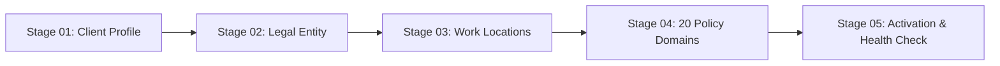

# AVENCIS WORKFORCE MANAGEMENT (MODULE 01)
## CLIENT ONBOARDING & 20 POLICY DOMAINS CONFIGURATION GUIDE

**Project:** Avencis ERP / Business Management Platform  
**Target Audience:** Avencis Implementation Specialists & Client Administrators  
**Status:** Authoritative Operational Manual  

---

### 1. Client Onboarding Lifecycle Overview

Onboarding an enterprise organisation into Avencis WFM follows a mandatory 5-stage sequential lifecycle. 
Under no circumstances may employees be onboarded or payroll calculated until all 5 stages are completed and verified.

---

### 2. Stage-by-Stage Implementation Instructions

#### Stage 01: Organisation Profile Registration
1. Navigate to `/admin/onboard` or click **Onboard New Client** from the Master Dashboard.
2. Enter the full corporate trading name (e.g. *Suman Technologies & Retail*).
3. Assign a unique uppercase identifier code (e.g. `SUMAN`, `MAHA`, `APEX`).
4. Select the primary industry sector (e.g. *Information Technology & Retail*, *Logistics & Transportation*, *Precision Manufacturing*).
5. Record primary administrator contact coordinates (Name, Corporate Email, Mobile Phone).

#### Stage 02: Legal Entity & Statutory Employer Configuration
1. Record the statutory legal entity name (e.g. *Suman Technologies Private Limited*).
2. Input Corporate Permanent Account Number (PAN) — 10 alphanumeric characters.
3. Input 15-character Goods & Services Tax Identification Number (GSTIN).
4. Input official Employee Provident Fund (EPF) establishment code (e.g. `MH/PUN/0045678/000`).
5. Input Employees' State Insurance Corporation (ESIC) registration code (e.g. `31000567890001001`).
6. Enter complete registered office postal address.
7. *Principle:* Avencis is the platform provider; the legal entity registered in this stage is the sole **employer of record** on all generated payslips and tax filings.

#### Stage 03: Work Locations & Geofence Polygon Setup
1. Define primary headquarters or operating depot names (e.g. *Pune Technology Park HQ*, *Chakan Central Depot*).
2. Enter geographic GPS center coordinates:
   - Latitude (e.g. `18.5913`° N)
   - Longitude (e.g. `73.7389`° E)
3. Set perimeter geofence radius (minimum 50 meters, standard 150 meters, maximum 2000 meters).
4. Any mobile check-in recorded outside this perimeter will be flagged as `OUT_OF_BOUNDS`.

#### Stage 04: The 20 Mandatory Policy Domains Engine
Policies are configured strictly at the **client level** and apply uniformly across all employees.
There are **zero employee-level overrides**.

> [!NOTE]
> **COMPUTATIONAL ENGINE AUDIT CLARIFICATION:**  
> All 20 domains are persisted in `ClientPolicy` and fully editable via the React UI form.  
> In the current first functional working draft, **5 of the 20 domains** (`enforceStrictGeofence`, `salaryDivisor`, `pfEnabled`, `esicEnabled`, `ptEnabled`) are actively wired into computational logic.  
> The remaining 15 domains are stored parameters whose automated background routines (e.g. overtime calculations, late penalty deductions, monthly accrual loops) are scheduled for Phase 2 implementation.

| No. | Policy Domain | Configurable Options | Default Recommendation |
|---|---|---|---|
| **01** | Overtime Calculation Method | `multiplier` / `flat_rate` / `comp_off` / `disabled` | `multiplier` |
| **02** | Overtime Multiplier Rate | Numeric (`1.0x` to `2.5x`) | `1.5x` (or `2.0x` for factories) |
| **03** | Late Arrival Grace Period | Minutes (`0` to `30`) | `15 Minutes` |
| **04** | Late Mark Penalty Rule | `none` / `deduct_half_day_per_3` / `deduct_cl` | `deduct_half_day_per_3` (Every 3 late arrivals = 0.5 day LWP) |
| **05** | Overnight Shift Date Attribution | `shift_start_date` / `shift_end_date` | `shift_start_date` |
| **06** | Standard Shift Working Hours | Hours (`8.0` to `12.0`) | `9.0 Hours` (8h work + 1h lunch) |
| **07** | Half-Day Minimum Hours | Hours (`4.0` to `6.0`) | `4.5 Hours` |
| **08** | Weekly Off Days | Multi-select: `SUNDAY`, `SATURDAY`, etc. | `SUNDAY` (or 6-day rota) |
| **09** | Attendance Tracking Mode | `double_punch` (In & Out) / `single_punch` | `double_punch` |
| **10** | GPS Telemetry Requirement | Boolean (`true` / `false`) | `true` |
| **11** | Mandatory Selfie Capture | Boolean (`true` / `false`) | `false` (optional for remote staff) |
| **12** | Strict Geofence Enforcement | Boolean (`true` / `false`) | `true` (Rejects/flags spoofed punches) |
| **13** | Supported Leave Categories | Array: `PL`, `CL`, `SL`, `COMP_OFF`, `LWP` | `['PL', 'CL', 'SL', 'LWP']` |
| **14** | Minimum Service Days for Leave | Days (`0` to `180`) | `30 Days` (Probation gate) |
| **15** | Monthly Paid Leave Accrual | Days per month (`1.0` to `3.0`) | `2.0 Days / Month` |
| **16** | Maximum Annual Carry-Forward | Days (`0` to `60`) | `30 Days` |
| **17** | Leave Encashment on Separation | Boolean (`true` / `false`) | `false` |
| **18** | Unpaid Leave Deduction Formula | `per_day_proration` | `per_day_proration` |
| **19** | Salary Calculation Divisor | `26` / `30` / `calendar_days` | `30 Days` (or `26` for factory wages) |
| **20** | Statutory Deductions Engine | Boolean toggles for PF, ESIC, PT, TDS | PF (12%), ESIC (0.75%), PT (₹200), TDS |

#### Stage 05: Workspace Health Check & Activation
1. The platform performs an automated health audit.
2. If any mandatory domain is unconfigured, status remains `isConfigured: false` and the client status remains `onboarding`.
3. Once all 20 domains are verified and saved, status transitions to `isConfigured: true` and the workspace status changes to `active`.
4. Payroll calculations and employee onboarding are now unlocked.
