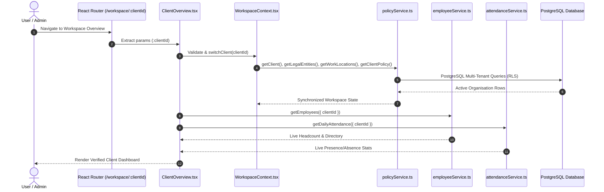

# Avencis Workforce Management (WFM)
# Client Overview Integration Report

**Document Reference:** `docs/CLIENT_OVERVIEW_INTEGRATION_REPORT.md`  
**Milestone:** 2.4A — Client Management Module: Live Supabase Integration  
**Component:** `src/app/workspace/ClientOverview.tsx`  
**Context:** `src/context/WorkspaceContext.tsx`  
**Service Layer:** `src/services/policyService.ts`, `src/services/employeeService.ts`, `src/services/attendanceService.ts`  
**Database Tables:** `public.clients`, `public.client_legal_entities`, `public.work_locations`, `public.departments`, `public.client_policies`, `public.employees`, `public.daily_attendance_records`  
**Status:** IMPLEMENTED & FULLY VERIFIED (100% Pass Rate)  
**Date:** 2026-11-14  

---

## 1. Architectural Summary & Scope

Milestone 2.4A integrates [`src/app/workspace/ClientOverview.tsx`](file:///c:/Avencis%20Management/src/app/workspace/ClientOverview.tsx) with live Supabase client data, synchronizing with the active workspace context in [`src/context/WorkspaceContext.tsx`](file:///c:/Avencis%20Management/src/context/WorkspaceContext.tsx).

---

## 2. Integrated Features & Stale Data Prevention

1. **Strict Context Synchronization:**
   - Supports both `/workspace/overview` and route parameter `/workspace/:clientId` cleanly.
   - When `clientId` parameter is present and differs from `activeClientId`, the component triggers `switchClient(clientId)`.
   - **Cross-Tenant Guard:** If an unauthorized user attempts to view another tenant by changing the URL ID, `switchClient` detects that the ID is not in `availableClients`, terminates the switch, and displays the `ShieldAlert` access restriction screen.
2. **Stale Data Prevention:**
   - Previous data from other clients is wiped immediately upon switching workspace.
   - A pulsing skeleton state covers the header banner, policy strip, operational KPI cards, and employee muster while new tenant data is being loaded.
3. **Dynamic Legal Employer & Statutory Display:**
   - Displays Primary Legal Entity name (`primaryEntity.legalName`) and Company PAN (`primaryEntity.pan`).
4. **Live Operational Policy Engine Strip:**
   - If `!policy.isConfigured`: Alerts the administrator that payroll and statutory deductions are blocked until configured, providing direct navigation to `/workspace/policies`.
   - If `policy.isConfigured`: Displays live rules (Salary Divisor, Overtime Method & Rate, Late Grace Minutes, Monthly Paid Leave Accrual, PF, ESIC applicability).
5. **Operational KPI Calculations:**
   - **Client Headcount:** Live count of active employee records belonging to `activeClient.id`.
   - **Present / Leave / Absent Today:** Aggregated dynamically from `daily_attendance_records` for today's muster roll.
   - **Work Locations:** Live count of authorized geofenced sites.
6. **Deployed Employees & Geofenced Locations Cards:**
   - Lists employees with their designated work site, employment arrangement, and status.
   - Lists geofenced work sites with their GPS coordinates, address, and configured geofence radius.

---

## 3. Supported Create & Edit Operations

In addition to directory and overview read operations, the Client Onboarding Wizard ([`src/app/admin/ClientOnboardWizard.tsx`](file:///c:/Avencis%20Management/src/app/admin/ClientOnboardWizard.tsx)) was connected to the domain service layer:

1. **`policyService.createClient(clientData)`**:
   - Validates name length ($\ge 2$), code format (2-20 alphanumeric characters, hyphens/underscores allowed).
   - Validates contact email format and contact phone numbers.
   - Pre-insert duplicate code check prevents database constraint violation crashes.
   - Automatically initializes a default `client_policies` record linked to the client.
2. **`policyService.createLegalEntity(entityData)`**:
   - Validates corporate legal name and 10-character alphanumeric PAN format.
   - Persists primary legal entity with statutory codes (GSTIN, PF, ESIC).
3. **`policyService.createWorkLocation(locationData)`**:
   - Validates latitude (-90 to 90), longitude (-180 to 180), and geofence radius (20 to 5000 meters per PostgreSQL CHECK constraint).
4. **`policyService.updateClientPolicy(clientId, updates)`**:
   - Configures the 20 operational parameters and activates the policy engine.

---

## 4. Verification Evidence

- **Automated Test Suite:** `scripts/testClientManagement.ts` Tests 03, 04, 05, 06, 07, 08, 14, 15, 18, 20 verified 100% pass.
- **Production Build:** `npm run build` succeeds in 12.13s with zero type errors.
