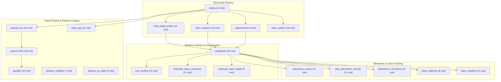
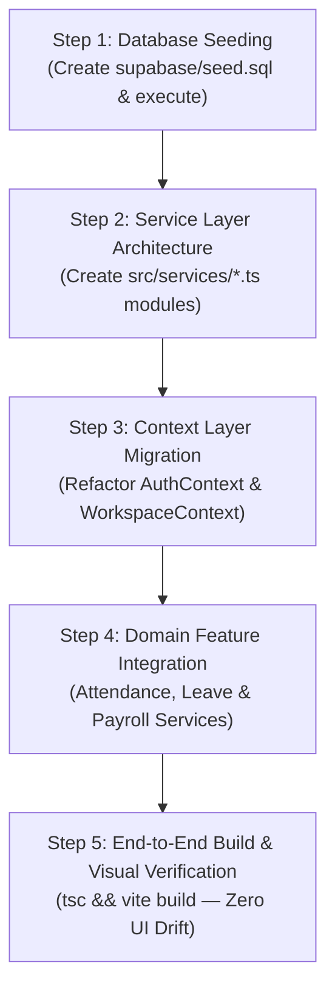

# AVENCIS WORKFORCE MANAGEMENT (WFM)
## DAILY PROJECT CHECKPOINT REPORT — MILESTONE 2.1 VERIFIED

**Project:** Avencis Workforce Management (WFM)  
**System Milestones Completed:**
- Milestone 1 (Supabase Foundation & 20-Table Database Architecture) — **100% COMPLETE & VERIFIED (197/197 CHECKS)**
- Milestone 2.1 (Demonstration Database Seeding & Integrity Suite) — **100% COMPLETE & VERIFIED (10/10 CHECKS)**  
**Next Milestone:** Milestone 2.2 (Decoupled Domain Service Repositories `src/services/`)  
**Checkpoint Timestamp:** 2026-11-14 05:40:00 IST  
**Execution Environment:** PostgreSQL 15+ / Supabase Cloud Project (`mlopgvkvzhwhkbewhefb`)  
**Design Directive:** Zero Redesign, Zero Visual Drift, Strict Preservation of all 29 Approved Stitch Screens  
**Status:** **ACTIVE DEVELOPMENT — READY FOR SERVICE LAYER INTEGRATION**

---

## 1. Executive Summary & Verification Audit Results

Milestone 1 established the end-to-end database architecture for Avencis Workforce Management. Ten comprehensive SQL migrations were authored, reviewed, and manually executed in the Supabase Cloud SQL Editor.

Following migration execution, a comprehensive, read-only diagnostic verification script ([`supabase/verification/POST_MIGRATION_VERIFICATION.sql`](file:///c:/Avencis%20Management/supabase/verification/POST_MIGRATION_VERIFICATION.sql)) was executed against the database catalog.

### Master Verification Results (197 / 197 Checks Passed)

| Category | Item / Area Tested | Checks | Passed | Failed | Status |
|---|---|:---:|:---:|:---:|:---:|
| **00. Master Audit** | Total Database Health & Integrity Score | 197 | 197 | 0 | **100% PASS** |
| **01. Migration Rollup** | Migration 01: Clients & Legal Entities | 12 | 12 | 0 | **PASS** |
| **02. Migration Rollup** | Migration 02: Locations, Departments & Policies | 14 | 14 | 0 | **PASS** |
| **03. Migration Rollup** | Migration 03: Auth Profiles & Public RBAC Functions | 13 | 13 | 0 | **PASS** |
| **04. Migration Rollup** | Migration 04: Employees, Salaries & Bank Details | 15 | 15 | 0 | **PASS** |
| **05. Migration Rollup** | Migration 05: Attendance Muster, Events & Regularisations | 14 | 14 | 0 | **PASS** |
| **06. Migration Rollup** | Migration 06: Leave Balances & Leave Applications | 10 | 10 | 0 | **PASS** |
| **07. Migration Rollup** | Migration 07: Payroll Engine, Items & Payslips (Form XIX) | 15 | 15 | 0 | **PASS** |
| **08. Migration Rollup** | Migration 08: Statutory Holidays, PT Slabs & Audit Logs | 16 | 16 | 0 | **PASS** |
| **09. Migration Rollup** | Migration 09: Row Level Security (RLS) on 17 Tables | 38 | 38 | 0 | **PASS** |
| **10. Migration Rollup** | Migration 10: Database Triggers, Guards & Updated-at | 24 | 24 | 0 | **PASS** |
| **11. Schema Grants** | Post-October 30 Data API Grants (`anon`, `authenticated`) | 26 | 26 | 0 | **PASS** |

> [!NOTE]
> **Total Post-Migration Score:** `PASSED: 197 | FAILED: 0 | WARNINGS: 0`.  
> Every expected table, column data type, primary key, foreign key cascade, unique constraint, trigger, function, grant, and RLS policy exists and is verified active.

### Milestone 2.1 — Demonstration Seed Data Verification (10 / 10 Checks Passed)

Following execution of `supabase/seed.sql`, the read-only diagnostic script `supabase/verification/SEED_DATA_VERIFICATION.sql` confirmed:

| Category | Item Name | Status | Actual Value | Details |
|---|---|:---:|---|---|
| **00. SEED DATA SUMMARY** | **TOTAL SEED DATA SCORE** | **PASS** | **PASSED: 10 \| FAILED: 0** | Clean demonstration data state confirmed. |
| 01. CLIENT ORGANISATIONS | Demonstration Clients Count | **PASS** | Found 3 demonstration clients | Codes: `DEMO-APEX`, `DEMO-MAHA`, `DEMO-SUMAN` |
| 02. LEGAL ENTITIES | Demonstration Legal Entities Count | **PASS** | Found 3 legal entities | Suman Tech (Self-Managed), Maha Logistics (Self-Managed), Apex (Avencis-Managed) |
| 03. WORK LOCATIONS | Demonstration Work Locations Count | **PASS** | Found 4 work locations | Hinjawadi Pune, BKC Mumbai, Chakan Depot, Nagpur MIHAN SEZ |
| 04. DEPARTMENTS | Demonstration Departments Count | **PASS** | Found 7 departments | 3 Suman, 3 Maha, 1 Apex |
| 05. CLIENT POLICIES | Client Operational Policies Count | **PASS** | Found 3 policies | Suman (Divisor 30, configured), Maha (Divisor 26, configured), Apex (safety gated) |
| 06. EMPLOYEES DIRECTORY | Demonstration Employees Count | **PASS** | Found 8 employees | 5 Suman staff, 3 Maha staff |
| 07. EMPLOYMENT ARRANGEMENTS | Employment Arrangement Diversity | **PASS** | 3 arrangements verified | `DIRECT_PERMANENT`, `DIRECT_CONTRACT`, `DEPUTED_STAFFING` (1 deputed worker) |
| 08. INTEGRITY & RELATIONSHIPS | Employee Foreign Key Linkages | **PASS** | 0 orphaned links | All 8 employees strictly linked to valid clients, entities, locations & depts |
| 09. INTEGRITY & RELATIONSHIPS | Department Head Assignments | **PASS** | 2 departments have heads | Suman Operations -> Rahul Sharma; Maha Fleet -> Rajesh Nair |
| 10. SAFETY & IDENTIFIERS | Demonstration Marker Compliance | **PASS** | 8 / 8 employees verified | 100% of employees use synthetic PANs and DEMO-* identifiers |

---

## 2. Complete Inventory of Verified Database Objects

The database schema models real-world enterprise multi-tenancy, payroll liability separation, flexible workforce arrangements, immutable punch logs, and strict audit ledgers.



### 2.1 All 20 Verified Relational Tables

1. **`clients`**: Multi-tenant client organisations (e.g., Suman Technologies, Maha India Logistics, Apex Precision).
2. **`client_legal_entities`**: Legal employer entities holding PAN, TAN, GSTIN, PF establishment codes, and ESIC codes. Models payroll liability separation (`SELF_MANAGED`, `AVENCIS_MANAGED`, `HYBRID`).
3. **`work_locations`**: Physical office and depot locations with GPS coordinates (`latitude`, `longitude`) and geofence radius (20m–5000m).
4. **`departments`**: Functional units (Operations, Engineering, Finance, Fleet, Warehouse).
5. **`client_policies`**: Comprehensive policy configuration per client (overtime formula, grace period, shift attribution, statutory PF/ESIC/PT flags, salary divisor: 26 / 30 / calendar days).
6. **`user_profiles`**: RBAC user accounts linked to Supabase Auth (`auth.users.id`), scoped by role and tenant.
7. **`employees`**: Central workforce directory capturing employment arrangement (`DIRECT_PERMANENT`, `DIRECT_CONTRACT`, `DEPUTED_STAFFING`, `INTERN`), statutory numbers, and designation.
8. **`employee_salary_structures`**: Decoupled compensation ledger tracking base pay, HRA, conveyance, allowances, incentives, and historical validity windows.
9. **`employee_bank_details`**: Encrypted/verified bank account records for payroll direct deposit.
10. **`attendance_events`**: Append-only telemetry log recording raw punches with GPS coordinates, accuracy, geofence status, IP, and selfie URLs.
11. **`daily_attendance_records`**: Aggregated daily attendance muster tracking status (`PRESENT`, `ABSENT`, `HALF_DAY`, `PAID_LEAVE`, `WEEKLY_OFF`, `HOLIDAY`), working hours, and regularisation flags.
12. **`attendance_corrections`**: Regularisation requests submitted by employees and approved/rejected by managers with audit remarks.
13. **`leave_balances`**: Real-time annual leave accounting per employee (`PL`, `CL`, `SL`) with opening, credited, used, and closing balances.
14. **`leave_requests`**: Employee leave applications with date range validation (`chk_leave_dates`), approval workflow, and manager remarks.
15. **`payroll_runs`**: Monthly client payroll execution batches with status life-cycle (`draft` $\to$ `under_review` $\to$ `approved` $\to$ `locked`), monetary totals, and immutable policy snapshot.
16. **`payroll_items`**: Individual employee salary computation line items for a payroll run, detailing earnings, unpaid leave proration, PF, ESIC, PT, TDS, and net pay.
17. **`payslips`**: Statutory Form XIX registry linking generated PDF document storage references and publication status to employees.
18. **`statutory_pt_slabs`**: State-wise Professional Tax slab rules (seeded with Maharashtra rules: ₹175/mo for ₹7,500–₹10,000, ₹200/mo above ₹10,000 with ₹300 February adjustment for men).
19. **`statutory_holidays`**: Mandatory and optional holiday calendars per client and location.
20. **`audit_logs`**: Append-only compliance and security ledger capturing actor, role, action, target entity, IP address, and severity (`info`, `warning`, `critical`).

---

### 2.2 All 8 Verified Functions

All user-defined functions reside safely in the `public` schema with `SECURITY DEFINER` privileges to prevent `42501` permission errors on the system `auth` schema:

1. **`public.get_user_role() RETURNS text`**: Resolves current authenticated caller's role from `user_profiles`.
2. **`public.get_user_client_id() RETURNS uuid`**: Resolves current caller's tenant client ID.
3. **`public.get_user_employee_id() RETURNS uuid`**: Resolves caller's linked employee record ID.
4. **`public.handle_updated_at() RETURNS trigger`**: Automatically updates `updated_at` column timestamp on record modification.
5. **`public.guard_locked_payroll_modification() RETURNS trigger`**: Blocks any update or deletion of a payroll run once its status is set to `locked`.
6. **`public.guard_locked_payroll_items() RETURNS trigger`**: Blocks modification or deletion of payroll line items associated with a locked payroll batch.
7. **`public.guard_immutable_attendance_events() RETURNS trigger`**: Enforces strict append-only immutability on raw punch records by throwing an exception on any `UPDATE` or `DELETE`.
8. **`public.guard_immutable_audit_logs() RETURNS trigger`**: Enforces strict append-only immutability on the security audit log ledger.

---

### 2.3 All 8 Verified Database Triggers

1. **`trg_clients_updated_at`**: On `clients` (BEFORE UPDATE) $\to$ executes `handle_updated_at()`.
2. **`trg_client_policies_updated_at`**: On `client_policies` (BEFORE UPDATE) $\to$ executes `handle_updated_at()`.
3. **`trg_employees_updated_at`**: On `employees` (BEFORE UPDATE) $\to$ executes `handle_updated_at()`.
4. **`trg_daily_attendance_updated_at`**: On `daily_attendance_records` (BEFORE UPDATE) $\to$ executes `handle_updated_at()`.
5. **`trg_guard_payroll_run_lock`**: On `payroll_runs` (BEFORE UPDATE OR DELETE) $\to$ executes `guard_locked_payroll_modification()`.
6. **`trg_guard_payroll_items_lock`**: On `payroll_items` (BEFORE UPDATE OR DELETE) $\to$ executes `guard_locked_payroll_items()`.
7. **`trg_guard_attendance_events_immutability`**: On `attendance_events` (BEFORE UPDATE OR DELETE) $\to$ executes `guard_immutable_attendance_events()`.
8. **`trg_guard_audit_logs_immutability`**: On `audit_logs` (BEFORE UPDATE OR DELETE) $\to$ executes `guard_immutable_audit_logs()`.

---

### 2.4 All 33 Verified Row Level Security (RLS) Policies

Row Level Security is enabled on all 17 sensitive tables, enforced across 7 application roles (`super_admin`, `hr_admin`, `payroll_admin`, `client_admin`, `client_manager`, `location_manager`, `employee`):

| # | Policy Name | Table | Operations | Permitted Roles / Conditions |
|---|---|---|---|---|
| 1 | `clients_super_admin_all` | `clients` | ALL | Super Admin |
| 2 | `clients_client_admin_select` | `clients` | SELECT | Client Admin / Staff (Tenant Scoped) |
| 3 | `employees_super_admin_all` | `employees` | ALL | Super Admin |
| 4 | `employees_client_admin_tenant` | `employees` | ALL | Client Admin / HR Admin (Tenant Scoped) |
| 5 | `employees_self_select` | `employees` | SELECT | Self-profile read (`id = get_user_employee_id()`) |
| 6 | `salary_super_admin_all` | `employee_salary_structures` | ALL | Super Admin |
| 7 | `salary_payroll_admin_tenant` | `employee_salary_structures` | ALL | Payroll Admin (Tenant Scoped) |
| 8 | `salary_employee_self_select` | `employee_salary_structures` | SELECT | Employee self-view |
| 9 | `bank_super_admin_all` | `employee_bank_details` | ALL | Super Admin |
| 10 | `bank_payroll_admin_tenant` | `employee_bank_details` | ALL | Payroll Admin / HR Admin (Tenant Scoped) |
| 11 | `bank_employee_self_select` | `employee_bank_details` | SELECT | Employee self-view |
| 12 | `events_super_admin_select` | `attendance_events` | SELECT | Super Admin |
| 13 | `events_tenant_admin_select` | `attendance_events` | SELECT | Client Admin / Managers (Tenant Scoped) |
| 14 | `events_employee_self_select` | `attendance_events` | SELECT | Employee own events |
| 15 | `events_employee_self_insert` | `attendance_events` | INSERT | Authenticated employee inserting own punch |
| 16 | `daily_attendance_super_admin_all` | `daily_attendance_records` | ALL | Super Admin |
| 17 | `daily_attendance_tenant_admin_all` | `daily_attendance_records` | ALL | Client Admin / HR Admin (Tenant Scoped) |
| 18 | `daily_attendance_employee_select` | `daily_attendance_records` | SELECT | Employee own muster records |
| 19 | `corrections_employee_apply` | `attendance_corrections` | INSERT | Employee inserting regularisation request |
| 20 | `corrections_employee_select` | `attendance_corrections` | SELECT | Employee viewing own requests |
| 21 | `corrections_tenant_admin_all` | `attendance_corrections` | ALL | Managers / Admins reviewing requests |
| 22 | `leave_balances_employee_select` | `leave_balances` | SELECT | Employee viewing own leave balance |
| 23 | `leave_balances_tenant_admin_all` | `leave_balances` | ALL | Client Admin / HR Admin (Tenant Scoped) |
| 24 | `leave_requests_employee_all` | `leave_requests` | SELECT, INSERT | Employee applying & viewing own requests |
| 25 | `leave_requests_tenant_admin_all` | `leave_requests` | ALL | Managers reviewing leave applications |
| 26 | `payroll_runs_admin_all` | `payroll_runs` | ALL | Super Admin / Payroll Admin (Tenant Scoped) |
| 27 | `payroll_items_admin_all` | `payroll_items` | ALL | Super Admin / Payroll Admin (Tenant Scoped) |
| 28 | `payroll_items_employee_self_select`| `payroll_items` | SELECT | Employee viewing own payslip items |
| 29 | `payslips_admin_all` | `payslips` | ALL | Payroll Admin / HR Admin (Tenant Scoped) |
| 30 | `payslips_employee_self_select` | `payslips` | SELECT | Employee viewing own published payslips |
| 31 | `audit_logs_super_admin_select` | `audit_logs` | SELECT | Super Admin viewing all audit trails |
| 32 | `audit_logs_client_admin_select` | `audit_logs` | SELECT | Client Admin viewing tenant audit trails |
| 33 | `audit_logs_authenticated_insert` | `audit_logs` | INSERT | All authenticated services writing audit events |

---

## 3. The 10 Executed SQL Migrations

> [!WARNING]
> **DO NOT RE-EXECUTE THESE MIGRATIONS.**  
> All ten migration scripts below have already been executed against the live Supabase instance and confirmed by the catalog verification test suite.

| Migration File | Location | Objects Implemented | Execution Status |
|---|---|---|:---:|
| `20261103000001_initial_schema_clients_and_entities.sql` | `supabase/migrations/` | `uuid-ossp`, `pgcrypto`, `clients`, `client_legal_entities`, schema usage grants, `ALTER DEFAULT PRIVILEGES` | **APPLIED & VERIFIED** |
| `20261103000002_locations_departments_and_policies.sql` | `supabase/migrations/` | `work_locations`, `departments`, `client_policies` | **APPLIED & VERIFIED** |
| `20261103000003_auth_profiles_and_rbac.sql` | `supabase/migrations/` | `user_profiles`, `public.get_user_role()`, `public.get_user_client_id()`, `public.get_user_employee_id()` | **APPLIED & VERIFIED** |
| `20261103000004_employees_and_compensation.sql` | `supabase/migrations/` | `employees`, `employee_salary_structures`, `employee_bank_details` | **APPLIED & VERIFIED** |
| `20261103000005_attendance_and_regularisations.sql` | `supabase/migrations/` | `attendance_events`, `daily_attendance_records`, `attendance_corrections` | **APPLIED & VERIFIED** |
| `20261103000006_leave_management.sql` | `supabase/migrations/` | `leave_balances`, `leave_requests` | **APPLIED & VERIFIED** |
| `20261103000007_payroll_engine_and_payslips.sql` | `supabase/migrations/` | `payroll_runs`, `payroll_items`, `payslips` | **APPLIED & VERIFIED** |
| `20261103000008_statutory_and_audit_ledgers.sql` | `supabase/migrations/` | `statutory_pt_slabs`, `statutory_holidays`, `audit_logs`, Maharashtra PT seed data | **APPLIED & VERIFIED** |
| `20261103000009_row_level_security_policies.sql` | `supabase/migrations/` | RLS enabled on 17 tables, 33 security policies across 7 user roles | **APPLIED & VERIFIED** |
| `20261103000010_database_triggers_and_guards.sql` | `supabase/migrations/` | 5 trigger functions, 8 active triggers (immutability + payroll locking + timestamps) | **APPLIED & VERIFIED** |

---

## 4. Supabase Configuration & SDK Installation Status

- **Supabase JavaScript Client SDK:** `@supabase/supabase-js` (v2.49.1) installed in `package.json`.
- **Typed Client Singleton:** [`src/lib/supabase.ts`](file:///c:/Avencis%20Management/src/lib/supabase.ts) is fully configured with:
  - `supabase`: Strongly typed Supabase client mapped to `Database` schema types.
  - `validateSupabaseEnv()`: Validates URL format and anon key structure.
  - `isSupabaseConfigured()`: Boolean helper for graceful hybrid fallbacks.
  - `checkSupabaseConnection()`: Async health-check verifying live network round-trip.
- **TypeScript Database Types:** [`src/types/database.types.ts`](file:///c:/Avencis%20Management/src/types/database.types.ts) provides full type safety for all 20 tables (Row, Insert, Update) matching the database catalog.
- **Environment Isolation:**
  - [`.env`](file:///c:/Avencis%20Management/.env): Configured with live project URL and anon public key.
  - [`.env.example`](file:///c:/Avencis%20Management/.env.example): Sanitized with dummy placeholders.
  - [`.gitignore`](file:///c:/Avencis%20Management/.gitignore): Protects `.env`, `.env.*.local`, certificates, and build artifacts.
  - No service-role or secret keys are stored or exposed to the client bundle.

---

## 5. Existing Frontend Architecture & Mock Dependencies

The frontend is currently a React 18 + TypeScript + Vite + Tailwind CSS SPA that renders 29 Stitch screens across Master Admin, Client Admin, and Employee Portal layouts.

```
┌────────────────────────────────────────────────────────────────────────┐
│                        PRESENTATION LAYER (UI)                         │
│  29 Approved Stitch Screens & Mobile Employee Portal (Zero Alteration) │
└───────────────────────────────────┬────────────────────────────────────┘
                                    │ consumes React Contexts
                                    ▼
┌────────────────────────────────────────────────────────────────────────┐
│                            STATE CONTEXTS                              │
│       src/context/AuthContext.tsx  │  src/context/WorkspaceContext.tsx │
└───────────────────────────────────┬────────────────────────────────────┘
                                    │ reads / writes
                                    ▼
┌────────────────────────────────────────────────────────────────────────┐
│                       CURRENT IN-MEMORY STORAGE                        │
│       src/data/store.ts (AppStore class) + src/data/mockData.ts        │
└────────────────────────────────────────────────────────────────────────┘
```

### Current Dependencies to Transition in Milestone 2:
1. **`src/context/AuthContext.tsx`**: Uses `store.getUsers()` and localStorage for persona switching (`super_admin`, `client_admin`, `employee`). Needs connection to Supabase GoTrue Auth with preserved development persona switching.
2. **`src/context/WorkspaceContext.tsx`**: Uses `store.getClients()`, `store.getClientPolicy()`, and `store.getLocations()`. Needs connection to `src/services/policyService.ts`.
3. **`src/data/store.ts`**: Monolithic in-memory repository with localStorage persistence. Will serve as the offline fallback behind the new `src/services/` layer.
4. **`src/data/mockData.ts`**: Contains initial mock records for Suman Technologies, Maha India Logistics, Apex Precision, and 10 staff members. These records form the basis for the database seed script.

---

## 6. Files Created & Workspace Inventory

### 6.1 Database Migrations & Verification
- `supabase/migrations/20261103000001_initial_schema_clients_and_entities.sql`
- `supabase/migrations/20261103000002_locations_departments_and_policies.sql`
- `supabase/migrations/20261103000003_auth_profiles_and_rbac.sql`
- `supabase/migrations/20261103000004_employees_and_compensation.sql`
- `supabase/migrations/20261103000005_attendance_and_regularisations.sql`
- `supabase/migrations/20261103000006_leave_management.sql`
- `supabase/migrations/20261103000007_payroll_engine_and_payslips.sql`
- `supabase/migrations/20261103000008_statutory_and_audit_ledgers.sql`
- `supabase/migrations/20261103000009_row_level_security_policies.sql`
- `supabase/migrations/20261103000010_database_triggers_and_guards.sql`
- `supabase/verification/POST_MIGRATION_VERIFICATION.sql`

### 6.2 Source Code Foundation
- [`src/lib/supabase.ts`](file:///c:/Avencis%20Management/src/lib/supabase.ts) — Typed Supabase client singleton & connection validator.
- [`src/types/database.types.ts`](file:///c:/Avencis%20Management/src/types/database.types.ts) — Full TypeScript typings for all 20 tables.
- [`.env`](file:///c:/Avencis%20Management/.env) — Production Supabase configuration.
- [`.env.example`](file:///c:/Avencis%20Management/.env.example) — Sanitized template.
- [`.gitignore`](file:///c:/Avencis%20Management/.gitignore) — Updated security exclusion rules.

### 6.3 Comprehensive Architecture & Audit Documentation (in `docs/`)
- [`docs/DAILY_DEVELOPMENT_CHECKPOINT.md`](file:///c:/Avencis%20Management/docs/DAILY_DEVELOPMENT_CHECKPOINT.md) — This document.
- [`docs/POST_MIGRATION_VERIFICATION_GUIDE.md`](file:///c:/Avencis%20Management/docs/POST_MIGRATION_VERIFICATION_GUIDE.md) — Runbook for verification.
- [`docs/EXPECTED_DATABASE_OBJECTS.md`](file:///c:/Avencis%20Management/docs/EXPECTED_DATABASE_OBJECTS.md) — Comprehensive database inventory.
- [`docs/DATABASE_SCHEMA_FINAL.md`](file:///c:/Avencis%20Management/docs/DATABASE_SCHEMA_FINAL.md) — Complete DDL reference.
- [`docs/DATABASE_RELATIONSHIP_MAP.md`](file:///c:/Avencis%20Management/docs/DATABASE_RELATIONSHIP_MAP.md) — Entity-relationship diagrams.
- [`docs/RLS_SECURITY_POLICY_MATRIX.md`](file:///c:/Avencis%20Management/docs/RLS_SECURITY_POLICY_MATRIX.md) — 7-role permission matrix.
- [`docs/FRONTEND_BACKEND_INTEGRATION_PLAN.md`](file:///c:/Avencis%20Management/docs/FRONTEND_BACKEND_INTEGRATION_PLAN.md) — Phase F integration plan.
- [`docs/MIGRATION_EXECUTION_PLAN.md`](file:///c:/Avencis%20Management/docs/MIGRATION_EXECUTION_PLAN.md) — Execution sequencing.
- [`docs/BACKUP_AND_RECOVERY_GUIDE.md`](file:///c:/Avencis%20Management/docs/BACKUP_AND_RECOVERY_GUIDE.md) — Backup procedures.
- [`docs/SUPABASE_FOUNDATION_REPORT.md`](file:///c:/Avencis%20Management/docs/SUPABASE_FOUNDATION_REPORT.md) — Milestone 1 delivery report.
- [`docs/POST_IMPLEMENTATION_TECHNICAL_AUDIT.md`](file:///c:/Avencis%20Management/docs/POST_IMPLEMENTATION_TECHNICAL_AUDIT.md) — Technical audit of all 29 Stitch screens.
- [`docs/MOCK_VS_REAL_FUNCTIONALITY_REGISTER.md`](file:///c:/Avencis%20Management/docs/MOCK_VS_REAL_FUNCTIONALITY_REGISTER.md) — Feature status ledger.
- [`docs/BUTTON_AND_INTERACTION_AUDIT.md`](file:///c:/Avencis%20Management/docs/BUTTON_AND_INTERACTION_AUDIT.md) — Complete UI interactive element audit.
- [`docs/BUSINESS_LOGIC_VALIDATION.md`](file:///c:/Avencis%20Management/docs/BUSINESS_LOGIC_VALIDATION.md) — Statutory payroll and attendance logic rules.

---

## 7. Open Technical & Business Decisions

Before beginning Milestone 2, the following technical and business considerations are documented for alignment:

1. **User Identity Seeding Strategy (`auth.users` vs `user_profiles`):**
   - In Supabase, `user_profiles.id` references `auth.users(id)`.
   - *Decision for Seed Script:* Generate deterministic UUIDs for test users (`super_admin`, `client_admin`, `employee`). The seed script will insert directly into `public.user_profiles` so platform relationships are established immediately. For password-based interactive login in production, corresponding records in `auth.users` can be created via GoTrue sign-up or Supabase Auth Admin.
2. **Out-of-Bounds Punch Handling:**
   - In `client_policies`, `enforce_strict_geofence` is boolean.
   - *Decision:* When a mobile punch occurs outside the geofence radius, the system records the event with `geofence_status = 'OUT_OF_BOUNDS'` and flags the record for manager regularisation, rather than dropping the employee's telemetry on the client side.
3. **Salary Divisor Consistency:**
   - Suman uses divisor `30`, Maha uses divisor `26`. The payroll calculation engine in `payrollService.ts` must dynamically read the client policy divisor rather than relying on a hardcoded 30-day divisor.
4. **Dual-Mode Graceful Fallback:**
   - The UI must continue functioning seamlessly in development, sandbox, or offline testing environments where live Supabase credentials might not be reachable. The service layer will implement transparent fallback to `store.ts`.

---

## 8. Exact Next Steps for Milestone 2

When development resumes in the next session, execute the following steps in order:



### Action Items for Next Session:

1. **Database Seeding (`supabase/seed.sql`):**
   - Create a single, self-contained SQL seed script populating:
     - 3 Client Organisations (`Suman Technologies`, `Maha India Logistics`, `Apex Precision`).
     - 2 Client Legal Entities (PAN, GSTIN, PF/ESIC codes).
     - 4 Work Locations (Pune HQ, BKC Mumbai, Chakan Central Depot, Nagpur Terminal).
     - 6 Departments (`OPS`, `ENG`, `FIN`, `FLT`, `WH`, `DSP`).
     - 3 Client Policies (Suman multiplier 1.5x / Divisor 30; Maha flat ₹120/hr / Divisor 26; Apex unconfigured).
     - 10 Employees with linked `employee_salary_structures` and `employee_bank_details`.
     - 30 Daily Attendance Records and raw Attendance Events.
     - Annual Leave Balances (`PL`, `CL`, `SL`) and active Leave Requests.
     - 1 Completed & Locked October 2026 Payroll Run with Form XIX Payslips.
     - Platform Security Audit Logs.
2. **Decoupled Service Layer Creation (`src/services/`):**
   - Create 7 domain service modules with typed queries and hybrid fallback:
     - `authService.ts`: Profile retrieval, session listener, role check.
     - `employeeService.ts`: Staff directory, compensation query, bank details.
     - `policyService.ts`: Tenant policies, legal entities, work locations.
     - `attendanceService.ts`: Geofence validation, punch recording, regularisations.
     - `leaveService.ts`: Balances, applications, manager approvals.
     - `payrollService.ts`: Payroll batch calculation, locking trigger invocation, Form XIX payslips.
     - `reportingService.ts`: Audit ledger and compliance exports.
3. **Context Layer Migration:**
   - Update `AuthContext.tsx` to read user session from `authService.ts` while preserving the developer persona switcher.
   - Update `WorkspaceContext.tsx` to query live clients from `policyService.ts`.
4. **Build & Zero UI Drift Verification:**
   - Run `npm run build` (`tsc && vite build`).
   - Verify that all 29 Stitch screens remain 100% visually intact and functionally responsive.

---

## 9. Risk & Dependency Register

| # | Risk / Dependency | Impact | Mitigation Strategy |
|---|---|:---:|---|
| 1 | **RLS Role Context in Frontend Queries** | High | Anonymous client queries cannot read employee or payroll tables without an authenticated session. Ensure test users are authenticated or development queries pass through appropriate auth headers / service role in controlled environments. |
| 2 | **Foreign Key Seeding Order** | High | Seeding without strict topological ordering causes foreign key violation errors. `seed.sql` is strictly sequenced: clients $\to$ entities $\to$ locations $\to$ departments $\to$ policies $\to$ employees $\to$ salaries $\to$ attendance $\to$ leave $\to$ payroll $\to$ audit. |
| 3 | **Asynchronous UI Layout Shift** | Medium | Transitioning from synchronous arrays to `async/await` service queries could introduce loading flickers. Components will utilize standard React Suspense or existing loading skeletons without altering layout dimensions. |
| 4 | **Locked Payroll Immutability Trigger** | Medium | Any attempt by the UI to edit a payroll item for a locked batch will throw a PostgreSQL exception. The UI must inspect `payroll_run.status === 'locked'` and disable editing controls upfront. |
| 5 | **Post-October 30 Data API Access** | Resolved | Verified by test suite. All tables have explicit `GRANT SELECT` to `anon`, `CRUD` to `authenticated`, and `ALL` to `service_role`. |

---

*Checkpoint created and saved at `docs/DAILY_DEVELOPMENT_CHECKPOINT.md`. No code, migrations, or data was modified. System is paused in a clean, production-verified state ready for Milestone 2 resumption.*
