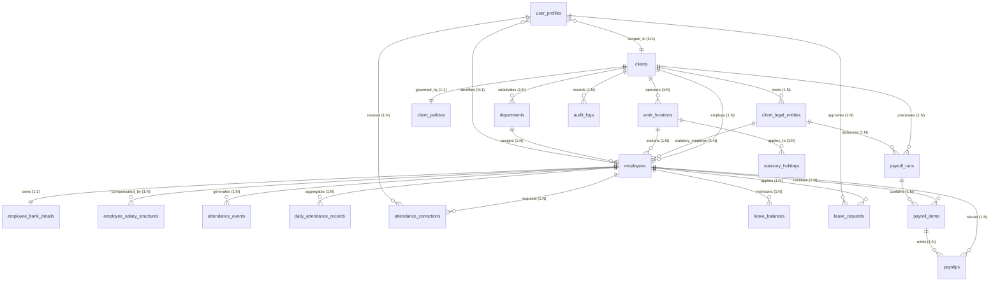

# AVENCIS WORKFORCE MANAGEMENT (WFM)
## DATABASE RELATIONSHIP MAP & FOREIGN KEY DIRECTORY

**Project:** Avencis ERP / Business Management Platform  
**Target Backend:** PostgreSQL 15+ / Supabase  
**Total Tables:** 20 Relational Tables  
**Status:** **AUTHORITATIVE RELATIONSHIP SPECIFICATION**  

---

## 1. Entity-Relationship Diagram

---

## 2. Foreign Key Directory & Cascade Rules

| Source Table | Source Column | Target Table | Target Column | Cardinality | Delete Action | Business Justification |
|---|---|---|---|:---:|---|---|
| `client_legal_entities` | `client_id` | `clients` | `id` | N : 1 | `CASCADE` | Legal entities belong strictly to one subscribing client organisation. |
| `client_policies` | `client_id` | `clients` | `id` | 1 : 1 | `CASCADE` | Policy rules belong strictly to the tenant client; deleted if client is purged. |
| `work_locations` | `client_id` | `clients` | `id` | N : 1 | `CASCADE` | Work sites and geofenced locations belong to client. |
| `departments` | `client_id` | `clients` | `id` | N : 1 | `CASCADE` | Departments belong to client. |
| `departments` | `head_employee_id` | `employees` | `id` | N : 1 | `SET NULL` | Department head assignment cleared if employee is separated. |
| `user_profiles` | `id` | `auth.users` | `id` | 1 : 1 | `CASCADE` | Profile tied directly to Supabase authentication identity. |
| `user_profiles` | `client_id` | `clients` | `id` | N : 1 | `SET NULL` | Cleared if client organisation is archived. |
| `user_profiles` | `employee_id` | `employees` | `id` | 1 : 1 | `SET NULL` | Null for external admins without staff records. |
| `employees` | `client_id` | `clients` | `id` | N : 1 | `CASCADE` | Tenant scoping. |
| `employees` | `legal_entity_id` | `client_legal_entities` | `id` | N : 1 | `RESTRICT` | Cannot delete legal entity with active contracted workers. |
| `employees` | `work_location_id` | `work_locations` | `id` | N : 1 | `RESTRICT` | Cannot delete work location while workers are actively stationed. |
| `employees` | `department_id` | `departments` | `id` | N : 1 | `SET NULL` | Department reassignment permitted. |
| `employee_salary_structures` | `employee_id` | `employees` | `id` | N : 1 | `CASCADE` | Salary histories purged if employee profile is wiped. |
| `employee_bank_details` | `employee_id` | `employees` | `id` | 1 : 1 | `CASCADE` | Disbursal accounts purged if employee profile is wiped. |
| `attendance_events` | `employee_id` | `employees` | `id` | N : 1 | `RESTRICT` | Raw telemetry must never be deleted while employee exists. |
| `daily_attendance_records` | `employee_id` | `employees` | `id` | N : 1 | `CASCADE` | Daily aggregate muster. |
| `attendance_corrections` | `employee_id` | `employees` | `id` | N : 1 | `CASCADE` | Employee regularisation requests. |
| `attendance_corrections` | `reviewed_by` | `user_profiles` | `id` | N : 1 | `SET NULL` | Manager reviewer reference preserved or cleared. |
| `leave_balances` | `employee_id` | `employees` | `id` | N : 1 | `CASCADE` | Leave balances cascade with employee. |
| `leave_requests` | `employee_id` | `employees` | `id` | N : 1 | `CASCADE` | Applications cascade with employee. |
| `leave_requests` | `reviewed_by` | `user_profiles` | `id` | N : 1 | `SET NULL` | Approver profile reference. |
| `payroll_runs` | `client_id` | `clients` | `id` | N : 1 | `CASCADE` | Monthly batch headers. |
| `payroll_runs` | `legal_entity_id` | `client_legal_entities` | `id` | N : 1 | `SET NULL` | Entity disbursing the run. |
| `payroll_items` | `run_id` | `payroll_runs` | `id` | N : 1 | `CASCADE` | Items cascade if an unfinalized draft run is deleted. |
| `payroll_items` | `employee_id` | `employees` | `id` | N : 1 | `RESTRICT` | Cannot delete an employee who has historical payroll line items. |
| `payslips` | `payroll_item_id` | `payroll_items` | `id` | N : 1 | `CASCADE` | Linked line item. |
| `payslips` | `employee_id` | `employees` | `id` | N : 1 | `CASCADE` | Issued recipient. |
| `statutory_holidays` | `client_id` | `clients` | `id` | N : 1 | `CASCADE` | Client holiday schedules. |
| `audit_logs` | `client_id` | `clients` | `id` | N : 1 | `SET NULL` | Global audit events retained even if client is purged. |

---

## 3. Critical Dependency Cycles & Prevention

1. **Circular Relationship: `departments.head_employee_id` $\leftrightarrow$ `employees.department_id`**
   - *Resolution:* `head_employee_id` is created without a foreign key initially. Once `employees` table is created, the foreign key constraint `fk_departments_head` is added via `ALTER TABLE ... ADD CONSTRAINT` with `ON DELETE SET NULL`.
2. **Circular Relationship: `user_profiles.employee_id` $\leftrightarrow$ `employees.id`**
   - *Resolution:* `employee_id` in `user_profiles` is linked via `ALTER TABLE` after `employees` exists, with `ON DELETE SET NULL`.
3. **Immutable Reference Protection:**
   - Deletion of an employee with active `payroll_items` is guarded with `ON DELETE RESTRICT` under labour compliance requirements, ensuring historical muster records cannot be orphaned.
