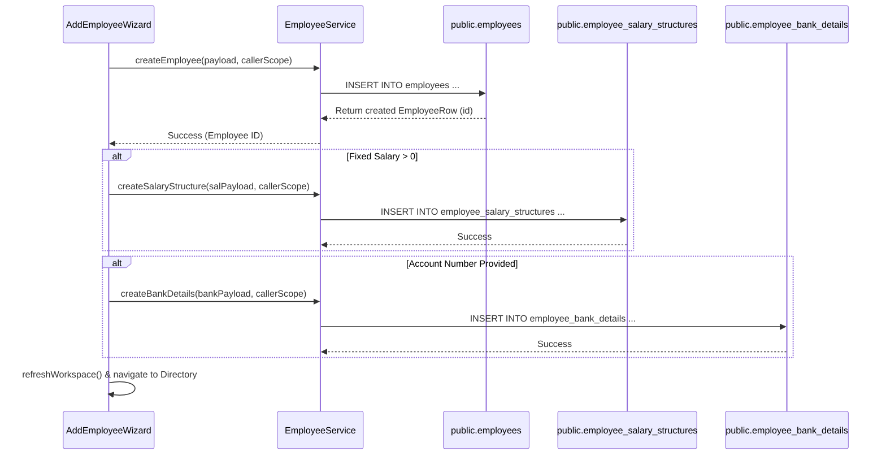

# Avencis WFM — Employee Onboarding Integration Report
## Milestone 2.4B: Add Employee Wizard, Validation Lifecycle & Atomicity Assessment

---

### 1. Executive Summary

The **Add Employee Wizard** (`src/app/workspace/AddEmployeeWizard.tsx`) provides a guided 4-step onboarding flow for registering staff into the Avencis WFM system. It has been integrated with `employeeService.ts` and `policyService.ts` to perform multi-stage employee creation, salary structure initialization, and bank coordinate setup.

---

### 2. Architecture & File Locations

| Component | File Path | Function |
| :--- | :--- | :--- |
| **Wizard Component** | [`src/app/workspace/AddEmployeeWizard.tsx`](file:///c:/Avencis%20Management/src/app/workspace/AddEmployeeWizard.tsx) | 4-step modal/page wizard, input validation, progress tracker |
| **Domain Service** | [`src/services/employeeService.ts`](file:///c:/Avencis%20Management/src/services/employeeService.ts) | `createEmployee`, `createSalaryStructure`, `createBankDetails` |
| **Org Context Service** | [`src/services/policyService.ts`](file:///c:/Avencis%20Management/src/services/policyService.ts) | `getLegalEntities`, `getWorkLocations`, `getDepartments` |
| **Routing** | [`src/App.tsx`](file:///c:/Avencis%20Management/src/App.tsx) | Routes `/workspace/:clientId/employees/new` and `/workspace/employees/add` |

---

### 3. Step-by-Step Onboarding Workflow

#### Step 1: Personal & Contact Information
- **Fields:** First Name, Last Name, Corporate Email Address, Mobile Number, Joining Date, Designation Title.
- **Validation:**
  - First Name and Last Name must be non-empty strings.
  - Corporate Email must contain `@` and valid domain formatting.
  - Mobile must be provided.
  - Joining Date defaults to the active calendar cycle.

#### Step 2: Legal Entity & Work Location Assignment
- **Fields:** Legal Employer Entity dropdown, Work Location dropdown, Department dropdown, Employment Arrangement radio group, Custom Employee Code (optional).
- **Employment Arrangements Supported:**
  1. `DIRECT_PERMANENT`: Regular full-time payroll employee of the client legal entity.
  2. `DIRECT_CONTRACT`: Fixed-term direct contractor under client payroll.
  3. `DEPUTED_STAFFING`: Staff deployed through staffing agency (e.g. driver or warehouse worker).
  4. `INTERN`: Stipend-based trainee.
- **Foreign Key Preservation:** Enforces valid IDs referencing `public.client_legal_entities`, `public.work_locations`, and `public.departments`.

#### Step 3: Monthly Compensation & Remuneration Structure
- **Fields:** Fixed Monthly Base Salary, Target Variable Incentive, Other Monthly Allowances.
- **Gross Monthly Wage Calculation:** Automatically sums base + incentive + allowances with live INR preview.

#### Step 4: Bank Account & Statutory Identity
- **Fields:** Bank Name, Account Number, IFSC Code, Permanent Account Number (PAN), Aadhaar UID Number.
- **Rigorous Validation Guards:**
  - **PAN Format:** Must be exactly 10 alphanumeric characters (e.g. `ABCDE1234F`). Automatically converted to uppercase.
  - **Aadhaar Format:** Must contain at least 12 digits (e.g. `5544 3322 1100`).
  - **IFSC Format:** Converted to uppercase alphanumeric string.

---

### 4. Multi-Stage Lifecycle & Atomicity Assessment

#### A. Execution Sequence in `AddEmployeeWizard.tsx`

#### B. Partial Record Risk Analysis
- **Current Behavior:** Employee creation is staged across three separate network calls (`employees`, `employee_salary_structures`, `employee_bank_details`).
- **Failure Mode:** If `createEmployee` succeeds but a subsequent network timeout or permission failure occurs during `createSalaryStructure` or `createBankDetails`, the employee record persists in `public.employees` with pending financial configuration.
- **Mitigation in 2.4B:**
  - The UI and directory handle missing salary structures gracefully, displaying `"Pending Setup"` without crashing.
  - In `EmployeeProfileView.tsx`, missing bank coordinates render `"No active bank account on record for disbursement"`.
  - Non-payroll roles (such as HR Admin) can onboard the employee without failing the wizard when salary creation returns `PERMISSION_ERROR`.
- **Architectural Recommendation for Milestone 3:**
  - Introduce a PostgreSQL stored function `public.onboard_employee_atomic(payload JSONB)` wrapping all three inserts inside a single database transaction (`BEGIN ... COMMIT`) to guarantee all-or-nothing atomicity when required.
