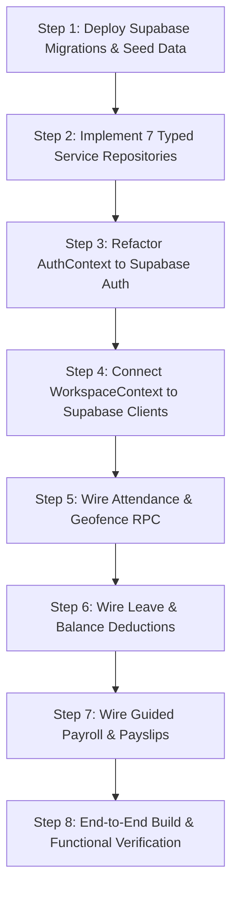

# AVENCIS WORKFORCE MANAGEMENT (WFM)
## FRONTEND-BACKEND INTEGRATION PLAN (PHASE F ARCHITECTURE)

**Project:** Avencis ERP / Business Management Platform  
**Target Backend:** PostgreSQL 15+ / Supabase  
**Design Directive:** Zero Redesign, Zero Layout Alterations, 100% Functionality Preservation  
**Pattern:** Clean Repository & Service Layer Pattern  
**Status:** **AUTHORITATIVE ARCHITECTURAL SPECIFICATION**  

---

## 1. Architectural Strategy & Guiding Principles

The frontend must transition from reading synchronous arrays in `src/data/store.ts` (`AppStore`) to consuming asynchronous domain services communicating with Supabase.

To guarantee zero regression in UI, layout, and visual fidelity:
1. **Preserve Component Props & Signatures:** UI components will receive identical data models and callbacks.
2. **Repository Decoupling:** Components will never invoke `supabase.from(...)` directly. All database queries, RPC calls, error handling, and transformation logic are encapsulated within typed service modules in `src/services/`.
3. **Graceful Offline & Hybrid Fallback:** If `isSupabaseConfigured()` is false, services automatically route queries through the in-memory fallback store (`store.ts`), ensuring local UI previews and tests never fail.

```
┌────────────────────────────────────────────────────────────────────────┐
│                        PRESENTATION LAYER (UI)                         │
│  29 Approved Stitch Screens & Mobile Employee Portal (Zero Alteration) │
└───────────────────────────────────┬────────────────────────────────────┘
                                    │ consumes React Hooks / Services
                                    ▼
┌────────────────────────────────────────────────────────────────────────┐
│                          DOMAIN SERVICE LAYER                          │
│  ├── authService.ts           ├── attendanceService.ts                 │
│  ├── employeeService.ts       ├── leaveService.ts                      │
│  ├── policyService.ts         ├── payrollService.ts                    │
│  └── reportingService.ts      └── auditService.ts                      │
└───────────────────┬────────────────────────────────┬───────────────────┘
                    │                                │
    (if Supabase is connected)       (if offline / test fallback)
                    ▼                                ▼
┌───────────────────────────────────────┐ ┌──────────────────────────────┐
│        SUPABASE DATA ACCESS           │ │    IN-MEMORY MOCK STORE      │
│  src/lib/supabase.ts (PostgreSQL/RLS) │ │    src/data/store.ts         │
└───────────────────────────────────────┘ └──────────────────────────────┘
```

---

## 2. Service Separation Matrix

The monolithic `store.ts` will be dismantled into 7 focused domain service modules:

| Domain Service | File Location | Core Responsibilities & Methods |
|---|---|---|
| **1. Authentication Service** | `src/services/authService.ts` | `signIn(email, password)`, `signOut()`, `getCurrentUser()`, `getSession()`, `onAuthStateChange()`, `getUserProfile()`. |
| **2. Employee Service** | `src/services/employeeService.ts` | `getEmployees(clientId, filters)`, `getEmployee(id)`, `createEmployee(data)`, `updateEmployeeStatus()`, `getSalaryStructure()`, `getBankDetails()`. |
| **3. Policy Service** | `src/services/policyService.ts` | `getClientPolicy(clientId)`, `updateClientPolicy(clientId, updates)`, `getLegalEntities(clientId)`, `getLocations(clientId)`. |
| **4. Attendance Service** | `src/services/attendanceService.ts` | `recordPunch(clientId, empId, type, coords)`, `getAttendanceRecords(clientId, date)`, `submitCorrection()`, `reviewCorrection()`. |
| **5. Leave Service** | `src/services/leaveService.ts` | `getLeaveBalances(empId)`, `getLeaveRequests(clientId)`, `applyLeave(data)`, `reviewLeaveRequest(id, status, remarks)`. |
| **6. Payroll Service** | `src/services/payrollService.ts` | `getPayrollRuns(clientId)`, `calculatePayrollRun(clientId, month, year)`, `lockPayrollRun(runId, approvedBy)`, `getPayslips()`. |
| **7. Reporting & Audit Service** | `src/services/reportingService.ts` | `getAuditLogs(clientId)`, `getAttendanceSummary(clientId, month)`, `exportFormXIX()`, `logAuditEvent()`. |

---

## 3. Implementation Phasing for Frontend Migration



### Step-by-Step Execution Details:

1. **Step 1: Database Provisioning (Awaiting Approval):**
   - Execute the 10 migration files on the live Supabase project.
   - Run seed script populating identical initial client and staff data (Suman Technologies, Maha India Logistics, Apex Precision).
2. **Step 2: Service Layer Creation:**
   - Create `src/services/` with strict TypeScript typing mapped to `src/types/database.types.ts`.
3. **Step 3: Authentication Migration:**
   - Refactor `AuthContext.tsx` to listen to `supabase.auth.onAuthStateChange()`.
   - Map active Supabase session to `user_profiles` record.
4. **Step 4: Client & Workspace Scoping:**
   - Refactor `WorkspaceContext.tsx` to query `supabase.from('clients').select('*')`.
5. **Step 5: Punch & Muster Migration:**
   - Wire `MobilePunchCard.tsx` to `attendanceService.recordPunch()`.
   - Ensure GPS coordinates and geofence verification execute seamlessly.
6. **Step 6: Leave Workflow Migration:**
   - Connect leave application modal and managerial approval tables.
7. **Step 7: Payroll Engine Migration:**
   - Connect guided payroll calculation wizard to `payrollService`.
   - Ensure locking calls Postgres trigger and locks the batch permanently.
8. **Step 8: Full Verification:**
   - Execute `npm run build` and verify that all 29 Stitch screens continue functioning with 100% fidelity.
