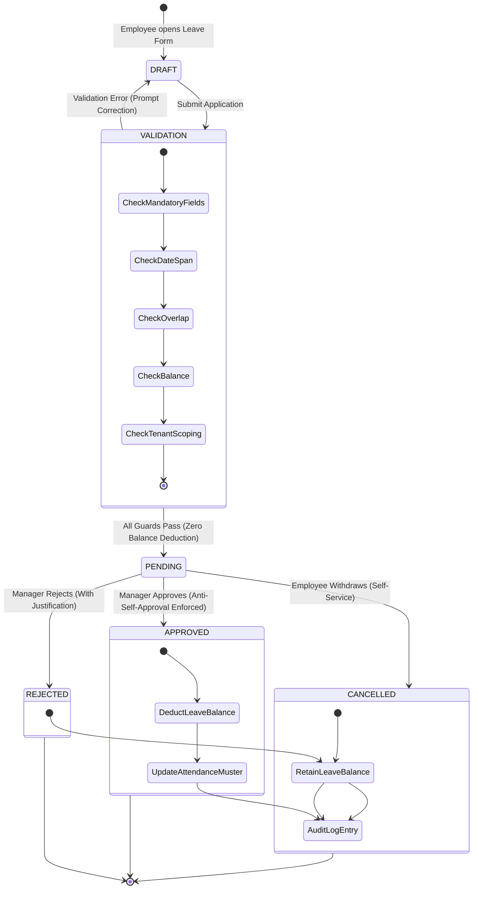

# AVENCIS WORKFORCE MANAGEMENT (WFM)
## LEAVE APPLICATION WORKFLOW SPECIFICATION

**Document Version:** 1.0.0  
**Milestone:** 2.4D  
**Target Process:** End-to-End Leave Application, Validation, Review, and Settlement  

---

### 1. Workflow Architecture & Lifecycle State Machine

The Avencis WFM leave management engine models time-off requests through a deterministic state machine. No transition may bypass validation guards or corporate governance restrictions.

---

### 2. Detailed Step-by-Step Execution

#### Step 1: Employee Initiation
- **Actor:** Authenticated Employee (`callerScope.role = 'employee'`, `callerScope.employeeId`).
- **Interface:** Screen `02-leave-application-register` (Mobile Drawer / Portal Tab).
- **Form Inputs:**
  - `leaveType`: Categorical selection (`PL`, `CL`, `SL`, `LWP`).
  - `startDate`: Effective beginning of leave period (`YYYY-MM-DD`).
  - `endDate`: Effective concluding date of leave period (`YYYY-MM-DD`).
  - `reason`: Justification text string ($\ge 5$ characters).
- **Automated Calculations:**
  - Application duration: $\text{totalDays} = (\text{endDate} - \text{startDate}) + 1$ (inclusive calendar days).

#### Step 2: Input & Business Logic Validation
Before writing to the ledger, `leaveService.submitLeaveRequest()` executes six sequential guards:
1. **Mandatory Identity:** Verifies `clientId` and `employeeId` are non-empty.
2. **Date Range Sanity:** Verifies $\text{endDate} \ge \text{startDate}$. Inverted spans are rejected with HTTP 400 (`VALIDATION_ERROR`).
3. **Substantive Reason:** Verifies `reason.trim().length >= 5`.
4. **Peer Spoofing Guard:** If `callerScope.role === 'employee'`, verifies `callerScope.employeeId === payload.employeeId`. Peer submissions are rejected with HTTP 403 (`PERMISSION_ERROR`).
5. **Cross-Tenant Guard:** Verifies `callerScope.clientId === payload.clientId`. External submissions are rejected with HTTP 403.
6. **Overlapping Span Guard:** Inspects active applications (`status IN ('PENDING', 'APPROVED')`) for the employee. If $\text{newStart} \le \text{reqEnd} \land \text{newEnd} \ge \text{reqStart}$, submission is blocked.
7. **Balance Solvency Guard:** For paid leaves (`PL`, `CL`, `SL`), verifies that $\text{totalDays} \le \text{closingBalance}$. Insufficient balance yields a descriptive rejection. Unpaid Leave (`LWP`) bypasses this check.

#### Step 3: Pending Queue Ingestion (Zero Balance Deduction)
- When validation succeeds, a record is inserted into `public.leave_requests` with `status = 'PENDING'`.
- **CRITICAL INVARIANT:** No deduction is made from `public.leave_balances` at this step. Available balance remains unchanged while the application awaits review.

#### Step 4: Managerial Review & Anti-Self-Approval Enforcement
- **Actor:** Authorized Reviewer (`super_admin`, `client_admin`, `hr_admin`, `client_manager`, `location_manager`).
- **Interface:** Screen `05-leave-management-dashboard` (`LeaveManagement.tsx`).
- **Governance Gate:**
  $$\text{Self-Approval Guard: } \text{reviewerEmployeeId} \ne \text{applicantEmployeeId}$$
  If the reviewer is the applicant, the review is strictly prohibited. The Approve button is replaced with `<ShieldAlert /> Self-Approval Prohibited`.
- **Review Decision:**
  - **Approval:** Requires reviewer ID and optional comments.
    - Transitions request to `APPROVED`.
    - Triggers atomic balance deduction: $\text{used} \mathrel{+}= \text{totalDays}$; $\text{closing} = \max(0, \text{opening} + \text{credited} - \text{used})$.
    - Mapped into the daily attendance muster as `PAID_LEAVE`.
  - **Rejection:** Requires manager remarks with business justification.
    - Transitions request to `REJECTED`.
    - Balance remains completely untouched.

#### Step 5: Employee Self-Service Withdrawal
- An employee may withdraw a pending application (`cancelLeaveRequest()`).
- Only requests in `PENDING` status may be cancelled. Approved or rejected requests cannot be cancelled through self-service.
- Concluded requests require administrative intervention.
