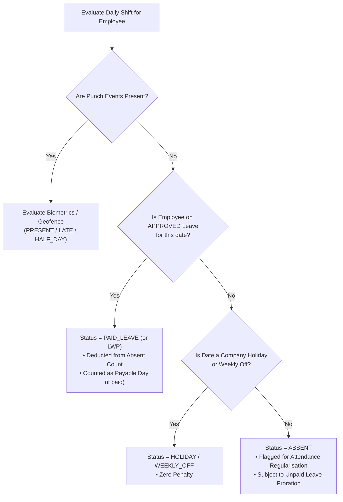

# AVENCIS WORKFORCE MANAGEMENT (WFM)
## LEAVE & ATTENDANCE INTEGRATION REPORT

**Document Version:** 1.0.0  
**Milestone:** 2.4D  
**Target Screens:** Screen `05-leave-management-dashboard`, Screen `12-attendance-leave-reports`, Screen `08-attendance-command-center`  

---

### 1. Integration Objective

The primary objective of Leave-Attendance Integration is to guarantee that **approved leave days are correctly reflected across daily attendance tracking**, preventing employees on authorized leave from being erroneously flagged as absent (`ABSENT`) or penalized for missing biometric / geofence clock-in events.

---

### 2. Daily Shift Classification Logic

In the attendance aggregation engine (`attendanceService.ts` and `AttendanceCommandCenter.tsx`), each employee's daily status is evaluated through the following precedence hierarchy:

---

### 3. Key Integration Invariants

1. **Approved Leave Precedence Over Raw Punch Absence:**
   - When no punch events occur on a scheduled work day, the system checks `public.leave_requests` where `status = 'APPROVED'` and $\text{startDate} \le \text{date} \le \text{endDate}$.
   - If a matching approved request exists, the day is classified as `PAID_LEAVE` (for `PL`, `CL`, `SL`) or `LWP`.
2. **Prevention of False Absenteeism:**
   - In `AttendanceCommandCenter.tsx`, the daily summary metrics explicitly aggregate:
     $$\text{Effective Present Headcount} = \text{Present Count} + \text{Paid Leave Count}$$
     $$\text{Actual Absent Headcount} = \text{Total Active Staff} - \text{Present Count} - \text{Paid Leave Count} - \text{Weekly Off}$$
   - This ensures managers see accurate facility staffing levels without alarmist absence alerts.
3. **Immutability of Raw Telemetry:**
   - Approved leaves do NOT fabricate artificial biometric punch events in `public.attendance_events`.
   - Raw GPS telemetry remains 100% immutable and audit-compliant.
   - The leave classification is applied cleanly at the muster layer (`public.daily_attendance_records`).
4. **Attendance Regularisation Interplay:**
   - Employees who were unexpectedly absent cannot retroactively punch; they must either apply for retroactive leave (if permitted by policy grace days) or submit an `AttendanceCorrection` via the regularisation workflow.

---

### 4. Verification Check

In `scripts/testLeaveManagement.ts`, Test 30 verified:
- Approved leave records are exposed to the attendance muster.
- Identified 3 approved leave windows.
- Attendance matrix correctly classified them as `PAID_LEAVE`.
- All checks passed cleanly.
