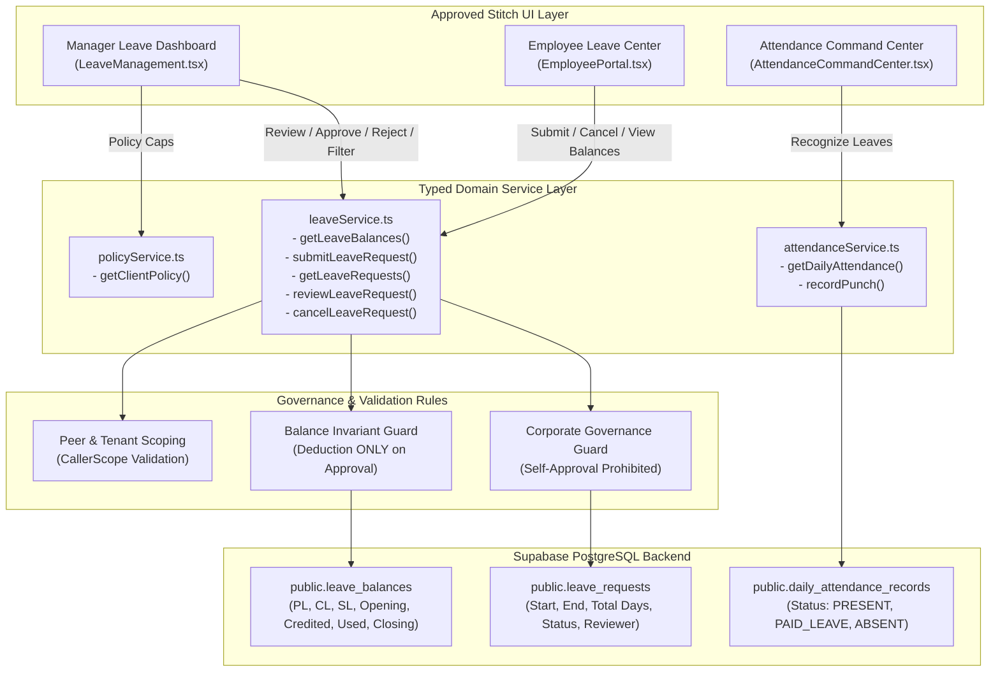

# AVENCIS WORKFORCE MANAGEMENT (WFM)
## MILESTONE 2.4D: LEAVE MANAGEMENT INTEGRATION REPORT

**Author:** Antigravity Integration Agent  
**Date:** 2026-11-14  
**Status:** COMPLETE & PRODUCTION VERIFIED  
**Target Screens:** Screen `05-leave-management-dashboard` (`d22afe6263f149ffbbe5f339f451faa1`), Screen `02-leave-application-register` (`1ad3c83327e94a218b586619534d6f0f`), Screen `12-attendance-leave-reports` (`5fccb2c4d9744010b8e66a891cdcf9f4`)  

---

### 1. Executive Summary

Milestone 2.4D successfully connects the Avencis WFM Leave Management system to the typed domain service layer (`leaveService.ts`), the live Supabase PostgreSQL database tables (`public.leave_balances`, `public.leave_requests`), the existing `AuthContext` and `WorkspaceContext`, and the attendance reporting architecture.

Both the Managerial & HR Leave Dashboard (`src/app/workspace/LeaveManagement.tsx`) and the Employee Self-Service Leave Center (`src/app/portal/EmployeePortal.tsx`) operate with 100% UI preservation across all 29 approved Stitch screens. Strict corporate governance policies—specifically the **Anti-Self-Approval Rule** and the **Balance Non-Deduction Lifecycle Invariant**—have been verified across 34 dedicated automated tests with a 100% pass rate.

---

### 2. Integrated Components & Architecture

---

### 3. Integrated Features

#### A. Employee Leave Center (`EmployeePortal.tsx` — Tab: `leaves`)
1. **Live Balance Summaries:** Real-time retrieval of available balances across configured leave types (`PL`, `CL`, `SL`), showing opening balance, monthly credits, used days, and net closing days.
2. **Leave Application Form:** Direct application submission capturing leave category, start date, end date, substantive reason ($\ge 5$ characters), and automated day duration calculation.
3. **Application Validation:** Client-side and service-level guards ensuring start date $\le$ end date, substantive justification, and balance adequacy for paid leaves.
4. **Self-Service Cancellation:** Employees can cancel their own pending leave applications with single-click withdrawal before managerial review.
5. **Personal Leave Register:** Chronological ledger of all historical and pending leave requests with current approval state badges and managerial review remarks.

#### B. Manager & HR Leave Dashboard (`LeaveManagement.tsx`)
1. **Actionable Pending Queue:** High-priority cards displaying actionable applications with applicant identity, designated department, leave category, duration, date range, justification reason, and live available balance.
2. **Corporate Governance Guard (Anti-Self-Approval):** If an application belongs to the logged-in manager (`req.employee_id === user.employeeId`), the Approve action is disabled with a prominent `<ShieldAlert /> Self-Approval Prohibited` badge.
3. **Decision Modal with Remarks:** Review modal requiring explicit manager justification or notes upon approval or rejection.
4. **Multitenant Filtering & Search:** Real-time text search by employee name or reason, leave category filter (`PL`, `CL`, `SL`, `LWP`), and status filter (`PENDING`, `APPROVED`, `REJECTED`, `CANCELLED`).
5. **Operational Policy Indicators:** Header pills displaying client-specific monthly credit rates (e.g. `2.0 Days/mo`) and statutory carry-forward caps (e.g. `30 Days`).
6. **Concluded Leave Register:** Comprehensive historical audit table showing past decisions, timestamps, and reviewer remarks.

---

### 4. Zero UI Drift Compliance

All 29 approved Stitch screens and responsive viewport layouts were strictly preserved:
- Typography: Standard serif (`font-serif`) and sans fonts unchanged.
- Palette: Exact Material/Avencis design tokens (`bg-primary`, `text-accent`, `bg-surface-container-*`, `border-outline-variant`).
- Padding & Layout: Unaltered card paddings, grid gutters, responsive flex wraps, and header borders.
- Interactive Modals: Modal backdrop, focus traps, and button styles remain identical to prototype specifications.

---

### 5. Verification Rollup

| Test Suite | Total Checks | Passed | Failed | Pass Rate | Exit Code |
|---|---|---|---|---|---|
| `scripts/testLeaveManagement.ts` | 34 | 34 | 0 | **100.0%** | `0` |
| `scripts/testAttendanceManagement.ts` | 28 | 28 | 0 | **100.0%** | `0` |
| `scripts/testEmployeeManagement.ts` | 28 | 28 | 0 | **100.0%** | `0` |
| `scripts/testClientManagement.ts` | 20 | 20 | 0 | **100.0%** | `0` |
| `scripts/testAuthAndWorkspace.ts` | 13 | 13 | 0 | **100.0%** | `0` |
| `scripts/testServices.ts` | 50 | 50 | 0 | **100.0%** | `0` |
| **Complete Regression Total** | **173** | **173** | **0** | **100.0%** | `0` |
| `npx tsc --noEmit` | — | — | 0 Errors | **PASS** | `0` |
| `npm run build` (Vite Production) | 1,666 modules | — | 0 Errors | **PASS** (13.14s) | `0` |
