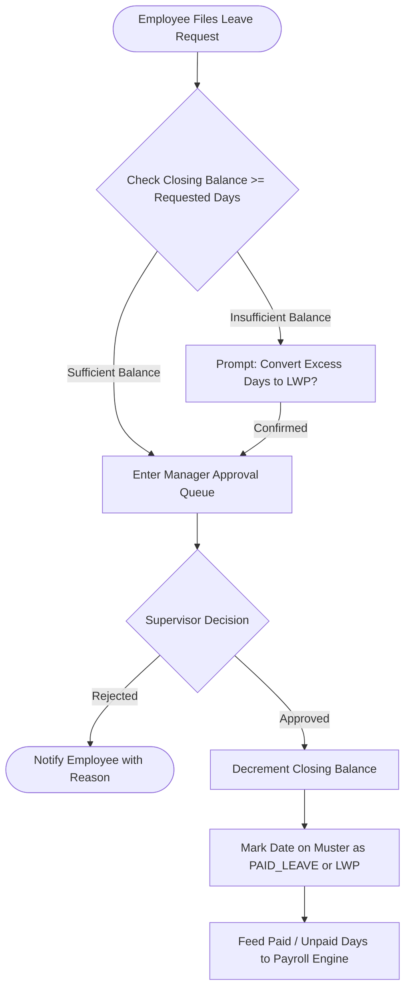

# AVENCIS WORKFORCE MANAGEMENT (MODULE 01)
## LEAVE GOVERNANCE & BALANCE LEDGER WORKFLOW

**Project:** Avencis ERP / Business Management Platform  
**Subsystem:** Leave Applications, Accruals & Balance Ledgers  
**Status:** Authoritative Operational Specification & Post-Audit Reconciliation  

> [!NOTE]
> **AUDIT RECONCILIATION NOTICE:**  
> The continuous balance ledger arithmetic ($\text{Closing} = \text{Opening} - \text{Used}$) and supervisor decision queue are verified working in state.  
> However:
> 1. `leaveBalances` are not serialized to `localStorage` and reset to initial mock data on page refresh.
> 2. Automated monthly accruals (`monthlyPaidLeaveAccrual`) and annual carry-forward caps currently lack scheduled background runners and are scheduled for Phase 2.

---

### 1. Leave Categories & Indian Statutory Rules

Avencis WFM supports five distinct leave classifications, governed strictly by the client's registered policy:

| Leave Type | Code | Accrual Frequency | Carry-Forward Rule | Salary Deduction Treatment |
|---|---|---|---|---|
| **Privilege / Earned Leave** | `PL` | Monthly ($1.75$–$2.0$ days/month) | Yes (up to client cap, e.g. 30 days) | Paid leave; zero deduction |
| **Casual Leave** | `CL` | Annual grant ($7$–$12$ days/year) | No (expires on December 31 / March 31) | Paid leave; zero deduction |
| **Sick / Medical Leave** | `SL` | Annual grant or monthly ($6$–$10$ days) | Partial (per client policy) | Paid leave; zero deduction |
| **Compensatory Off** | `COMP_OFF` | Earned via approved weekend shift work | Valid for 60–90 days from credit | Paid leave; zero deduction |
| **Loss of Pay (Unpaid)** | `LWP` | On exhaustion of paid balances or absent | N/A | **Unpaid; base salary prorated per day** |

---

### 2. End-to-End Leave Workflow

---

### 3. Balance Ledger Arithmetic

For every employee and leave type, the closing balance is computed via the continuous balance ledger formula:

$$\text{Closing Balance} = \text{Opening Balance} + \text{Credited Accruals} - \text{Approved Used Days}$$

- **Opening Balance:** Brought forward from previous fiscal year (subject to `maxCarryForward`).
- **Credited Accruals:** Added on the first day of each calendar month if employee service tenure $\ge \text{minServiceDaysForLeave}$.
- **Approved Used Days:** Sum of all days in approved leave requests for that category.
- **Negative Balance Prevention:** The system blocks leave applications exceeding the closing balance unless the employee explicitly applies for `LWP`.

---

### 4. Integration with Payroll Proration

When monthly payroll is initiated:
1. All approved `LWP` days (and unregularised full-day absences) within the fiscal cycle are aggregated into `unpaidDays`.
2. Total paid days are derived as:
   $$\text{Paid Days} = \text{Calendar Days} - \text{Unpaid Days}$$
3. Fixed base compensation is prorated using the client's configured divisor ($26$, $30$, or actual calendar days).
