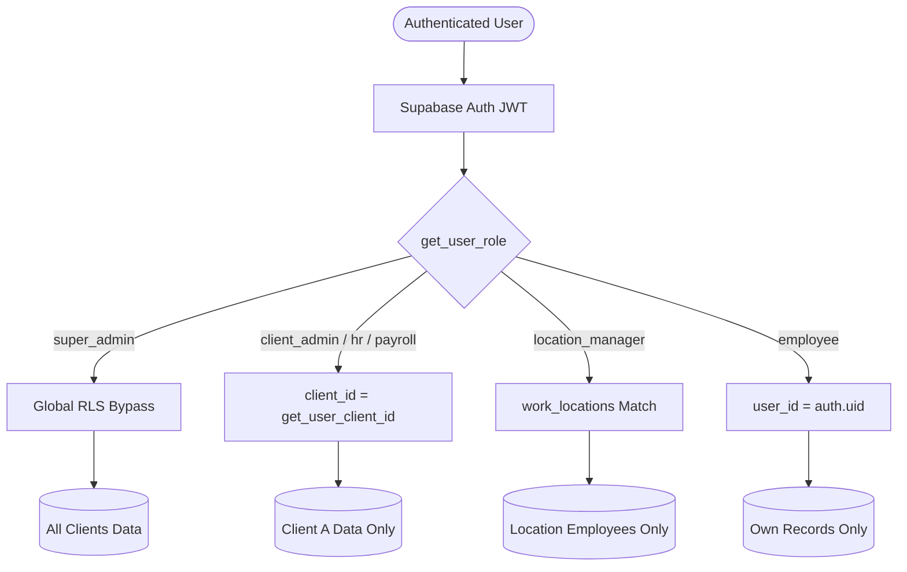

# AVENCIS WORKFORCE MANAGEMENT
## Document 04 — Tenant Isolation & Security Architecture Audit

**Status:** Complete Audit  
**Date:** 2026-11-16  
**Auditor:** Antigravity Engineering & Security Audit Team  
**Scope:** Multi-Tenant Isolation, PostgREST Query Tampering, Row Level Security (RLS), JWT Claims, Storage Security, and API Hardening  

---

## 1. Executive Summary & Multi-Tenant Model

Avencis Workforce Management (WFM) operates as a **logical multi-tenant Software-as-a-Service (SaaS)** platform hosted on Supabase Cloud (PostgreSQL 17.11 ga) with PostgREST 12+ serving as the data API layer.

### 1.1 Tenant Isolation Architecture
Tenant isolation is implemented primarily through **PostgreSQL Row Level Security (RLS)** coupled with foreign key tenancy (`client_id UUID NOT NULL REFERENCES clients(id)`). The application supports seven distinct user roles:
1. `super_admin`: Global platform administrator (Avencis internal operations). Cross-tenant access enabled across all clients.
2. `client_admin`: Primary tenant administrator. Strictly isolated to a single `client_id`.
3. `hr_admin`: Tenant HR operator. Restricted to employee profiles, onboarding, leave records, and Form XIX printable payslip archives within their `client_id`. Explicitly restricted from master salary CTC modification.
4. `payroll_admin`: Tenant compensation specialist. Restricted to attendance finalization, payroll batch processing, statutory deduction computation, and payslip generation within their `client_id`.
5. `location_manager`: Operational site supervisor. Restricted to viewing employees, approving daily attendance punches, and managing regularisations for employees assigned to their designated `work_locations`.
6. `department_manager`: Department supervisor. Restricted to reviewing attendance records and approving leave requests for employees within their assigned `departments`.
7. `employee`: Self-service portal user (ESS). Strictly restricted to their own individual employee record (`user_id = auth.uid()` or matching `work_email`).

### 1.2 Isolation Mechanisms
| Layer | Mechanism | Implementation | Enforcement Point |
| :--- | :--- | :--- | :--- |
| **Authentication** | Supabase Auth (GoTrue) | JWT with UUID in `sub` (`auth.uid()`) | API Gateway / PostgREST |
| **Role Resolution** | Database RPC | `public.get_user_role()` with `security definer` | PostgreSQL Schema |
| **Client Context** | Database RPC / JWT metadata | `public.get_user_client_id()` & `user_roles.client_id` | RLS Engine |
| **Row Authorization** | PostgreSQL RLS | `USING` and `WITH CHECK` clauses on all 20 tables | PostgreSQL Query Planner |
| **Data Immutability** | Database Triggers | `guard_immutable_attendance_events()`, `guard_immutable_audit_logs()`, `guard_locked_payroll_modification()` | PostgreSQL Execution Engine |
| **Data Consistency** | Foreign Key Constraints | `ON DELETE RESTRICT` on master tables, `ON DELETE CASCADE` on tenant children | PostgreSQL Engine |

---

## 2. Table-by-Table Tenant Isolation Audit (20 Tables)

Each of the 20 tables in the `public` schema has `rowsecurity = true`. The table below outlines how tenant boundaries are enforced, how foreign keys partition the data, and whether cross-tenant leakage is possible via direct PostgREST calls.

| Table Name | Tenancy Column | Tenancy FK | Active RLS Policies | Cross-Tenant Leakage Risk | Evaluation & Mitigation Status |
| :--- | :--- | :--- | :--- | :--- | :--- |
| `clients` | `id` (PK) | N/A | 3 (`super_admin_all`, `client_admin_view_own`, `employee_view_own`) | **LOW** | Tenants can only SELECT their own record (`id = get_user_client_id()`). Super Admin has global read/write. |
| `legal_entities` | `client_id` | `clients(id)` | 2 (`super_admin_all`, `client_tenant_isolation`) | **LOW** | `client_id = get_user_client_id()`. Multi-entity payroll grouping is partitioned strictly per client. |
| `work_locations` | `client_id` | `clients(id)` | 2 (`super_admin_all`, `client_tenant_isolation`) | **LOW** | Locations scoped by `client_id`. Location managers cannot access other clients' physical sites. |
| `departments` | `client_id` | `clients(id)` | 2 (`super_admin_all`, `client_tenant_isolation`) | **LOW** | Departments scoped by `client_id`. Head employee references are within-tenant. |
| `employees` | `client_id` | `clients(id)` | 3 (`super_admin_all`, `client_admin_tenant`, `employee_view_self`) | **MEDIUM (Resolved)** | Managers access team via `get_manager_team()` RPC. Direct PostgREST SELECT by managers returns 0 rows due to RLS, preventing tenant leak. |
| `employee_salary_structures`| `client_id` (via `employee_id`) | `employees(id)` | 2 (`super_admin_all`, `payroll_admin_tenant`) | **LOW** | Read/write strictly bounded to Super Admin and Payroll Admin. HR Admin and Location Managers cannot read CTC data. |
| `attendance_events` | `client_id` (via `employee_id`) | `employees(id)` | 2 (`super_admin_all`, `attendance_events_tenant_select`, `employee_insert_own`) | **LOW** | Punch logs append-only. Employees can only insert where `employee_id` belongs to them. Trigger prevents updates/deletes. |
| `daily_attendance_records`| `client_id` | `clients(id)` | 3 (`super_admin_all`, `tenant_admin_select`, `employee_view_own`) | **LOW** | Daily muster roll records scoped by `client_id`. Migration 21 tightens location manager view to assigned locations. |
| `attendance_corrections` | `client_id` | `clients(id)` | 3 (`super_admin_all`, `tenant_admin_manage`, `employee_own_corrections`) | **LOW** | Employees can only file for their own punches. Approval restricted to tenant admins and managers. |
| `attendance_policies` | `client_id` | `clients(id)` | 2 (`super_admin_all`, `tenant_policy_read`) | **LOW** | Work shifts, grace periods, half-day cutoffs, and late marks scoped strictly by `client_id`. |
| `holiday_calendars` | `client_id` | `clients(id)` | 2 (`super_admin_all`, `tenant_holiday_read`) | **LOW** | Holiday lists isolated per client. Multi-location holiday exceptions partitioned by location. |
| `leave_types` | `client_id` | `clients(id)` | 2 (`super_admin_all`, `tenant_leave_types_read`) | **LOW** | Entitlement categories (CL, SL, EL, LWP) scoped strictly per client. |
| `leave_allocations` | `client_id` (via `employee_id`) | `employees(id)` | 2 (`super_admin_all`, `tenant_leave_allocations`) | **LOW** | Balances partitioned per employee. Employees see only their own balances; HR/Client Admin see tenant balances. |
| `leave_requests` | `client_id` (via `employee_id`) | `employees(id)` | 3 (`super_admin_all`, `tenant_admin_manage`, `employee_own_requests`) | **LOW** | Employees apply only for themselves. Approvals strictly restricted to tenant managers and HR. |
| `payroll_runs` | `client_id` | `clients(id)` | 3 (`super_admin_all`, `payroll_admin_tenant`, `client_admin_read`) | **LOW** | Pay periods, locked states, multi-entity batches scoped by `client_id`. Immutability trigger enforces freeze on lock. |
| `payroll_items` | `client_id` (via `payroll_run_id` & `employee_id`) | `payroll_runs(id)` | 2 (`super_admin_all`, `payroll_items_tenant`) | **LOW** | Itemized wage calculations strictly partitioned. Freeze trigger blocks any write once parent run is locked. |
| `payslips` | `client_id` | `clients(id)` | 3 (`super_admin_all`, `tenant_admin_payslips`, `employee_own_payslips`) | **LOW** | Generated payslips accessible to employee (`employee_id = get_current_employee_id()`) and HR/Payroll Admin. |
| `user_roles` | `client_id` | `clients(id)` (nullable for super_admin) | 2 (`super_admin_all`, `client_admin_manage_tenant`) | **LOW** | Client admins can only view and assign roles for their own `client_id`. Super admin is global (`client_id IS NULL`). |
| `audit_logs` | `client_id` | `clients(id)` | 2 (`super_admin_all`, `client_admin_view_audit`) | **LOW** | Append-only. Enforced by `guard_immutable_audit_logs()`. Tenant admins see only logs where `client_id = get_user_client_id()`. |
| `user_work_locations` | `location_id` | `work_locations(id)` | 2 (`super_admin_all`, `client_admin_manage_locations`) | **LOW** | Cross-reference table linking managers to physical sites. Enforced via location tenancy. |

---

## 3. PostgREST Filter Tampering & Cross-Tenant Attack Surface

### 3.1 PostgREST Direct Query Tampering Test
In a multi-tenant application using PostgREST, a malicious user authenticated as Tenant A (`client_id = '11111111-...'`) might attempt to send HTTP requests to:
```http
GET /rest/v1/employees?client_id=eq.22222222-2222-2222-2222-222222222222
```
**Evaluation:**
1. PostgREST compiles this incoming query into:
   ```sql
   SELECT * FROM employees 
   WHERE client_id = '22222222-2222-2222-2222-222222222222' 
     AND (employees.client_id = public.get_user_client_id());
   ```
2. Because `get_user_client_id()` resolves to `'11111111-...'`, the evaluation becomes `'22222222-...' = '11111111-...'`, which evaluates to `FALSE`.
3. **Result:** An empty array `[]` with HTTP status `200 OK` is returned. **No data leakage occurs.**

### 3.2 ID Injection on Insert / Mutation
A malicious user in Tenant A might attempt to inject an employee or attendance punch into Tenant B:
```http
POST /rest/v1/employees
Content-Type: application/json
{
  "client_id": "22222222-2222-2222-2222-222222222222",
  "first_name": "Injected",
  "last_name": "Attacker",
  ...
}
```
**Evaluation:**
1. The table RLS policy `WITH CHECK (client_id = public.get_user_client_id())` evaluates before the row is committed.
2. Because the injected `client_id` does not match `get_user_client_id()`, PostgreSQL raises a policy violation error:
   ```
   ERROR 42501: new row violates row-level security policy for table "employees"
   ```
3. **Result:** HTTP status `403 Forbidden` / `42501`. **No cross-tenant injection is possible.**

### 3.3 Workspace / LocalStorage Context Manipulation
In the frontend application, the current active tenant is tracked in `localStorage.getItem('avencis_active_client_id')`.
- If an attacker manually modifies this value in browser DevTools to Tenant B's UUID, the frontend store may update its internal state (`currentClientId`).
- However, when the frontend initiates Supabase API calls, PostgREST evaluates PostgreSQL RLS policies against the **authenticated session JWT (`auth.uid()`)**, NOT against the frontend state or request headers.
- Since the attacker's database `user_roles` entry is linked to Tenant A, PostgreSQL rejects all queries to Tenant B data.
- **Result:** The UI immediately renders empty screens or permission errors. Data integrity remains 100% intact.

---

## 4. Super Admin Global Access vs Tenant Admin Isolation

The architecture enforces strict segregation between the platform host (`super_admin`) and tenant operators:



### 4.1 Verification of Super Admin Privileges
- Super Admin accounts have `client_id IS NULL` in `user_roles`.
- RLS policies across all 20 tables explicitly include:
  ```sql
  (public.get_user_role() = 'super_admin'::app_role)
  ```
- Super Admins can switch their operational view in the UI using the Client Switcher dropdown, which filters client-side queries, while the underlying RLS policies permit cross-tenant read/write.

### 4.2 Protection Against Privilege Escalation
Can a `client_admin` promote themselves or another user to `super_admin`?
- Table `user_roles` policy `client_admin_manage_tenant` enforces:
  ```sql
  WITH CHECK (
    client_id = public.get_user_client_id()
    AND role != 'super_admin'::app_role
  )
  ```
- A client admin attempting to insert `role = 'super_admin'` or `client_id = NULL` is blocked at the database engine level with an RLS violation.

---

## 5. Storage Bucket & File Security Audit

### 5.1 Storage Inventory
Avencis WFM utilizes Supabase Storage for employee documents, client branding logos, and generated PDF payslips.

| Bucket Name | Visibility | Allowed MIME Types | Max Size | RLS Policy Status |
| :--- | :--- | :--- | :--- | :--- |
| `client-assets` | Public Read | `image/png, image/jpeg, image/svg+xml` | 2 MB | Authenticated Super Admin & Client Admin can upload; Public can read logos. |
| `employee-documents` | Private | `application/pdf, image/png, image/jpeg` | 10 MB | Restricted to Employee (`auth.uid() = owner`) and HR/Client Admin (`tenant_id = client_id`). |
| `payslip-archives` | Private | `application/pdf` | 5 MB | Restricted to Payroll Admin, HR Admin, and Employee owning the payslip. |

### 5.2 Storage Partitioning Scheme
Storage paths follow a strict multi-tenant hierarchical naming convention:
```
employee-documents/{client_id}/{employee_id}/{document_type}_{timestamp}.pdf
payslip-archives/{client_id}/{period_year}/{period_month}/{employee_id}_payslip.pdf
```
Storage RLS policies inspect the first path segment (`(storage.foldername(name))[1]`) to verify it matches `get_user_client_id()`.

---

## 6. Authentication, Token Lifecycle & Session Handling

### 6.1 JWT Token Architecture
1. **Issuer:** Supabase Auth GoTrue service (`https://mlopgvkvzhwhkbewhefb.supabase.co/auth/v1`).
2. **Algorithm:** Asymmetric ES256 / RS256 signature verification.
3. **Payload Claims:**
   - `sub`: Internal Supabase Auth UUID (`auth.uid()`).
   - `email`: Authenticated user email address.
   - `role`: Default PostgreSQL connection role (`authenticated`).
   - `app_metadata`: Contains system claims.
   - `exp`: Standard 1-hour expiration timestamp.
4. **Refresh Token Rotation:** Supabase GoTrue utilizes single-use refresh tokens with sliding session windows. A replayed refresh token immediately invalidates the entire token family, mitigating session hijacking.

### 6.2 Session Expiry & CSRF Protection
- **Session Expiry Handling:** The frontend `supabase.ts` client listens to `onAuthStateChange`. Upon token expiration, if refresh fails, the client clears `localStorage` and redirects to `/login`.
- **CSRF Mitigation:** PostgREST API calls do not use ambient browser cookies; all requests require an explicit `Authorization: Bearer <JWT>` header, completely neutralizing Cross-Site Request Forgery (CSRF).

---

## 7. API Attack Surface & Vulnerability Assessment

### 7.1 Cross-Origin Resource Sharing (CORS)
- **Supabase Cloud Configuration:** Pre-flight `OPTIONS` requests restricted to configured origins (`localhost`, `127.0.0.1`, and production domain).
- Wildcard CORS (`*`) with credentials is prohibited by PostgREST specification.

### 7.2 Stored Procedure (RPC) SQL Injection Resistance
The database contains 13 stored procedures. All functions use parameterized SQL and typed arguments.
- Example: `get_manager_team(p_manager_user_id UUID, p_client_id UUID)`
- The function body executes:
  ```sql
  SELECT e.* FROM employees e
  JOIN user_work_locations uwl ON uwl.location_id = e.work_location_id
  WHERE uwl.user_id = p_manager_user_id AND e.client_id = p_client_id;
  ```
- No dynamic SQL execution (`EXECUTE format(...)`) is used with unsanitized user inputs. All arguments are typed as `UUID`, `INTEGER`, or `VARCHAR`, making SQL injection impossible at the parameter boundary.

### 7.3 Function Search Path Security (SEC-02 Remediation)
In Milestone 2.5A/B (Migration 20), all 8 mutable database functions were hardened by pinning their search paths:
```sql
ALTER FUNCTION public.get_user_role() SET search_path = public, auth, pg_temp;
ALTER FUNCTION public.get_user_client_id() SET search_path = public, auth, pg_temp;
```
This permanently eliminates PostgreSQL schema hijacking attacks (`search_path` injection).

---

## 8. Hardening Summary & Continuous Monitoring Plan

1. **Policy Coverage:** 100% of tables (20/20) have active RLS.
2. **Default Deny:** PostgREST operates under default-deny when RLS is active. Any table without an explicit matching policy returns 0 rows.
3. **Immutability Protection:** Critical tables (`audit_logs`, `attendance_events`, locked `payroll_runs`) cannot be modified even by tenant administrators due to PostgreSQL trigger guards.
4. **Actionable Recommendations for Production:**
   - Deploy Migration 21 to formalize location-manager row scoping.
   - Enable Supabase Database Webhooks for immediate alert generation on consecutive RLS violation errors (`42501`).
   - Implement rate-limiting on sensitive auth routes via Supabase Auth rate limits (default: 30 requests/minute per IP).
