# AVENCIS WORKFORCE MANAGEMENT
## Document 05 — End-to-End Workflow Architecture Map

**Status:** Complete Specification  
**Date:** 2026-11-16  
**Auditor:** Antigravity Engineering & Product Architecture Team  
**Scope:** 20 Core Cross-Module Business Workflows, State Transition Models, Actor Responsibilities, and Failure Handling  

---

## Table of Workflows

1. [WF-01: Client Onboarding & Initial Setup](#wf-01-client-onboarding--initial-setup)
2. [WF-02: Client Policy & Calendar Configuration](#wf-02-client-policy--calendar-configuration)
3. [WF-03: Legal Entity & Geofenced Location Management](#wf-03-legal-entity--geofenced-location-management)
4. [WF-04: User Account Provisioning & RBAC Assignment](#wf-04-user-account-provisioning--rbac-assignment)
5. [WF-05: Employee Onboarding 4-Step Lifecycle](#wf-05-employee-onboarding-4-step-lifecycle)
6. [WF-06: Employee Transfer, Promotion & Reassignment](#wf-06-employee-transfer-promotion--reassignment)
7. [WF-07: Resignation, Termination & Offboarding](#wf-07-resignation-termination--offboarding)
8. [WF-08: Daily Attendance Lifecycle (Normal Shift)](#wf-08-daily-attendance-lifecycle-normal-shift)
9. [WF-09: Attendance Exceptions, Grace & Penalties](#wf-09-attendance-exceptions-grace--penalties)
10. [WF-10: Attendance Correction & Regularisation](#wf-10-attendance-correction--regularisation)
11. [WF-11: Policy Assignment & Custom Shift Overrides](#wf-11-policy-assignment--custom-shift-overrides)
12. [WF-12: Leave Application & Multi-Level Approval](#wf-12-leave-application--multi-level-approval)
13. [WF-13: Leave Cancellation & Balance Restoration](#wf-13-leave-cancellation--balance-restoration)
14. [WF-14: Unauthorised Absence & LWP Integration](#wf-14-unauthorised-absence--lwp-integration)
15. [WF-15: Monthly Attendance Finalization Gate](#wf-15-monthly-attendance-finalization-gate)
16. [WF-16: Payroll Batch Initialization & Math Engine](#wf-16-payroll-batch-initialization--math-engine)
17. [WF-17: Payroll Review, Overtime & Statutory Adjustments](#wf-17-payroll-review-overtime--statutory-adjustments)
18. [WF-18: Payroll Approval, Immutability Freeze & Payslips](#wf-18-payroll-approval-immutability-freeze--payslips)
19. [WF-19: Employee Self-Service (ESS) Daily Journey](#wf-19-employee-self-service-ess-daily-journey)
20. [WF-20: Client Suspension & Tenant Lockout](#wf-20-client-suspension--tenant-lockout)

---

### WF-01: Client Onboarding & Initial Setup
**Primary Actor:** `super_admin`  
**Description:** Onboarding a new corporate client enterprise onto the Avencis WFM platform.

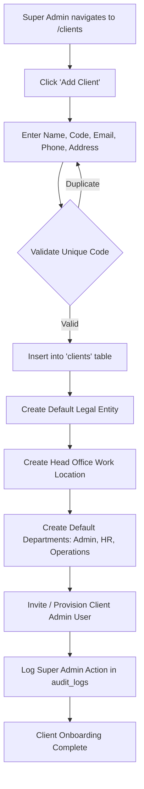

---

### WF-02: Client Policy & Calendar Configuration
**Primary Actor:** `client_admin` / `hr_admin`  
**Description:** Setting up client-wide attendance rules, shifts, holidays, and leave quotas.

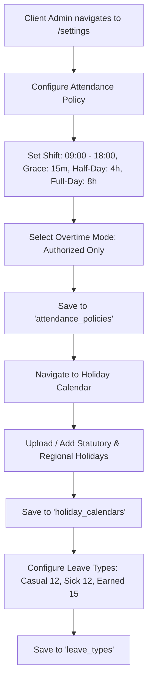

---

### WF-03: Legal Entity & Geofenced Location Management
**Primary Actor:** `client_admin`  
**Description:** Defining multi-entity structures and physical sites with GPS radius geofencing.

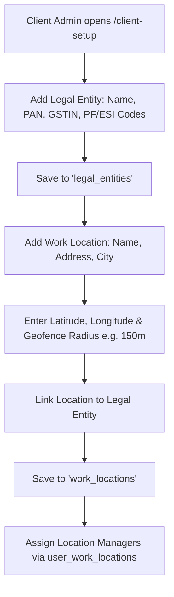

---

### WF-04: User Account Provisioning & RBAC Assignment
**Primary Actor:** `client_admin` / `super_admin`  
**Description:** Provisioning administrative and operational user logins with explicit role binding.

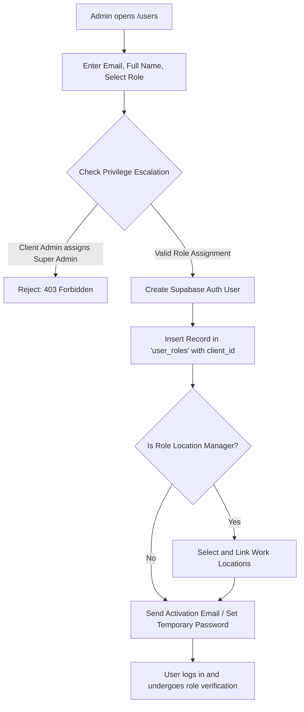

---

### WF-05: Employee Onboarding 4-Step Lifecycle
**Primary Actor:** `hr_admin` / `client_admin`  
**Description:** Complete 4-step wizard for formal worker onboarding with statutory validation.

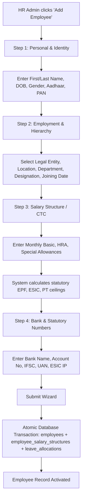

---

### WF-06: Employee Transfer, Promotion & Reassignment
**Primary Actor:** `hr_admin`  
**Description:** Moving an employee between branches, departments, or changing salary and grade.

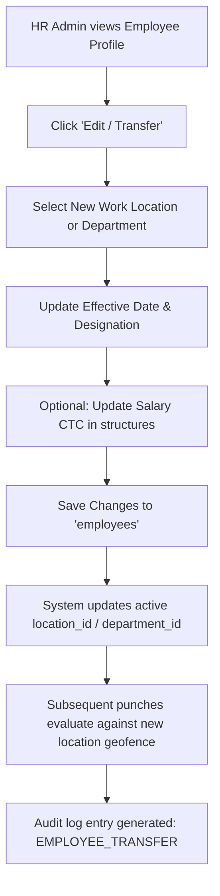

---

### WF-07: Resignation, Termination & Offboarding
**Primary Actor:** `hr_admin` / `client_admin`  
**Description:** Orderly exit lifecycle, status deactivation, and payroll severance tagging.

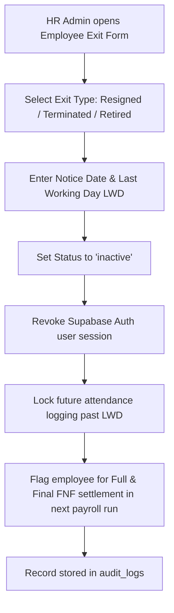

---

### WF-08: Daily Attendance Lifecycle (Normal Shift)
**Primary Actor:** `employee`  
**Description:** Standard daily punch-in and punch-out flow with geofence validation.

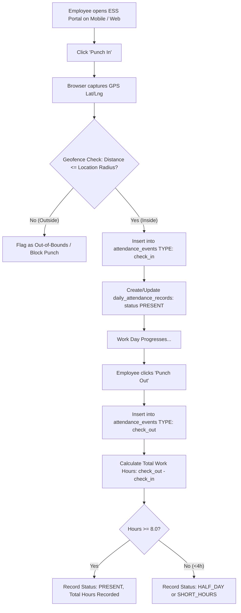

---

### WF-09: Attendance Exceptions, Grace & Penalties
**Primary Actor:** Automated System Engine / `location_manager`  
**Description:** Handling late arrivals, grace periods, and non-punches.

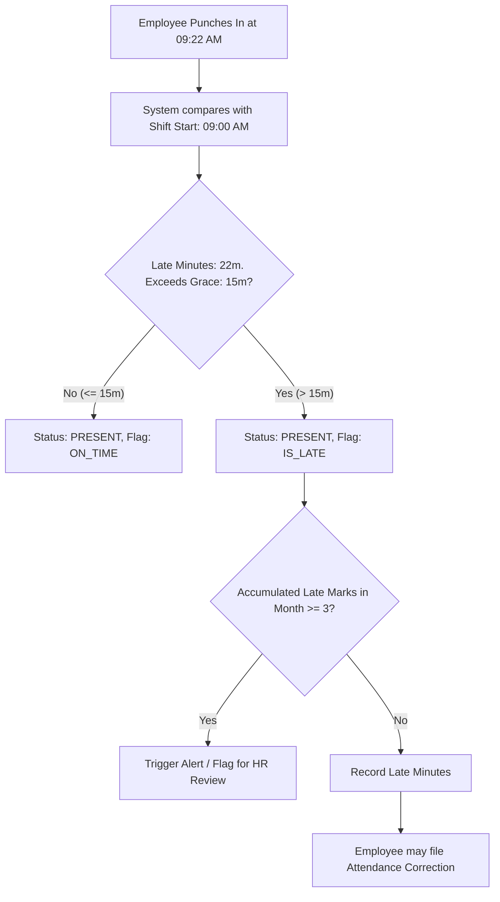

---

### WF-10: Attendance Correction & Regularisation
**Primary Actor:** `employee` & `location_manager`  
**Description:** Remediation of missed punches or technical geofence failures.

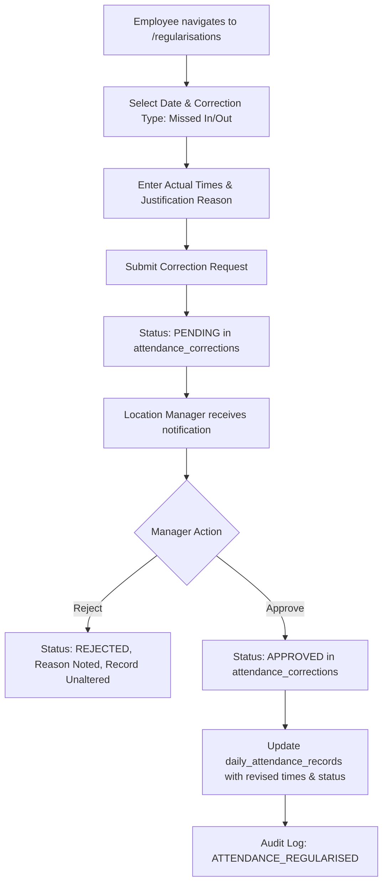

---

### WF-11: Policy Assignment & Custom Shift Overrides
**Primary Actor:** `hr_admin`  
**Description:** Applying non-standard work hours or rotating shift policies.

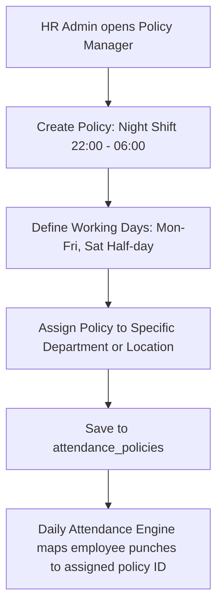

---

### WF-12: Leave Application & Multi-Level Approval
**Primary Actor:** `employee`, `department_manager`, `hr_admin`  
**Description:** Applying for leave with balance deduction and muster sync.

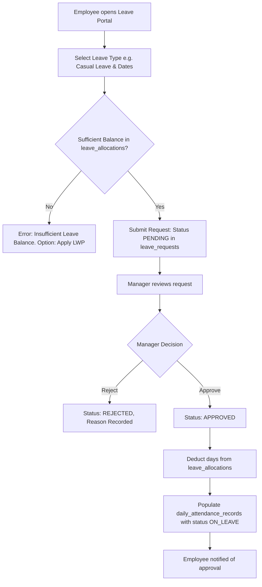

---

### WF-13: Leave Cancellation & Balance Restoration
**Primary Actor:** `employee` / `hr_admin`  
**Description:** Reversing a submitted or approved leave request.

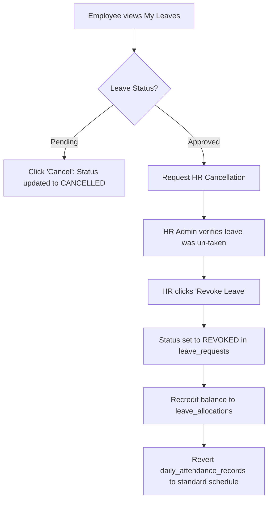

---

### WF-14: Unauthorised Absence & LWP Integration
**Primary Actor:** Automated Attendance Job / `hr_admin`  
**Description:** Converting absent days into Loss of Pay (LWP) deductions for payroll.

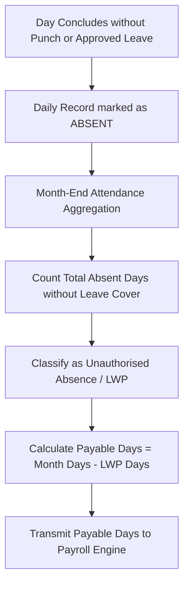

---

### WF-15: Monthly Attendance Finalization Gate
**Primary Actor:** `hr_admin` / `payroll_admin`  
**Description:** Mandatory prerequisite verification before payroll calculation can be triggered.

```mermaid
flowchart TD
    A[Payroll Admin navigates to /payroll] --> B[Click 'Run Payroll']
    B --> C{Check 1: Any Pending Attendance Corrections?}
    C -- Yes --> D[Block: 'Resolve 3 pending corrections before finalizing']
    C -- No --> E{Check 2: Any Pending Leave Requests for Period?}
    E -- Yes --> F[Block: 'Resolve 2 pending leave requests before finalizing']
    E -- No --> G[Prompt: 'Finalize Attendance Muster for [Period]?']
    G --> H[User Confirms Finalization]
    H --> I[Muster Locked: No further corrections permitted for period]
    I --> J[Gate Passed: Proceed to Payroll Calculation]
```

---

### WF-16: Payroll Batch Initialization & Math Engine
**Primary Actor:** `payroll_admin`  
**Description:** Generating itemized earnings and statutory deductions per employee.

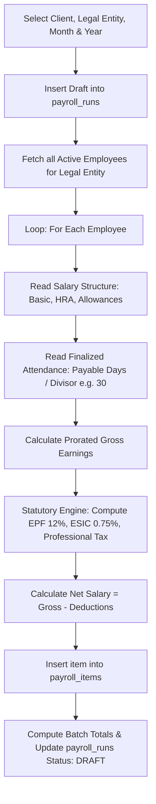

---

### WF-17: Payroll Review, Overtime & Statutory Adjustments
**Primary Actor:** `payroll_admin`  
**Description:** Reviewing draft payroll register and inserting authorized overtime or bonuses.

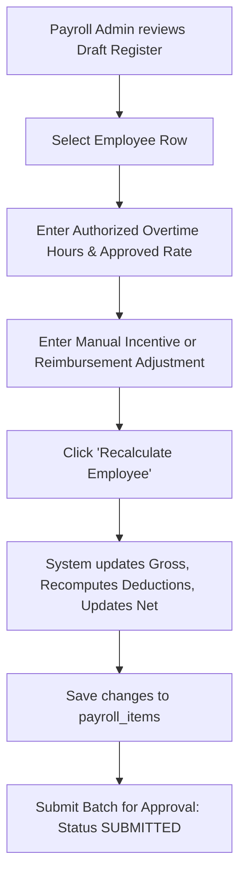

---

### WF-18: Payroll Approval, Immutability Freeze & Payslips
**Primary Actor:** `client_admin`  
**Description:** Segregation of duties approval, database-level locking, and Form XIX payslip issuance.

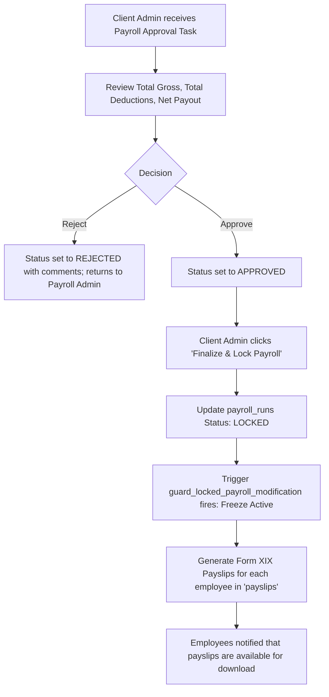

---

### WF-19: Employee Self-Service (ESS) Daily Journey
**Primary Actor:** `employee`  
**Description:** Full daily interaction flow for an operational front-line employee.

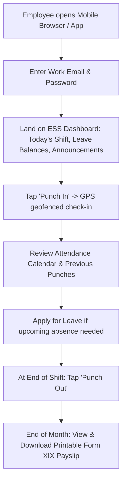

---

### WF-20: Client Suspension & Tenant Lockout
**Primary Actor:** `super_admin`  
**Description:** Emergency or commercial suspension of a tenant account.

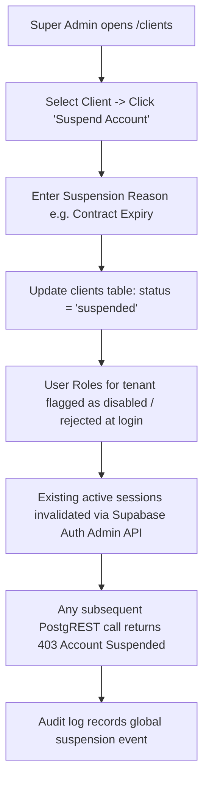
