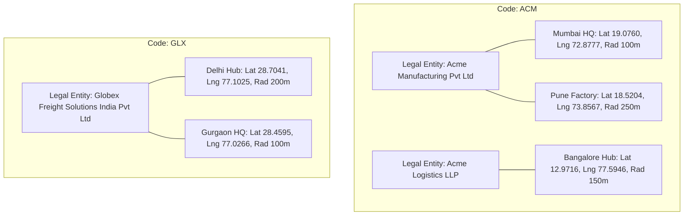

# AVENCIS WORKFORCE MANAGEMENT
## Document 08 — Test Environment & Synthetic Data Architecture Plan

**Status:** Complete Specification  
**Date:** 2026-11-16  
**Auditor:** Antigravity Quality Assurance & Security Engineering  
**Scope:** Test Environments, Multi-Tenant Synthetic Data Sets, Provisioning Personas, and Non-Destructive Reset Procedures  

---

## 1. Environment Architecture & Staging Configuration

To ensure end-to-end testing accurately reproduces production behavior without endangering production operations, the testing programme is designed to execute against a dedicated **Staging Project** on Supabase Cloud or a strictly sandboxed multi-tenant partition.

### 1.1 Environment Topology
| Component | Staging Specification | Production Specification |
| :--- | :--- | :--- |
| **Frontend URL** | `http://localhost:5173` (Vite dev) or `http://localhost:4173` (Preview build) | `https://app.avenciswfm.com` |
| **Database Engine** | PostgreSQL 17.11 (ga) | PostgreSQL 17.11 (ga) |
| **Supabase Project** | `mlopgvkvzhwhkbewhefb.supabase.co` (Dedicated Test Project) | Dedicated Production Instance |
| **Data Mode** | `VITE_DATA_SOURCE_MODE=supabase` | `VITE_DATA_SOURCE_MODE=supabase` |
| **Mock Fallback** | Explicitly disabled via `isProd()` check in preview/build mode | Unconditionally disabled |
| **Auth Provider** | Supabase GoTrue with synthetic email accounts (`@avencis.test`) | Supabase GoTrue with corporate SSO / SMTP |

---

## 2. Multi-Tenant Synthetic Client Topology

The test programme requires two completely independent corporate tenants to rigorously test and verify tenant isolation, cross-tenant boundary security, and role segregation.



### 2.1 Client A Profile — Acme Corporation
- **Client Code:** `ACM`
- **Legal Entity 1:** `Acme Manufacturing Pvt Ltd` (PAN: `AAACA1234A`, GSTIN: `27AAACA1234A1Z5`, PF: `MH/BAN/0012345/000`)
- **Legal Entity 2:** `Acme Logistics LLP` (PAN: `AAACL5678B`, GSTIN: `27AAACL5678B1Z2`, PF: `MH/PUN/0056789/000`)
- **Work Locations:**
  1. `Mumbai Head Office` (Corporate, Rad 100m)
  2. `Pune Plant 1` (Manufacturing, Rad 250m)
  3. `Bangalore Logistics Center` (Distribution, Rad 150m)
- **Departments:** `Executive Management`, `Human Resources`, `Plant Operations`, `Supply Chain`, `Finance`
- **Attendance Policies:**
  - `General Shift`: 09:00 - 18:00, 15m Grace, 4h Half-Day, 8h Full-Day, Overtime Mode: Authorized
  - `Plant Shift A`: 06:00 - 14:00, 10m Grace, 4h Half-Day, 8h Full-Day, Overtime Mode: Authorized

### 2.2 Client B Profile — Globex Logistics
- **Client Code:** `GLX`
- **Legal Entity:** `Globex Freight Solutions India Pvt Ltd` (PAN: `AABCG9876C`, GSTIN: `07AABCG9876C1Z9`)
- **Work Locations:**
  1. `Delhi Central Sorting Hub` (Rad 200m)
  2. `Gurgaon Regional Office` (Rad 100m)
- **Departments:** `Fleet Operations`, `Warehouse Management`, `Administration`
- **Attendance Policy:** `Logistics Shift`: 08:00 - 17:00, 15m Grace

---

## 3. Synthetic User Persona Matrix (7 Roles Across Tenants)

All test personas use standard password: `AvencisTest@2026#Secure`

| Persona ID | Email Address | Role | Tenant Assignment | Location / Department Scope | Test Purpose |
| :--- | :--- | :--- | :--- | :--- | :--- |
| **USR-SUPER** | `superadmin@avencis.test` | `super_admin` | Global (`client_id = NULL`) | Global (Unrestricted) | Cross-tenant administration, client suspension, global audits. |
| **USR-ACM-ADM**| `admin.acme@avencis.test` | `client_admin` | Acme Corp (`ACM`) | All Acme Locations | Tenant administration, user invites, payroll sign-off. |
| **USR-ACM-HR** | `hr.acme@avencis.test` | `hr_admin` | Acme Corp (`ACM`) | All Acme Locations | Employee onboarding, leave allocation, muster review. Restricted from CTC edits. |
| **USR-ACM-PAY**| `payroll.acme@avencis.test`| `payroll_admin`| Acme Corp (`ACM`) | All Acme Locations | Attendance finalization, payroll batch run, overtime review. |
| **USR-ACM-MGR1**| `mgr.pune@avencis.test` | `location_manager`| Acme Corp (`ACM`) | Pune Plant 1 only | Location team review, punch regularisation approval. |
| **USR-ACM-MGR2**| `mgr.ops@avencis.test` | `department_manager`| Acme Corp (`ACM`) | Plant Operations Dept | Department leave request approval, shifts. |
| **USR-ACM-EMP1**| `emp.rahul@avencis.test` | `employee` | Acme Corp (`ACM`) | Pune Plant 1 / Operations | Standard worker ESS flow (punches, leaves, payslips). |
| **USR-ACM-EMP2**| `emp.sneha@avencis.test` | `employee` | Acme Corp (`ACM`) | Mumbai HQ / Finance | Mid-month joiner test persona. |
| **USR-GLX-ADM**| `admin.globex@avencis.test`| `client_admin`| Globex Logistics (`GLX`)| All Globex Locations | Cross-tenant boundary target (verifying Acme cannot see Globex). |
| **USR-GLX-EMP1**| `emp.priya@avencis.test` | `employee` | Globex Logistics (`GLX`)| Delhi Hub / Fleet | Tenant isolation verification target. |

---

## 4. Synthetic Employee Population & Edge Case Scenarios

| Employee Code | Name | Client | Location / Dept | Monthly CTC | Special Characteristics / Edge Case Tested |
| :--- | :--- | :--- | :--- | :--- | :--- |
| `EMP-ACM-001` | Rahul Sharma | Acme Corp | Pune / Operations | ₹ 35,000 | **Standard Baseline:** 100% attendance, EPF capped at ₹15,000, ESIC exempt (>₹21,000). |
| `EMP-ACM-002` | Sneha Patil | Acme Corp | Mumbai / Finance | ₹ 65,000 | **Mid-Month Joiner:** Joined on the 16th of current month; tests proration (15 payable days). |
| `EMP-ACM-003` | Amit Kumar | Acme Corp | Pune / Operations | ₹ 18,500 | **Statutory Low Wage:** Subject to both EPF (12%) and ESIC (0.75% employee, 3.25% employer). |
| `EMP-ACM-004` | Vikram Rao | Acme Corp | Bangalore / Supply | ₹ 45,000 | **Heavy Absence / LWP:** 10 unapproved absent days; tests payable days deduction and LWP deduction. |
| `EMP-ACM-005` | Pooja Nair | Acme Corp | Pune / Operations | ₹ 28,000 | **Authorized Overtime:** 18 hours of approved overtime entered in payroll run; tests OT multiplier. |
| `EMP-ACM-006` | Rajesh Deshmukh| Acme Corp | Pune / Operations | ₹ 50,000 | **Mid-Month Resignation:** Exited on 20th; tests exit flag, prorated pay, and FNF freeze. |
| `EMP-ACM-007` | Sunita Gupta | Acme Corp | Mumbai / HR | ₹ 42,000 | **Leave Exhaustion:** Exceeded casual leave quota; tests system rejection and fallback to LWP. |
| `EMP-ACM-008` | Manoj Shinde | Acme Corp | Pune / Operations | ₹ 22,000 | **Missed Punch Regularisation:** Multiple missed punches; tests regularisation workflow. |
| `EMP-GLX-001` | Priya Singh | Globex | Delhi / Fleet | ₹ 32,000 | **Cross-Tenant Verification:** Confirms Acme admins cannot view or search this employee. |
| `EMP-GLX-002` | Deepak Verma | Globex | Gurgaon / Admin | ₹ 40,000 | **Globex Independent Payroll:** Confirms independent payroll batch calculation per client. |

---

## 5. Non-Destructive Seeding & Reset Procedures

### 5.1 Seeding Protocol
Seeding must be performed via dedicated test script:
```bash
npx tsx --env-file=.env scripts/seedMasterTestEnvironment.ts
```
The script performs idempotent operations:
1. Verifies if client code `ACM` exists. If yes, reuses existing IDs.
2. Creates or maps Supabase Auth users using `admin.auth.admin.createUser()` with `email_confirm: true`.
3. Inserts or updates matching records in `user_roles`.
4. Ensures foreign key dependencies are maintained in topological order (`clients -> legal_entities -> work_locations -> departments -> employees -> structures -> policies`).

### 5.2 Non-Destructive Reset Protocol
To reset test transactions without dropping production schema or deleting user accounts:
```sql
-- Safe reset of test attendance and payroll batches for Acme Corp
DELETE FROM public.payroll_items 
WHERE payroll_run_id IN (SELECT id FROM public.payroll_runs WHERE client_id = 'acme-uuid-placeholder');

DELETE FROM public.payslips 
WHERE client_id = 'acme-uuid-placeholder';

DELETE FROM public.payroll_runs 
WHERE client_id = 'acme-uuid-placeholder' AND status != 'LOCKED';

DELETE FROM public.attendance_events 
WHERE employee_id IN (SELECT id FROM public.employees WHERE client_id = 'acme-uuid-placeholder');

DELETE FROM public.daily_attendance_records 
WHERE client_id = 'acme-uuid-placeholder';
```
*Note: Locked payroll runs and immutable audit logs cannot and should not be deleted, ensuring real compliance behavior.*
