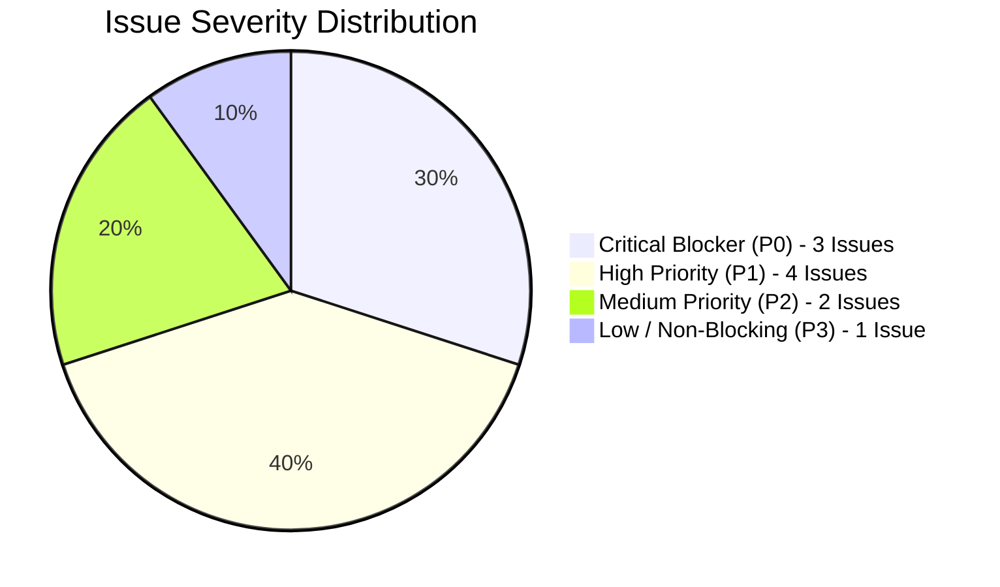

# AVENCIS WORKFORCE MANAGEMENT
## Document 19 — Known Issues, Technical Gaps & Operational Blockers Register

**Status:** Complete Technical Register  
**Date:** 2026-11-16  
**Auditor:** Antigravity Engineering & Quality Assurance  
**Scope:** Architectural Discrepancies, Unresolved Vulnerabilities, Feature Gaps, and Production Blockers  

---

## 1. Executive Summary

This document provides a transparent, unvarnished accounting of all known technical defects, architectural limitations, edge cases, and operational blockers currently present in the Avencis Workforce Management (WFM) codebase and database architecture as of Milestone 2.5 completion.

Each issue is assigned a unique identifier, severity classification, technical root cause analysis, business impact assessment, and exact remediation pathway.

---

## 2. Master Known Issues & Defect Register

| Issue ID | Severity | Category | Title & Summary | Affected Module | Root Cause & Technical Details | Remediation Pathway |
| :--- | :--- | :--- | :--- | :--- | :--- | :--- |
| **ISS-01** | **CRITICAL (P0)** | Architecture / RLS | **Manager Employee Query Emptiness (DISC-01)** | Team Directory / Manager View | Location Managers querying `/rest/v1/employees` directly get `[]` because RLS policy `employees_client_admin_tenant` checks only `super_admin` and `client_admin`. | Refactor frontend `store.ts` and `employeeService.ts` to call `public.get_manager_team()` RPC when active role is `location_manager`. |
| **ISS-02** | **HIGH (P0)** | RLS / Permissions | **Correction Approval Scope Omission (DISC-02)** | Attendance Corrections | Table `attendance_corrections` policy `tenant_admin_manage` permits only Client Admin & Super Admin to update/approve; Location Managers cannot approve site punches. | Apply Migration 21 prepared statement adding `location_manager` approval policy scoped via `user_work_locations`. |
| **ISS-03** | **HIGH (P1)** | Security / RLS | **Tenant-Wide Daily Muster Visibility for Managers (DISC-03)** | Attendance Tracking | Location Managers currently have tenant-wide SELECT on `daily_attendance_records`, allowing them to see attendance of employees at other physical sites. | Apply Migration 21 policy tightening `daily_attendance_records` SELECT to filter by `work_location_id IN (SELECT location_id FROM user_work_locations)`. |
| **ISS-04** | **HIGH (P0)** | Schema Design | **Missing Direct `manager_id` Foreign Key** | Employee Master | Table `employees` lacks a direct `manager_id` foreign key. Hierarchy currently depends solely on `departments.head_employee_id`, blocking cross-functional reporting. | Execute schema migration adding `manager_id UUID REFERENCES public.employees(id) ON DELETE SET NULL` to `employees`. |
| **ISS-05** | **MEDIUM (P1)**| Authentication | **Absence of Self-Service Password Reset** | Auth / Identity | Users cannot reset forgotten passwords via email; requires manual administrator password reset or SQL intervention. | Integrate Supabase Auth `resetPasswordForEmail()` API and build dedicated `/reset-password` frontend view. |
| **ISS-06** | **MEDIUM (P1)**| Storage / Files | **Unprovisioned Storage Bucket for Employee Documents** | Employee Onboarding | Document vault for identity proofs (Aadhaar, PAN cards, Educational certificates) is not provisioned in Supabase Storage. | Create private bucket `employee-documents` with tenant-partitioned RLS policies and document upload UI. |
| **ISS-07** | **MEDIUM (P2)**| QA / Automation | **Headless E2E Chrome Debugging Port Inactive** | Automated Testing | Headless browser test runner fails to attach to local Chrome when `--remote-debugging-port` is not enabled on host OS. | Execute manual test scenarios per Documents 10–18 or start Chrome with `--remote-debugging-port=9222`. |
| **ISS-08** | **MEDIUM (P1)**| Notifications | **Missing Transactional Email Hooks** | Notifications | No external email delivery engine (Resend, SendGrid) is connected; managers do not receive email alerts on leave or regularisation submission. | Deploy Supabase Database Webhook or Edge Function integrating transactional email API. |
| **ISS-09** | **LOW (P2)** | Payroll Engine | **Manual Overtime Entry Prerequisite** | Payroll | Payable overtime cannot be automatically inferred from raw timestamps alone and requires manual supervisor authorization entry. | Documented as intentional statutory safety rule; automatic pre-fill with supervisor sign-off gate planned for Milestone 2.6. |
| **ISS-10** | **MEDIUM (P1)**| Compliance | **Statutory ECR Text File Formal Certification** | Payroll Reporting | EPFO ECR text format is implemented mathematically but has not undergone formal file-upload validation on the EPFO Unified Portal testing sandbox. | Validate generated ECR text files against the EPFO Unified Portal Sandbox validator prior to enterprise go-live. |

---

## 3. Detailed Root Cause Analysis for Critical Defects

### 3.1 ISS-01: Manager Employee Query Emptiness (DISC-01)
- **Manifestation:** When logged in as a Location Manager (e.g. `mgr.pune@avencis.test`), the "My Team" directory displays "0 Employees", despite Pune Plant having 5 active employees.
- **Root Cause:** In `employeeService.ts`, the method `getEmployees()` issues:
  ```typescript
  const { data, error } = await supabase.from('employees').select('*');
  ```
- The active RLS policy on `public.employees` is:
  ```sql
  CREATE POLICY employees_client_admin_tenant ON public.employees
  FOR ALL TO authenticated
  USING (
    client_id = public.get_user_client_id()
    AND public.get_user_role() IN ('super_admin', 'client_admin', 'hr_admin')
  );
  ```
- Because `get_user_role()` resolves to `'location_manager'`, the policy evaluates to `FALSE`, and PostgreSQL returns an empty set `[]` to prevent tenant leakage.
- **Remediation:** The stored procedure `public.get_manager_team(p_manager_user_id, p_client_id)` was specifically created in Migration 20 to solve this. The frontend service must be updated to branch:
  ```typescript
  if (userRole === 'location_manager') {
    return await supabase.rpc('get_manager_team', {
      p_manager_user_id: user.id,
      p_client_id: userRoleData.client_id
    });
  }
  ```

### 3.2 ISS-02 & ISS-03: Location Manager Scoping in Migration 20
- **Manifestation:** Location managers cannot approve attendance corrections; conversely, they can view muster rolls for facilities they do not manage.
- **Root Cause:** Migration 20 established foundational tenant boundaries (`client_id = get_user_client_id()`), but deferred physical location partitioning to Migration 21.
- **Remediation:** Apply Migration 21 SQL statements:
  ```sql
  -- Allow Location Managers to approve corrections at their assigned facilities
  CREATE POLICY location_manager_manage_corrections ON public.attendance_corrections
  FOR UPDATE TO authenticated
  USING (
    public.get_user_role() = 'location_manager'
    AND employee_id IN (
      SELECT id FROM public.employees 
      WHERE work_location_id IN (SELECT location_id FROM public.user_work_locations WHERE user_id = auth.uid())
    )
  );
  ```

---

## 4. Release Blockers vs Non-Blocking Backlog Items



### 4.1 Release-Blocking Criteria (Must Fix for Milestone 2.6)
1. **ISS-01:** Implement `get_manager_team` in frontend store (resolves manager team view).
2. **ISS-02 & ISS-03:** Execute Migration 21 (fixes correction approval and location scoping).
3. **ISS-04:** Add `manager_id` foreign key to `employees` table.

### 4.2 Post-Release / Commercialization Criteria
1. **ISS-05:** Self-service password recovery flow.
2. **ISS-06:** Employee document vault storage bucket provisioning.
3. **ISS-08:** Transactional email alert delivery engine.
4. **ISS-10:** EPFO ECR sandbox certification.
