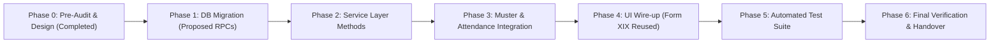

# AVENCIS WORKFORCE MANAGEMENT (WFM)
# MILESTONE 2.4E: PAYROLL MANAGEMENT
## MASTER TECHNICAL IMPLEMENTATION PLAN (REVISED)

> **Document:** `docs/MILESTONE_2_4E_IMPLEMENTATION_PLAN.md`  
> **Status:** PROPOSED IMPLEMENTATION PLAN — PENDING APPROVAL (REVISED POST-REVIEW)  
> **Target Milestone:** 2.4E (Payroll Management & Payslips)  
> **Author:** Antigravity Engineering (Google DeepMind)  

---

## 1. IMPLEMENTATION WORKSTREAMS & SEQUENCING

Milestone 2.4E is structured into six strictly sequential phases incorporating all approved decisions:

---

## 2. PHASE-BY-PHASE EXECUTION PLAN

### Phase 1: Database Migration (Additive & Corrective) [PROPOSED]
- **Target File:** `supabase/migrations/20261115000018_payroll_engine_baseline.sql` (Prepared — **NOT EXECUTED**)
- **Key Deliverables:**
  1. Additive columns on `payroll_items`:
     - `basic_pay NUMERIC(12,2) NOT NULL DEFAULT 0`
     - `hra NUMERIC(12,2) NOT NULL DEFAULT 0`
     - `conveyance NUMERIC(12,2) NOT NULL DEFAULT 0`
     - `special_allowance NUMERIC(12,2) NOT NULL DEFAULT 0`
     - `overtime_pay NUMERIC(12,2) NOT NULL DEFAULT 0`
     - `pf_employer NUMERIC(12,2) NOT NULL DEFAULT 0`
     - `esic_employer NUMERIC(12,2) NOT NULL DEFAULT 0`
  2. Transactional Stored Procedure:
     `public.generate_payroll_run(p_client_id UUID, p_month INT, p_year INT)`
     - Verifies reviewer identity from `auth.uid()`.
     - **Attendance Finalization Check:** Ensures zero `PENDING` regularisations exist for period; aborts if unresolved.
     - Ingests finalized muster from `daily_attendance_records` (9-status counts, zero late deductions).
     - Prorates fixed base components using client divisor.
     - Evaluates configurable EPF rules, ESIC wage threshold, and state PT schedules.
     - Leaves `overtime_pay` at 0.00 until manual authorized entry.
     - Writes `payroll_runs` and `payroll_items` in a single atomic transaction.
  3. Transactional Stored Procedure:
     `public.lock_payroll_run(p_run_id VARCHAR, p_approved_by VARCHAR)`
     - Re-verifies zero pending regularisations.
     - Transitions status from `approved` to `locked`.
     - Generates published payslip records in `payslips` (`is_published = TRUE`).
     - Appends critical severity entry into `audit_logs`.

### Phase 2: Domain Service Layer (`payrollService.ts`) [PROPOSED]
- **Target File:** `src/services/payrollService.ts`
- **New Service Methods:**
  1. `calculatePayrollRun(clientId, month, year)`: Dispatches live RPC `generate_payroll_run` or falls back to robust store calculation.
  2. `updatePayrollItemOverrides(itemId, incentives, overtimePay)`: Authorises variable incentives and manual overtime during `REVIEW` stage.
  3. `approvePayrollRun(runId, approvedBy)`: Transitions run to `approved`.
  4. `lockAndPublishPayrollRun(runId, approvedBy)`: Dispatches live RPC `lock_payroll_run`.
  5. `verifyAttendanceFinalized(clientId, month, year)`: Pre-flight validator checking for pending regularisations.

### Phase 3: Muster & Statutory Calculation Helper [PROPOSED]
- **Target File:** `src/services/payrollCalculationHelper.ts` (New module)
- **Deliverables:**
  - `aggregateMonthlyAttendance(records, month, year)`:
    - Counts `PRESENT`, `ON_DUTY`, `WEEKLY_OFF`, `HOLIDAY` (1.0 paid).
    - Counts `PAID_LEAVE` (1.0 paid).
    - Counts `HALF_DAY` (0.5 paid, 0.5 unpaid).
    - Counts `UNPAID_LEAVE` and `ABSENT` (1.0 unpaid).
    - **No automatic late deduction** (`LATE` counts as 1.0 paid).
  - `calculateIndianStatutoryDeductions(basic, gross, state, policy)`:
    - Evaluates configurable EPF, ESIC (Gross $\le$ ₹21k), PT state schedules, and configurable TDS.

### Phase 4: UI Stitch Screen Integration [PROPOSED]
- **Target Files:**
  - `src/app/workspace/PayrollDashboard.tsx`: Wire to live `payrollService.getPayrollRuns`.
  - `src/app/workspace/PayrollGuidedWizard.tsx`:
    - Step 1: Enforce Attendance Finalization Gate (Blocks run if pending regularisations exist).
    - Step 2: Display muster summary without automatic late deductions.
    - Step 3: Provide input fields for **Authorised Overtime** and Variable Incentives.
    - Step 4: Display statutory breakdown with configurable TDS.
    - Step 5: Executive sign-off and immutable lock.
  - `src/app/workspace/PayslipManagement.tsx`: Connect payslip register to live `getPayslips`.
  - `src/app/workspace/OfficialPayslipView.tsx`: Hydrate approved Form XIX printable template from live line-item records.
  - `src/app/portal/EmployeePortal.tsx`: Hydrate employee personal payslips tab.

### Phase 5: Automated Testing Suite [PROPOSED]
- **Target Files:**
  - `scripts/testPayrollMath.ts`: Pure unit tests for proration, EPF ceiling rules, ESIC thresholds, state PT, and integer rounding.
  - `scripts/testPayrollService.ts`: Service layer mock, attendance finalization gate, and locked batch tamper guards.
  - `scripts/testPayrollIntegration.ts`: Full attendance -> leave -> payroll -> payslip lifecycle test.
  - Target: **25+ new automated test cases** adding to the existing 196 tests (Target: 220+ tests passing 100%).

### Phase 6: Post-Implementation Audit & Handover Gate [PROPOSED]
- Execute `npx tsc --noEmit` (0 errors).
- Execute `npm run build` (Clean production bundle).
- Execute full automated test suite (100% pass rate).
- Present post-implementation audit report and request user approval.

---

## 3. PROPOSED FILES TO CREATE OR MODIFY

| File Path | Action | Description |
| :--- | :---: | :--- |
| `supabase/migrations/20261115000018_payroll_engine_baseline.sql` | **CREATE** | Stored procedures `generate_payroll_run`, `lock_payroll_run`, and item column additions. |
| `src/services/payrollCalculationHelper.ts` | **CREATE** | Pure mathematical helper for attendance aggregation and statutory deductions. |
| `src/services/payrollService.ts` | **MODIFY** | Add calculation, approval, locking, override, and attendance validation methods. |
| `src/data/store.ts` | **MODIFY** | Replace mock stubs with realistic attendance muster aggregation. |
| `src/app/workspace/PayrollDashboard.tsx` | **MODIFY** | Wire to live service queries with loading skeleton and error states. |
| `src/app/workspace/PayrollGuidedWizard.tsx` | **MODIFY** | Connect 5-step wizard with attendance gate and manual overtime input. |
| `src/app/workspace/PayslipManagement.tsx` | **MODIFY** | Connect payslip register to live `getPayslips`. |
| `src/app/workspace/OfficialPayslipView.tsx` | **MODIFY** | Hydrate Form XIX payslip from live line-item records. |
| `src/app/portal/EmployeePortal.tsx` | **MODIFY** | Hydrate employee personal payslips tab. |
| `scripts/testPayrollMath.ts` | **CREATE** | Pure unit test suite for statutory and proration math. |
| `scripts/testPayrollIntegration.ts` | **CREATE** | Integration test suite for full payroll lifecycle. |
