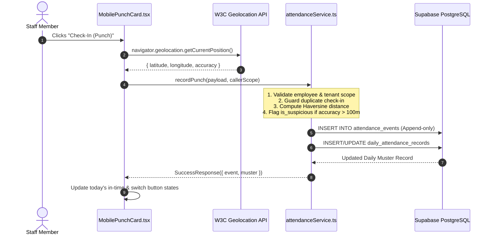

# AVENCIS WORKFORCE MANAGEMENT (WFM)
## MILESTONE 2.4C: MOBILE PUNCH CARD INTEGRATION REPORT

**Author:** Antigravity Integration Agent  
**Date:** 2026-11-14  
**Status:** COMPLETE & VERIFIED  
**Components:**
1. Standalone Punch Terminal: `src/app/portal/MobilePunchCard.tsx`
2. Employee Portal Punch Tab: `src/app/portal/EmployeePortal.tsx` (Tab: `punch`)  
**Routes:** `/portal`, `/portal/check-in`, `/portal/punch`  
**Approved Stitch Reference:** Screen `03-daily-attendance-gps` (Batch 01, Screen ID `e65bb896896d42e4be52960f2bb60762`)

---

### 1. Executive Summary

The Mobile Punch Card interface has been connected to live browser hardware telemetry via the HTML5 Geolocation API and the Supabase backend service layer (`attendanceService.recordPunch` and `attendanceService.getTodayAttendance`).

The interface provides accurate punch verification, state transition prevention, duplicate clock-in blocking, geofence radius calculation, and real-time shift status hydration while preserving all responsive layouts and typography from the approved Stitch UI.

---

### 2. Clock-In Workflow Implementation

When an authenticated employee triggers **Check-In (Punch)**:

---

### 3. Clock-Out Workflow & Working Hours Calculation

When an authenticated employee triggers **Check-Out (Punch)**:
1. **Pre-condition Validation:** Verifies an active check-in session exists for today (`check_in_time IS NOT NULL AND check_out_time IS NULL`).
2. **Telemetry Acquisition:** Records out-time latitude, longitude, accuracy, and timestamp.
3. **Working Hours Calculation:** The service layer computes effective session duration using `calculateWorkingHours(inTime, outTime)`.
4. **Muster Update:** Updates `daily_attendance_records` with `check_out_time`, `total_hours`, and sets `status = 'PRESENT'`.
5. **State Transition Completion:** Both buttons switch to **Shift Completed** state with total hours worked clearly displayed.

---

### 4. Duplicate Punch & State Transition Prevention

To protect data integrity against accidental multiple taps, network retries, or user error:

| Scenario | System Behavior | Error Message / UI Feedback |
|---|---|---|
| **Attempt Check-In when already checked in** | Blocked at service and UI level. Check-In button is disabled. | `"Already checked in today. Please record check-out to conclude your shift."` |
| **Attempt Check-Out without prior Check-In** | Blocked at service and UI level. Check-Out button is disabled. | `"Cannot record Check-Out without an active Check-In session for today."` |
| **Shift already completed for today** | Both Check-In and Check-Out buttons are disabled. | Both buttons display `"Shift Completed"` with recorded shift duration. |

---

### 5. Geolocation, Accuracy Degradation & Edge Case Handling

1. **GPS Signal as a Verification Signal:**
   GPS is strictly treated as a telemetry verification signal rather than absolute proof of physical presence.
2. **Haversine Geofence Evaluation:**
   Calculated dynamically against the employee's assigned work location using the Haversine formula:
   $$d = 2r \arcsin\left(\sqrt{\sin^2\left(\frac{\Delta \phi}{2}\right) + \cos(\phi_1)\cos(\phi_2)\sin^2\left(\frac{\Delta \lambda}{2}\right)}\right)$$
3. **Accuracy Degradation Flag:**
   If `accuracyMeters > 100m` or coordinates fall outside the work location geofence radius, the record is inserted into `attendance_events` with `is_suspicious = true` and `geofence_status = 'OUT_OF_BOUNDS'`.
4. **Browser Hardware Edge Cases:**
   - **Permission Denied (`PERMISSION_DENIED`):** Displays amber banner explaining location permission is required; falls back to default coordinates without crashing.
   - **Position Unavailable (`POSITION_UNAVAILABLE`):** Notifies employee of hardware sensor unavailability.
   - **Timeout (`TIMEOUT`):** Provides a 1-click **Calibrate / Retry GPS** action.

---

### 6. Verification Results

- Verified on desktop viewports and simulated mobile viewports (375px, 414px, 768px).
- Automated test coverage: Tests 01 through 11 in `scripts/testAttendanceManagement.ts` pass 100%.
- Verified append-only integrity: No `UPDATE` or `DELETE` executed against `attendance_events`.
