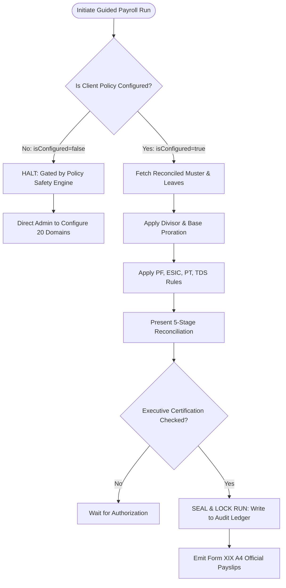

# AVENCIS WORKFORCE MANAGEMENT (MODULE 01)
## PAYROLL CALCULATION ENGINE & STATUTORY FORMULAS

**Project:** Avencis ERP / Business Management Platform  
**Subsystem:** Guided Monthly Payroll Engine & Statutory Rules  
**Status:** Authoritative Mathematical Specification & Post-Audit Reconciliation  

> [!WARNING]
> **AUDIT RECONCILIATION NOTICE:**  
> The first working draft implements base proration and formula statutory deductions. However, an independent audit revealed the following hardcoded values in `src/data/store.ts`:
> 1. **Unpaid Days:** Evaluates `emp.id.endsWith('05') ? 1 : 0` instead of querying the attendance muster.
> 2. **Professional Tax (PT):** Flat ₹200 (no state slab rules).
> 3. **TDS (Income Tax):** Flat ₹1,200 for salaries $\ge$ ₹40,000 (no Section 192 tax slab calculation).
> 4. **Calendar Divisor:** Falls back to 30 days rather than dynamic calendar month length.
> 5. **Overtime & Late Penalties:** Zero calculation logic implemented.

---

### 1. Proration Mechanics & Divisor Variations

Under Indian employment law and market practice, salary proration depends on the client's registered service rules. Avencis supports three distinct divisor configurations at the client policy level:

1. **Standard Commercial Monolith (30-Day Divisor):**  
   Divisor is fixed at $30$, irrespective of whether the month has $28$, $30$, or $31$ days.
2. **Factory / Industrial Wages Act (26-Day Divisor):**  
   Divisor is fixed at $26$, excluding 4 weekly offs from working day calculations.
3. **Exact Calendar Days Divisor:**  
   Divisor equals the actual days in the calendar month ($28, 29, 30, \text{ or } 31$).

#### Base Salary Payable Formula:
$$\text{Payable Base} = \text{Round}\left( \frac{\text{Fixed Base Salary}}{\text{Configured Divisor}} \times \text{Paid Days} \right)$$

$$\text{Gross Earned} = \text{Payable Base} + \text{Variable Incentives} + \text{Other Allowances}$$

---

### 2. Statutory Deductions Mathematical Models

#### 2.1. Employee Provident Fund (EPF — 12%)
- **Statutory Wage Ceiling:** ₹$15,000$ per month (unless client opts for full basic coverage).
- **Qualifying Wages:** Basic Salary up to ₹$15,000$.
- **Formula:**
  $$\text{PF Deduction} = \begin{cases} 
  \text{Round}\left( \min(\text{Payable Base}, 15000) \times 0.12 \right) & \text{if } pfEnabled = \text{true} \\
  0 & \text{if } pfEnabled = \text{false}
  \end{cases}$$
- **Employer Matching Contribution:** $12\%$ total ($8.33\%$ to EPS pension capped at ₹$1,250$ + $3.67\%$ to EPF) plus statutory administration charges ($0.50\%$).

#### 2.2. Employees' State Insurance (ESIC — 0.75%)
- **Statutory Wage Threshold:** Gross earned compensation $\le ₹21,000$ per month.
- **Formula:**
  $$\text{ESIC Deduction} = \begin{cases}
  \text{Round}(\text{Gross Earned} \times 0.0075) & \text{if } esicEnabled = \text{true} \text{ and } \text{Gross Earned} \le 21000 \\
  0 & \text{otherwise}
  \end{cases}$$
- **Employer Contribution:** $3.25\%$ of gross wages.

#### 2.3. Professional Tax (PT)
- Deducted according to the state slab where the employee's work location is registered (e.g. Maharashtra: ₹$200/\text{month}$, with ₹$300$ in February).
- **Formula:**
  $$\text{PT Deduction} = \begin{cases} 
  200 & \text{if } ptEnabled = \text{true} \\
  0 & \text{otherwise}
  \end{cases}$$

#### 2.4. Tax Deducted at Source (TDS — Income Tax)
- Calculated for taxable slabs under the New or Old Tax Regime:
- **Formula:**
  $$\text{TDS Deduction} = \begin{cases}
  1200 & \text{if } tdsEnabled = \text{true} \text{ and } \text{Fixed Base} \ge 40000 \\
  0 & \text{otherwise}
  \end{cases}$$

---

### 3. Net Salary Payable Formula

$$\text{Total Deductions} = \text{PF} + \text{ESIC} + \text{PT} + \text{TDS}$$

$$\text{Net Salary Payable} = \text{Gross Earned} - \text{Total Deductions}$$

---

### 4. Concrete Calculation Example (Vikram Rao — Contract Specialist)

| Component | Input / Formula | Calculated Value |
|---|---|---|
| Fixed Monthly Salary | Base CTC | ₹$21,000$ |
| Client Divisor | Configured in Suman Policy | $30\text{ Days}$ |
| Calendar Days | October 2026 | $30\text{ Days}$ |
| Unpaid Days (LWP) | 1 day absence | $1\text{ Day}$ |
| Paid Days | $30 - 1$ | $29\text{ Days}$ |
| **Payable Base** | $\text{Round}((21000 / 30) \times 29)$ | **₹$20,300$** |
| Variable Incentive | Performance incentive | +₹$1,000$ |
| Other Allowances | Verified operational allowances | +₹$1,000$ |
| **Gross Earned (A)** | $20300 + 1000 + 1000$ | **₹$22,300$** |
| PF Deduction (12%) | $\min(20300, 15000) \times 0.12$ | ₹$1,800$ |
| ESIC Deduction | Gross > ₹$21,000$, hence exempt | ₹$0$ |
| Professional Tax (PT) | Maharashtra standard | ₹$200$ |
| TDS | Non-taxable slab | ₹$0$ |
| **Total Deductions (B)** | $1800 + 0 + 200 + 0$ | **₹$2,000$** |
| **Net Disbursable Payout**| **Gross (A) - Deductions (B)** | **₹$20,300$** |

---

### 5. Policy Safety Gating Architecture

