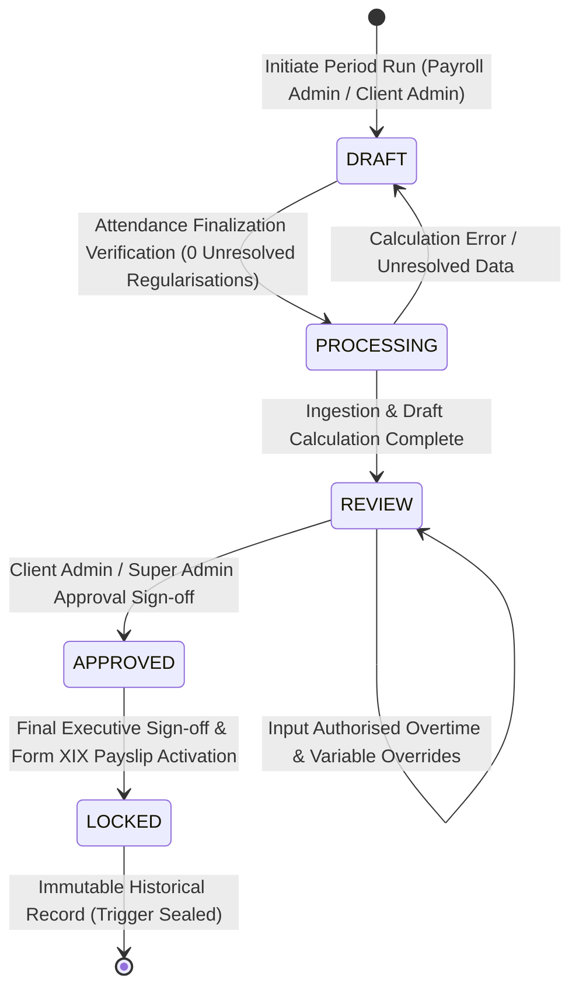

# AVENCIS WORKFORCE MANAGEMENT (WFM)
# MILESTONE 2.4E: PAYROLL MANAGEMENT
## PAYROLL DOMAIN ARCHITECTURE & SYSTEM DESIGN (REVISED)

> **Document:** `docs/PAYROLL_DOMAIN_DESIGN.md`  
> **Status:** AUTHORITATIVE ARCHITECTURAL SPECIFICATION (REVISED POST-REVIEW)  
> **Milestone:** 2.4E (Payroll Management)  
> **Author:** Antigravity Engineering (Google DeepMind)  

---

## 1. REVISED LIFECYCLE & STATE MACHINE GOVERNANCE

The payroll processing lifecycle enforces a deterministic 5-stage progression with strict separation of duties, role-based authorization gates, and an unyielding attendance finalization check:



### Stage Details & Governance:

| State | Allowed Transitions | Permitted Roles | Actions Allowed | Validation & Compliance Gates |
| :--- | :--- | :--- | :--- | :--- |
| **`DRAFT`** | `PROCESSING`, `DELETED` | `payroll_admin`, `client_admin`, `super_admin` | Select period, select legal employer scope, inspect eligible employee headcount. | 1. Client policy must be `is_configured = TRUE`.<br>2. **Attendance Finalization Gate:** Zero unresolved attendance regularisations for the period. |
| **`PROCESSING`** | `REVIEW`, `DRAFT` | System / Service Engine | Ingest finalized muster (`daily_attendance_records`), apply client divisor proration, compute earnings and statutory contributions. | All eligible employees must have active salary structures and verified work location mappings. |
| **`REVIEW`** | `PROCESSING` (Recalculate), `APPROVED`, `DRAFT` | `payroll_admin`, `client_admin` | Inspect aggregate metrics, review individual employee line items, enter **authorised overtime hours/amounts**, input approved variable incentives. | Total net pay $\ge 0$ for all employees; zero negative net pay shortfalls. |
| **`APPROVED`** | `LOCKED`, `REVIEW` (Revert) | `client_admin`, `super_admin` | Formal corporate sign-off on calculated payroll batch; locks variable earnings adjustments. | Segregation of duties: Reviewer cannot be the sole unverified submitter. |
| **`LOCKED`** | *Terminal State* | `client_admin`, `super_admin` | Finalizes batch, triggers automated creation of Form XIX payslip registry (`is_published = TRUE`). | Triggers `trg_guard_payroll_run_lock` and `trg_guard_payroll_items_lock` activate; batch is 100% immutable. |

---

## 2. PAYROLL GROUPING: LEGAL EMPLOYER & PROCESSING RESPONSIBILITY

The system separates corporate entity dimensions to support varied deployment and staffing models without cross-tenant pollution:

```
+----------------------------------------------------------------------------------------------------+
| A. TENANT SCOPE               | clients (Primary isolation boundary enforced by RLS)               |
| B. LEGAL EMPLOYER             | client_legal_entities (Holds PAN, TAN, PF/ESIC Code, Form XVI/XIX) |
| C. PROCESSING RESPONSIBILITY  | Avencis WFM Internal Operations vs. Client Internal Payroll        |
| D. WORK LOCATION              | work_locations (Physical site; determines Professional Tax State)  |
| E. DEPARTMENT                 | departments (Internal cost center)                                 |
+----------------------------------------------------------------------------------------------------+
```

### Schema Relationship & Grouping Behavior:
- Under the existing schema, `payroll_runs` carries `CONSTRAINT unq_client_period UNIQUE (client_id, period_month, period_year)` and `legal_entity_id UUID REFERENCES client_legal_entities(id)`.
- **Single Consolidated Master Run with Sub-Entity Partitioning:**  
  Within a tenant's monthly payroll run, each individual line item in `payroll_items` is tied via `employee_id` to `employees.legal_entity_id`.
- **Legal Compliance Reporting:** Statutory returns (PF ECR, ESIC Monthly Challan, State PT Schedules, Form XIX Payslips) are partitioned and grouped strictly by the employee's **Legal Employer (`client_legal_entities`)**, rather than solely by employment arrangement.

---

## 3. EARNINGS ARCHITECTURE & OVERTIME POLICY

### 3.1 Standard Prorated Monthly Components
1. **Basic Salary (`basic_pay`):** Prorated based on effective paid days vs. client divisor.
2. **House Rent Allowance (`hra`):** Prorated allowance based on salary structure definition.
3. **Conveyance & Fixed Allowances:** Prorated based on effective paid days.
4. **Special Allowance (`special_allowance`):** Prorated balancing component.

### 3.2 Overtime Earnings Policy [REVISED DECISION]
- **Strict Human Authorization:** In accordance with corporate governance decisions, **payable overtime is NOT inferred automatically from raw attendance hours alone.**
- **Workflow:**
  1. The attendance command center provides visibility into excess hours logged.
  2. Overtime hours/amounts must be formally approved and entered by an authorised administrator during the `REVIEW` stage.
  3. The approved amount is recorded in `payroll_items.overtime_pay` and incorporated into gross earnings.

### 3.3 Late Arrival Policy [REVISED DECISION]
- **No Automatic Salary Deductions:** In accordance with corporate decisions, **no automatic wage deductions or arbitrary 0.5-day penalties will be imposed for late arrivals.**
- Punctuality tracking remains an administrative and operational metric in Attendance Management; payroll deductions are strictly restricted to verified full unpaid days (`UNPAID_LEAVE`, `ABSENT`) and formal half-day leave (`HALF_DAY`).

---

## 4. DEDUCTIONS ARCHITECTURE & STATUTORY COMPLIANCE

### 4.1 Employee Provident Fund (EPF — 12%) [REVISED DECISION]
- **Configurable Statutory Rules:** The calculation engine supports configurable statutory rules rather than a universal ₹15,000 ceiling or universal uncapped calculation.
- **Rule Resolution:**
  - Evaluates client policy and employee salary structure configuration.
  - Standard statutory ceiling: 12% of $\min(\text{Payable Basic}, 15000)$.
  - Opted uncapped coverage: 12% of full Payable Basic.
  - Effective dating tracks historical statutory rule changes.

### 4.2 Employees' State Insurance (ESIC — 0.75%)
- Applies 0.75% to Gross Earned wages when total monthly remuneration $\le ₹21,000$.
- If Gross Remuneration exceeds ₹21,000, employee is statutorily exempt for that contribution period.

### 4.3 Professional Tax (PT — State Schedules)
- Keyed to the employee's physical work location state (`work_locations.state`).
- Ingested dynamically from `statutory_pt_slabs` (e.g. Maharashtra standard ₹200 with February ₹300 adjustment).

### 4.4 Tax Deducted at Source (TDS — Section 192) [REVISED DECISION]
- **Removal of Arbitrary Flat Placeholder:** The legacy flat ₹1,200 placeholder in `store.ts` is completely removed.
- **Configurable Withholding & Statutory Pathway:**
  1. **Phase 1 Implementation:** Each employee's salary record specifies a verified monthly tax withholding instruction (`tds_withholding_amount`) derived from their selected tax regime (New Tax Regime u/s 115BAC or Old Regime).
  2. **Statutory Validation Boundary:** Annual tax projection, Chapter VI-A investments (80C, 80D, 80G), HRA exemption verification, and annual true-up require professional statutory compliance validation before automated tax deduction algorithms can be certified for legal remittance.

---

## 5. PAYSLIP DELIVERY & ARTIFACT LIFECYCLE [REVISED DECISION]

1. **Reuse Approved Form XIX Printable Interface:**
   - Milestone 2.4E reuses and activates the approved Stitch Form XIX printable interface (`OfficialPayslipView.tsx`).
   - Hydrated directly from verified database line items (`payroll_items` and `employee_salary_structures`).
   - Browser-native print engine (`window.print()`) provides immediate, zero-overhead A4 printable payslips with print media styling.
2. **Subsequent PDF Engine:**
   - Asynchronous PDF generation and cloud storage uploads (`payslips.storage_pdf_url`) remain staged for subsequent implementation without blocking core payroll processing.
