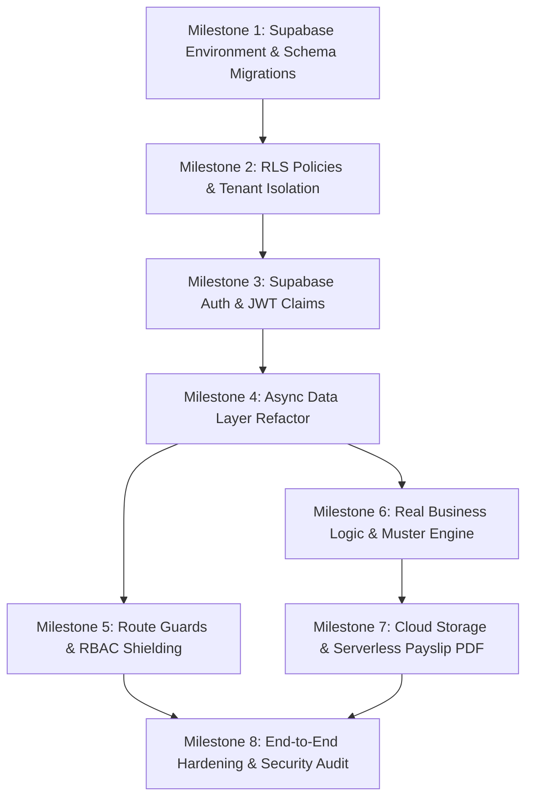

# AVENCIS WORKFORCE MANAGEMENT (WFM)
## PHASE 2 IMPLEMENTATION ROADMAP & TECHNICAL BACKEND SPECIFICATION

**Project:** Avencis ERP / Business Management Platform  
**Module:** Workforce Management (WFM) — Attendance & Payroll  
**Stage:** Phase 2 — Production Backend & Supabase Integration  
**Status:** Authoritative Execution Plan & Technical Architecture Roadmap  

---

## 1. Executive Strategy & Guiding Principles

The Phase 1 implementation successfully delivered high-fidelity UI templates, responsive mobile portal interfaces, client switching, and in-memory mock workflows across all 29 approved Stitch screens.

Phase 2 transitions the platform from a simulated client-side prototype into an enterprise-grade, secure, multi-tenant cloud application backed by Supabase (PostgreSQL 15+, Supabase Auth, Row Level Security, Edge Functions, and Object Storage).

### Mandatory Non-Negotiables for Phase 2
1. **Preserve Approved Visual Design:** Zero redesigns or UI drift. All 29 Stitch screens, layout structures, typography, and Avencis branding elements must remain pixel-accurate.
2. **Server-Side Security Enforcement:** Zero trust in frontend guards. Tenant isolation, role-based access, and permission checks must be enforced at the database level via Postgres Row Level Security (RLS).
3. **Audit Trail Immutability:** Raw attendance punches, biometric/GPS telemetry, and locked payroll batches must be cryptographically immutable.
4. **Asynchronous Architecture:** Refactor `src/data/store.ts` into a typed, asynchronous service layer (`src/services/`) interacting with Supabase via `@supabase/supabase-js`.

---

## 2. Implementation Milestones & Work Breakdown Structure



---

### Milestone 1: Database & Supabase Environment Setup
**Objective:** Establish the Supabase project configuration, local development harness, environment variable management, and execute the complete baseline relational schema migrations.

#### Tasks & Technical Specifications:
1. **Package Installation & Environment Configuration:**
   - Install dependencies: `npm install @supabase/supabase-js @types/node`.
   - Create `.env.example`, `.env.development`, and `.env.production` files:
     ```env
     VITE_SUPABASE_URL=https://<project-ref>.supabase.co
     VITE_SUPABASE_ANON_KEY=eyJhbGciOi...
     SUPABASE_SERVICE_ROLE_KEY=eyJhbGciOi... # Server/Edge functions only
     ```
   - Create Supabase client singleton in `src/lib/supabase.ts` with strict TypeScript types generated from the database schema.
2. **Supabase CLI & Migration Suite:**
   - Initialise Supabase CLI: `npx supabase init`.
   - Create structured SQL migration files in `supabase/migrations/`:
     - `20261103000001_create_clients_and_entities.sql`: `clients`, `client_legal_entities`.
     - `20261103000002_create_locations_and_departments.sql`: `work_locations`, `departments`.
     - `20261103000003_create_client_policies.sql`: `client_policies` (with all 20 rule domains).
     - `20261103000004_create_employees_and_profiles.sql`: `employees`, `user_profiles`.
     - `20261103000005_create_attendance_tables.sql`: `attendance_events`, `daily_attendance_records`.
     - `20261103000006_create_corrections_and_exceptions.sql`: `attendance_corrections`.
     - `20261103000007_create_leave_tables.sql`: `leave_balances`, `leave_requests`.
     - `20261103000008_create_payroll_tables.sql`: `payroll_runs`, `payroll_items`.
     - `20261103000009_create_audit_logs.sql`: `audit_logs` (tamper-evident log).
     - `20261103000010_create_statutory_reference_tables.sql`: `statutory_pt_slabs`, `statutory_holidays`.
3. **Database Seed Harness:**
   - Create `supabase/seed.sql` populating identical seed records from `src/data/mockData.ts` to ensure development continuity for Suman Technologies, Maha India Logistics, and Apex Precision.

#### Acceptance Criteria:
* `npx supabase db reset` runs cleanly without SQL syntax or foreign-key constraint errors.
* TypeScript types are generated via `npx supabase gen types typescript --local > src/types/database.types.ts`.
* Client code connects to Supabase successfully.

---

### Milestone 2: Row Level Security (RLS) & Multi-Tenant Isolation
**Objective:** Guarantee complete, mathematically provable multi-tenant isolation at the database layer.

#### Tasks & Technical Specifications:
1. **Enable RLS across all 12 tables:**
   ```sql
   ALTER TABLE clients ENABLE ROW LEVEL SECURITY;
   ALTER TABLE client_legal_entities ENABLE ROW LEVEL SECURITY;
   ALTER TABLE work_locations ENABLE ROW LEVEL SECURITY;
   ALTER TABLE departments ENABLE ROW LEVEL SECURITY;
   ALTER TABLE client_policies ENABLE ROW LEVEL SECURITY;
   ALTER TABLE employees ENABLE ROW LEVEL SECURITY;
   ALTER TABLE attendance_events ENABLE ROW LEVEL SECURITY;
   ALTER TABLE daily_attendance_records ENABLE ROW LEVEL SECURITY;
   ALTER TABLE attendance_corrections ENABLE ROW LEVEL SECURITY;
   ALTER TABLE leave_balances ENABLE ROW LEVEL SECURITY;
   ALTER TABLE leave_requests ENABLE ROW LEVEL SECURITY;
   ALTER TABLE payroll_runs ENABLE ROW LEVEL SECURITY;
   ALTER TABLE payroll_items ENABLE ROW LEVEL SECURITY;
   ALTER TABLE audit_logs ENABLE ROW LEVEL SECURITY;
   ```
2. **Tenant & Role-Based Helper Functions:**
   ```sql
   CREATE OR REPLACE FUNCTION public.get_user_role() RETURNS text AS $$
     SELECT COALESCE(auth.jwt() -> 'app_metadata' ->> 'role', 'employee');
   $$ LANGUAGE sql STABLE;

   CREATE OR REPLACE FUNCTION public.get_user_client_id() RETURNS text AS $$
     SELECT auth.jwt() -> 'app_metadata' ->> 'client_id';
   $$ LANGUAGE sql STABLE;
   ```
3. **Execute Core Security Policies:**
   - **Super Admin Policy (Global):**
     ```sql
     CREATE POLICY "Super admin full access" ON employees
     FOR ALL TO authenticated
     USING (public.get_user_role() = 'super_admin');
     ```
   - **Client Admin Policy (Tenant Scoped):**
     ```sql
     CREATE POLICY "Client admin scoped access" ON employees
     FOR ALL TO authenticated
     USING (public.get_user_role() = 'client_admin' AND client_id = public.get_user_client_id());
     ```
   - **Employee Self Policy:**
     ```sql
     CREATE POLICY "Employee read self record" ON employees
     FOR SELECT TO authenticated
     USING (auth.get_user_role() = 'employee' AND id = auth.jwt() -> 'app_metadata' ->> 'employee_id');

     CREATE POLICY "Employee read self payslips" ON payroll_items
     FOR SELECT TO authenticated
     USING (auth.get_user_role() = 'employee' AND employee_id = auth.jwt() -> 'app_metadata' ->> 'employee_id');
     ```
   - **Payroll Run Protection Policy:**
     ```sql
     CREATE POLICY "Only authorized admins write payroll" ON payroll_runs
     FOR ALL TO authenticated
     USING (auth.get_user_role() IN ('super_admin', 'client_admin'))
     WITH CHECK (auth.get_user_role() IN ('super_admin', 'client_admin'));
     ```

#### Acceptance Criteria:
* An authenticated employee query to `supabase.from('payroll_items').select('*')` returns strictly their own records.
* A client admin querying `employees` never receives records belonging to another `client_id`.
* Any direct API write or modification to `payroll_runs` by an unprivileged token returns Postgres HTTP 403 Forbidden.

---

### Milestone 3: Supabase Authentication Integration
**Objective:** Replace client-side mock authentication and demo persona switcher with authentic Supabase Auth sessions, email/password or Magic Link verification, and secure cookie/JWT session persistence.

#### Tasks & Technical Specifications:
1. **Supabase Auth Hook for JWT Custom Claims:**
   - Implement Postgres trigger on `auth.users` to inject `role`, `client_id`, and `employee_id` directly into the issued JWT:
     ```sql
     CREATE OR REPLACE FUNCTION public.handle_user_claims()
     RETURNS trigger AS $$
     DECLARE
       v_profile record;
     BEGIN
       SELECT role, client_id, employee_id INTO v_profile 
       FROM public.user_profiles 
       WHERE auth_user_id = NEW.id;

       IF FOUND THEN
         NEW.raw_app_meta_data = NEW.raw_app_meta_data || 
           jsonb_build_object(
             'role', v_profile.role,
             'client_id', v_profile.client_id,
             'employee_id', v_profile.employee_id
           );
       END IF;
       RETURN NEW;
     END;
     $$ LANGUAGE plpgsql SECURITY DEFINER;
     ```
2. **Refactor `AuthContext.tsx`:**
   - Connect to `supabase.auth.signInWithPassword({ email, password })`.
   - Maintain active user state via `supabase.auth.onAuthStateChange()`.
   - Store session token in secure `localStorage` / httpOnly cookies managed by `@supabase/supabase-js`.
   - Restrict the Persona Switcher UI to `NODE_ENV === 'development'` or remove entirely in production builds.

#### Acceptance Criteria:
* Full page reload retains authentication session and active user role without unmounting or redirecting to login.
* Invalid credentials display native inline error messages.
* Logout clears JWT tokens and redirects cleanly to `/login`.

---

### Milestone 4: Data Layer Asynchronous Refactoring
**Objective:** Migrate the entire synchronous `store.ts` in-memory singleton into asynchronous service modules backed by Supabase tables and RPCs.

#### Tasks & Technical Specifications:
1. **Modular Service Directory Structure:**
   - `src/services/clientService.ts`: CRUD for clients, legal entities, locations, departments.
   - `src/services/policyService.ts`: Policy fetch and configuration updates.
   - `src/services/employeeService.ts`: Employee roster, filters, onboarding.
   - `src/services/attendanceService.ts`: Punch recording (via atomic RPC), muster aggregation.
   - `src/services/leaveService.ts`: Application, manager review, balance deduction.
   - `src/services/payrollService.ts`: Guided calculation, reconciliation, authorization, ledger lock.
   - `src/services/auditService.ts`: Query and append to immutable audit log.
2. **Atomic Attendance Punch Stored Procedure (`wfm_record_punch`):**
   - Implement an atomic Postgres RPC to ensure that (a) the immutable `attendance_event` is logged, (b) geofence validation is computed in Postgres via `ST_DWithin` (or Haversine formula), and (c) the daily aggregate `daily_attendance_record` is created or updated in a single atomic transaction.

#### Acceptance Criteria:
* Zero calls to `localStorage.setItem('avencis_wfm_...')` in application services.
* Multiple browser sessions updating records concurrently see real-time consistency.

---

### Milestone 5: Route Protection & Security Guards
**Objective:** Close all frontend URL navigation vulnerabilities in `src/App.tsx` and secure payslip viewing.

#### Tasks & Technical Specifications:
1. **Implement Enterprise Route Guard Component:**
   ```typescript
   // src/components/auth/ProtectedRoute.tsx
   interface ProtectedRouteProps {
     allowedRoles?: ('super_admin' | 'client_admin' | 'employee')[];
     requireConfiguredPolicy?: boolean;
     children: React.ReactNode;
   }
   ```
2. **Guard Application Routes in `src/App.tsx`:**
   - Wrap `/admin/*` routes with `<ProtectedRoute allowedRoles={['super_admin']}>`.
   - Wrap `/workspace/*` routes with `<ProtectedRoute allowedRoles={['super_admin', 'client_admin']}>`.
   - Wrap `/portal/*` routes with `<ProtectedRoute allowedRoles={['employee', 'client_admin', 'super_admin']}>`.
3. **Fix Payslip Parameter Tampering:**
   - Refactor `/workspace/payslips/view/:employeeId` to verify that the requesting user either:
     - Owns the payslip (`employee_id === user.employee_id`), OR
     - Is a client admin for that employee's assigned `client_id`, OR
     - Is a super admin.
   - Unauthorised access attempts must redirect to `/403` and write a `critical` security violation into `audit_logs`.

#### Acceptance Criteria:
* Direct navigation to `/admin/dashboard` while logged in as an employee redirects immediately to `/portal` or `/login`.
* Direct manipulation of URL `:employeeId` parameter to another employee returns a 403 Access Denied error.

---

### Milestone 6: Production Business Logic Realization
**Objective:** Replace all hardcoded calculation stubs with real, statutory-compliant algorithms.

#### Tasks & Technical Specifications:
1. **Dynamic Calendar Days:**
   - Replace hardcoded `30` with `new Date(year, month, 0).getDate()` to accurately reflect 28, 29, 30, or 31 days.
2. **Muster-Driven Unpaid Days (LOP):**
   - Replace `emp.id.endsWith('05') ? 1 : 0` with dynamic query:
     $$\text{Unpaid Days} = \text{Count}(\text{Unapproved Absent Days}) + \text{Sum}(\text{Approved LWP Days})$$
3. **Statutory Professional Tax (PT) Slabs:**
   - Query `statutory_pt_slabs` table based on the employee's work location state.
   - For Maharashtra: Gross $\le$ ₹7,500: ₹0; ₹7,501–₹10,000: ₹175; >₹10,000: ₹200 (₹300 in February).
4. **Statutory Tax Deducted at Source (TDS):**
   - Implement annual taxable income projection under Section 115BAC (New Tax Regime).
   - Apply standard deduction (₹75,000) and 87A rebate for income $\le$ ₹7,00,000.
5. **Overtime Calculation Engine:**
   - Accumulate daily overtime hours where `worked_hours > standard_working_hours`.
   - Multiply excess hours by configured overtime rate multiplier ($1.5\times$ or $2.0\times$ hourly base).
6. **Immutable Payroll Period Locking Trigger:**
   - Add database trigger `guard_locked_payroll_mutation` preventing any attendance event, regularisation, or leave request for dates within a finalized payroll run.

#### Acceptance Criteria:
* Payroll calculations for a 31-day month reflect 31 days.
* Adding an unapproved absent day to an employee immediately prorates their payable base salary upon next payroll preview.
* Maharashtra employees have ₹300 deducted for February and ₹200 for other months.

---

### Milestone 7: Cloud Storage & Serverless PDF Payslips
**Objective:** Replace simulated client-side payslip generation with cryptographically signed, serverless Form XIX PDF rendering backed by Supabase Storage.

#### Tasks & Technical Specifications:
1. **Supabase Storage Buckets:**
   - Create bucket `employee-avatars` (public read, authenticated write).
   - Create bucket `payslip-archives` (private read, accessible only via signed URL or RLS).
2. **Supabase Edge Function (`generate-payslip-pdf`):**
   - Implement Deno/TypeScript serverless function utilizing `@react-pdf/renderer` or `puppeteer-core`.
   - Generates official Indian Factories Act **Form XIX (Rule 78)** format:
     - Header: Registered Legal Entity Name, CIN/GSTIN, Factory/Establishment Address.
     - Section A: Employee credentials (Name, ID, Department, Designation, DOJ, PAN, UAN, PF No, ESIC No, Bank Account, IFSC).
     - Section B: Attendance reconciliation (Calendar Days, Paid Days, LOP Days, Overtime Hours).
     - Section C: Side-by-side Earnings & Deductions ledger.
     - Section D: Net Pay in words, bank payout reference, executive digital signature lock, and QR code for authenticity verification.
   - Uploads compiled PDF to `payslip-archives/{clientId}/{year}/{month}/{employeeCode}_FormXIX.pdf`.
3. **Client Integration:**
   - "Download Official Form XIX" button calls Edge Function to obtain an authenticated, short-lived signed URL (60-minute expiry).

#### Acceptance Criteria:
* Clicking "Download Official PDF" downloads a valid, high-resolution vector PDF adhering strictly to statutory Form XIX standards.
* The PDF URL is temporary and cannot be accessed publicly without authentication.

---

### Milestone 8: End-to-End Hardening & Security Audit
**Objective:** Perform automated end-to-end integration testing, penetration testing on tenant boundaries, and comprehensive performance benchmarking.

#### Tasks & Technical Specifications:
1. **Automated Test Suite (Vitest + Playwright):**
   - Write integration tests for:
     - Multi-tenant boundary isolation (verifying tenant cross-talk failure).
     - Clock-in within geofence vs. out-of-bounds flagging.
     - Leave balance debit and rejection on overdraft.
     - Proration mathematics across 28, 29, 30, and 31-day months.
     - Payroll locking immutability.
2. **Security Vulnerability Scan:**
   - Audit all API calls using OWASP Top 10 checklist.
   - Verify that all sensitive employee PII (PAN, bank details) are shielded by RLS.

---

## 3. Timeline, Sequencing & Resource Matrix

| Phase 2 Milestone | Target Duration | Dependencies | Key Technical Deliverables |
|---|---|---|---|
| **M1: Supabase Setup & Schema** | Week 1 | None | `.env`, `supabase/migrations/` (10 SQL files), `seed.sql`, TypeScript types |
| **M2: RLS Policies & Isolation** | Week 2 | M1 | Row Level Security policies across 12 tables, cross-tenant denial tests |
| **M3: Supabase Auth & JWT** | Week 3 | M1, M2 | Custom claims trigger, `AuthContext.tsx` refactor, session cookies |
| **M4: Async Data Layer** | Week 4 | M2, M3 | `src/services/` (7 service modules), atomic punch RPC |
| **M5: Route Guards & RBAC** | Week 5 | M3, M4 | `<ProtectedRoute>`, route defense in `App.tsx`, payslip authorization |
| **M6: Production Business Logic** | Week 6 | M4 | Real muster aggregation, state PT slabs, dynamic calendar days, OT calculation |
| **M7: Storage & Form XIX PDFs** | Week 7 | M6 | Supabase Storage buckets, `generate-payslip-pdf` Edge Function, Form XIX PDF |
| **M8: Hardening & Final Audit** | Week 8 | M1–M7 | Vitest/Playwright test suite, security sign-off report, production deployment |

---

## 4. Acceptance & Sign-off Criteria

Phase 2 will be deemed complete and production-ready when:
1. **0 Mock Stores:** The entire application communicates exclusively with Supabase APIs.
2. **100% RLS Coverage:** Every database table has active Row Level Security verified by automated negative test cases.
3. **Zero Plaintext Credentials:** All user authentication is governed by Supabase Auth with bcrypt-hashed passwords.
4. **Statutory Mathematical Accuracy:** Payroll proration, EPF, ESIC, PT, and TDS produce 100% mathematically correct outputs against verified Indian labour law benchmarks.
5. **Form XIX Compliance:** Official payslip generation produces genuine, printable vector PDF documents compliant with state statutory forms.
