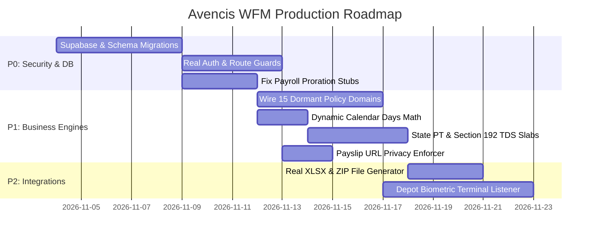

# AVENCIS WORKFORCE MANAGEMENT (MODULE 01)
## REMAINING IMPLEMENTATION BACKLOG — PRODUCTION ROADMAP

**Audit Date:** 03 November 2026  
**Auditor:** Antigravity Master Technical Audit System  
**Baseline:** First Functional Working Draft  
**Target:** Production-Grade Operational Workforce & Payroll Platform  

---

### Priority Legend

- **P0 — Critical Security & Data Integrity:** Must be implemented before any live client or worker data can be entered.
- **P1 — Core Business Logic & Compliance:** Necessary to ensure statutory and legal payroll compliance under Indian labour law.
- **P2 — Enterprise Integrations:** Required for operational automation (banking, biometric devices, file generation).
- **P3 — Polish & Scalability:** Architectural hardening and future ERP expansion.

---

### BACKLOG REGISTER



---

#### P0 — Critical Security & Data Integrity

##### P0-01: Supabase Backend Integration & Database RLS Migrations
- **Problem:** Currently, zero database integration exists. All records reside in browser memory and partial `localStorage`. Data does not synchronize across devices, and live RLS policies are inoperative.
- **Solution:**
  1. Install `@supabase/supabase-js`.
  2. Create `supabase/migrations/20261103000000_wfm_core_schema.sql` containing tables from `docs/DATABASE_SCHEMA_DOCUMENTATION.md`.
  3. Enable Row Level Security (RLS) on all tables with policies:
     ```sql
     CREATE POLICY client_admin_isolation ON employees
     FOR ALL TO authenticated
     USING (client_id = (SELECT client_id FROM user_profiles WHERE id = auth.uid()));
     ```
  4. Create `src/lib/supabaseClient.ts` and refactor `src/data/store.ts` to perform asynchronous queries.
- **Files:** `package.json`, `supabase/migrations/*.sql`, `src/lib/supabaseClient.ts`, `src/data/store.ts`.
- **Effort:** 3–5 Days.

##### P0-02: Real Authentication & Route Authorization Guards
- **Problem:** Authentication is simulated; passwords are bypassed; sessions are unencrypted in `localStorage`. Any user can navigate to `/admin/*` or `/workspace/payroll/run` by changing the browser URL.
- **Solution:**
  1. Integrate Supabase Auth (`supabase.auth.signInWithPassword`, `supabase.auth.signOut`).
  2. Implement an `<AuthGuard allowedRoles={['super_admin']} />` wrapper around protected routes in `src/App.tsx`.
  3. Validate JWT access tokens on every database request via server/RLS context.
- **Files:** `src/context/AuthContext.tsx`, `src/App.tsx`, `src/components/layout/AuthGuard.tsx`.
- **Effort:** 2–3 Days.

##### P0-03: Remove Hardcoded Payroll Unpaid Days Heuristic (`endsWith('05')`)
- **Problem:** `calculatePayrollRun` in `src/data/store.ts` calculates unpaid days using `emp.id.endsWith('05') ? 1 : 0`, completely ignoring the attendance muster and leave records.
- **Solution:**
  1. Query `daily_attendance_records` for the specified `periodMonth` and `periodYear`.
  2. Count records where `status === 'ABSENT'` or `status === 'HALF_DAY'` ($0.5\text{ days}$).
  3. Query `leave_requests` for approved requests where `leaveType === 'LWP'`.
  4. Set `unpaidDays = absentDays + (halfDays * 0.5) + lwpDays`.
- **Files:** `src/data/store.ts` (line 504), `src/app/workspace/PayrollGuidedWizard.tsx`.
- **Effort:** 1–2 Days.

##### P0-04: Full LocalStorage Persistence for All Store Collections
- **Problem:** `attendanceEvents`, `leaveBalances`, `corrections`, `legalEntities`, and `workLocations` do not persist in `localStorage` and reset to initial mock data on page refresh.
- **Solution:** Update `saveToStorage()` and `loadFromStorage()` in `src/data/store.ts` to serialize and restore all 12 collections until backend Supabase migration is complete.
- **Files:** `src/data/store.ts` (lines 54–87).
- **Effort:** 0.5 Day.

---

#### P1 — Core Business Logic & Statutory Compliance

##### P1-01: Wire the 15 Dormant Policy Domains into Computational Engines
- **Problem:** 15 of the 20 policy domains exist only as UI form fields and are never evaluated by the application logic.
- **Solution:**
  1. **Overtime (`overtimeMethod`, `overtimeRate`):** Calculate overtime pay during payroll if `daily.totalHours > policy.standardWorkingHours`.
  2. **Late Marks (`lateGraceMinutes`, `latePenaltyRule`):** Check check-in timestamp against shift start + grace minutes. Apply `deduct_half_day_per_3` to increment unpaid days.
  3. **Leave Tenure (`minServiceDaysForLeave`):** Validate employee joining date before allowing leave applications.
  4. **Leave Accruals (`monthlyPaidLeaveAccrual`):** Implement monthly balance increment routine.
- **Files:** `src/data/store.ts`, `src/app/portal/EmployeePortal.tsx`, `src/app/workspace/LeaveManagement.tsx`.
- **Effort:** 3–4 Days.

##### P1-02: Fix 26-Day Divisor Inflation & Dynamic Calendar Days Math
- **Problem:** When `salaryDivisor === '26'`, paid days are passed as 30, inflating payable base salary to $115\%$. When `salaryDivisor === 'calendar_days'`, it falls back to 30.
- **Solution:**
  1. For 26-day divisor, cap maximum paid days at 26 (excluding 4 weekly offs):
     $$\text{Paid Days (26-day)} = \min(26, \text{Calendar Days} - \text{Weekly Offs} - \text{Unpaid Days})$$
  2. For calendar divisor, compute exact days: `new Date(year, month, 0).getDate()`.
- **Files:** `src/data/store.ts` (lines 495–508).
- **Effort:** 1 Day.

##### P1-03: Implement State-Specific Professional Tax (PT) & Income Tax TDS Slabs
- **Problem:** PT is hardcoded flat ₹200; TDS is hardcoded flat ₹1,200.
- **Solution:**
  1. Add PT state lookup tables (Maharashtra, Karnataka, Gujarat, Tamil Nadu, West Bengal). Apply ₹300 February adjustment for Maharashtra.
  2. Implement an annualized TDS calculator estimating tax liability under Section 192 (standard deduction ₹75,000 under FY 2026-27 regime).
- **Files:** `src/data/store.ts`, `src/types/index.ts`.
- **Effort:** 2–3 Days.

##### P1-04: Implement Cross-Employee Payslip Privacy Guard
- **Problem:** Any logged-in user can view any employee's payslip and bank details by altering the URL parameter in `/workspace/payslips/view/:employeeId`.
- **Solution:**
  In `OfficialPayslipView.tsx`, verify:
  ```ts
  if (currentUser.role === 'employee' && currentUser.employeeId !== employee.id) {
    return <AccessDeniedNotice message="You are only authorized to view your own payslip." />;
  }
  if (currentUser.role === 'client_admin' && currentUser.clientId !== employee.clientId) {
    return <AccessDeniedNotice message="Cross-tenant access prohibited." />;
  }
  ```
- **Files:** `src/app/workspace/OfficialPayslipView.tsx`.
- **Effort:** 0.5 Day.

---

#### P2 — Enterprise Integrations & Automation

##### P2-01: Real Excel (.xlsx), CSV, and PDF ZIP Batch Exporters
- **Problem:** Clicking "Export Sheet (.xlsx)" or "Bulk PDF Export (.zip)" triggers a browser alert.
- **Solution:**
  1. Install `xlsx` or `exceljs` and `jszip`.
  2. Implement real file generation for Form II muster, Form XIV leave register, and EPF/ESIC statements.
- **Files:** `src/app/admin/ReportsAnalyticsView.tsx`, `src/app/workspace/PayslipManagement.tsx`.
- **Effort:** 2 Days.

##### P2-02: Physical Biometric Hardware TCP/IP Listener (Edge Sidecar)
- **Problem:** Hardware terminals (ZKTeco, eSSL, Matrix) cannot open raw TCP sockets from a web browser.
- **Solution:**
  Develop a lightweight Python / Node.js background edge daemon for depot LANs that polls biometric hardware via TCP port 4370 and pushes punch events to the central database via authenticated REST API.
- **Files:** `services/biometric-daemon/`.
- **Effort:** 4–6 Days.

##### P2-03: Direct Corporate Banking NEFT/RTGS Disbursement API
- **Problem:** Disbursement batches are currently manual text files.
- **Solution:**
  Integrate direct banking webhook APIs (ICICI Corporate Banking / HDFC E-CMS / RazorpayX) with dual-custody authorization for automated salary payouts.
- **Files:** `src/services/bankingService.ts`.
- **Effort:** 5–7 Days.
