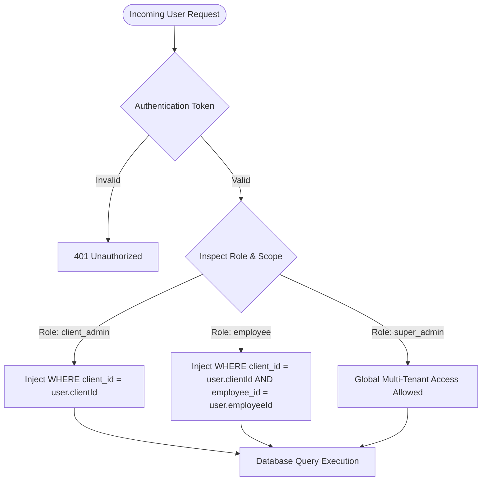

# AVENCIS WORKFORCE MANAGEMENT (MODULE 01)
## ENTERPRISE ROLE-BASED ACCESS CONTROL (RBAC) MATRIX

**Project:** Avencis ERP / Business Management Platform  
**Document Code:** RBAC-SEC-01  
**Status:** Authoritative Security Policy Specification  
**Current Draft Enforcement:** **CLIENT-SIDE UI FILTERING ONLY** (Backend & Database RLS Enforcement Scheduled for Phase 2)  

> [!WARNING]
> **AUDIT STATUS CLARIFICATION:**  
> The persona permissions below reflect the target authorization policy. In the current first functional working draft, role enforcement operates strictly through client-side React UI conditional rendering and `localStorage`.  
> There is no backend JWT verification, routes lack server-enforced route guards, and direct URL parameter manipulation allows cross-record viewing. Backend database enforcement is marked **NOT YET IMPLEMENTED**.

---

### 1. Persona Definitions

| Persona Tier | Identifier | Target Identity | Operational Scope |
|---|---|---|---|
| **Tier 01: Global Super Admin** | `super_admin` | Avencis Corporate Leadership & Platform Operations | Global master authority across all client organisations, cross-tenant switcher, client provisioning, and payroll final sealing. |
| **Tier 02: Client Admin** | `client_admin` | Client HR Directors, Payroll Controllers, Ops Managers | Strictly locked to a single client tenant. Manages legal entities, sites, client policies, employee onboarding, attendance regularisations, and payroll simulation. |
| **Tier 03: Field / Office Employee** | `employee` | Field staff, logistics operators, store associates | Personal self-service only (ESS). Mobile smartphone GPS punches, leave requests, regularisation submissions, and payslip viewing. |

---

### 2. Capability Permission Matrix

| Functional Capability | Super Admin | Client Admin | Employee (ESS) | Security & Multi-Tenant Constraint |
|---|:---:|:---:|:---:|---|
| **Client Provisioning & Setup** | ✅ Full | ❌ Denied | ❌ Denied | Only Avencis operations may onboard or suspend client tenants. |
| **Workspace Tenant Switching** | ✅ Full | ❌ Denied | ❌ Denied | Client Admin is strictly bound to `user.clientId`. |
| **Legal Entity CRUD** | ✅ Full | ✅ Scoped | ❌ Denied | Registered under client tenant holding PAN, PF, and ESIC numbers. |
| **Work Location & Geofence Definition** | ✅ Full | ✅ Scoped | ❌ Denied | Defines coordinate center and 20m–2000m radius perimeter. |
| **20 Client Policy Domains Editing** | ✅ Full | ✅ Scoped | ❌ Denied | Configured strictly at client level; zero employee overrides allowed. |
| **Employee Master Onboarding** | ✅ Full | ✅ Scoped | ❌ Denied | Requires attachment to Client Legal Entity and Work Location. |
| **Salary & Bank Details Modification** | ✅ Full | ✅ Scoped | ❌ Denied | Changes are recorded in immutable audit log. |
| **GPS Mobile Check-In / Check-Out** | ✅ Full | ✅ Scoped | ✅ Self | Validated mathematically via Haversine distance against assigned site. |
| **Live Attendance Command Center** | ✅ Full | ✅ Scoped | ❌ Denied | Displays real-time presence, geofence breaches, and late marks. |
| **Attendance Regularisation Filing** | ✅ Full | ✅ Scoped | ✅ Self | Requires missed punch timestamp and supervisor justification note. |
| **Attendance Regularisation Review** | ✅ Full | ✅ Scoped | ❌ Denied | Approval updates aggregate daily record; rejection locks status. |
| **Leave Application Submission** | ✅ Full | ✅ Scoped | ✅ Self | Validates against employee live balance ledger. |
| **Leave Application Decision (Approve/Reject)** | ✅ Full | ✅ Scoped | ❌ Denied | Automatically decrements closing balance upon approval. |
| **Guided Monthly Payroll Simulation** | ✅ Full | ✅ Scoped | ❌ Denied | Gated: blocked if client policies are `isConfigured: false`. |
| **Payroll Authorization & Locking** | ✅ Full | ❌ Denied* | ❌ Denied | Sealing payroll batch requires statutory executive sign-off. |
| **Form XIX Official A4 Payslip Rendering** | ✅ Full | ✅ Scoped | ❌ Denied | Generates official printable payslips under Payment of Wages Act. |
| **Personal Payslip Download & View** | ✅ Full | ✅ Scoped | ✅ Self | Employee can view personal payslips once batch is dispatched. |
| **Security Audit Logs Access** | ✅ Full | ✅ Tenant | ❌ Denied | Client Admin is restricted to audit events matching their `clientId`. |
| **Evaluation Persona Impersonation** | ✅ Full | ❌ Denied | ❌ Denied | Test fixture feature restricted to Super Admin sandbox evaluation. |

*\*Note: In enterprise deployments, final payroll locking is reserved for Avencis Global Admin or designated Client CFO with dual-key authentication.*

---

### 3. Tenant Boundary Enforcement Architecture

