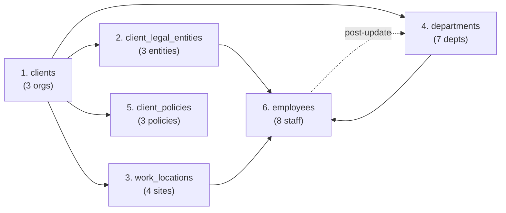

# AVENCIS WORKFORCE MANAGEMENT (WFM)
## SEED DATA ARCHITECTURAL DESIGN SPECIFICATION

**Project:** Avencis Workforce Management (WFM)  
**Target Backend:** PostgreSQL 15+ / Supabase Cloud  
**Deliverable:** `supabase/seed.sql`  
**Companion Diagnostic:** `supabase/verification/SEED_DATA_VERIFICATION.sql`  
**Design Directive:** 100% Idempotent, Safe, Non-Destructive, Demonstration Data Only  
**Status:** **AUTHORITATIVE SEED SPECIFICATION (PRE-EXECUTION)**

---

## 1. Objectives & Safety Boundaries

The purpose of `supabase/seed.sql` is to populate the database with a clean, structured set of foundational demonstration entities for multi-tenant exploration, without introducing unapproved assumptions about compensation, statutory deductions, or live credentials.

### Strict Safety Boundaries
1. **Zero Production Risk:** Contains no `DROP`, `TRUNCATE`, or unconstrained `DELETE` statements.
2. **Strict Idempotency:** Uses deterministic RFC 4122 UUIDs and `ON CONFLICT (...) DO UPDATE` logic. Re-running the script will refresh demonstration records without duplicating rows or breaking primary/foreign key relationships.
3. **Explicit Demonstration Markers:** All codes (`DEMO-*`), names (`[Demo]`), emails (`@*-demo.test`), and synthetic statutory numbers (`DEMOP*`, `0000 0000 0*`) are unmistakably identified as non-production test data.
4. **No Auth Injections:** Does not insert synthetic credentials into `auth.users` or `user_profiles`. (See Section 6 for Supabase Auth workflow).
5. **No Speculative Payroll or Banking:** Completely omits `payroll_runs`, `payroll_items`, `payslips`, `employee_salary_structures`, and `employee_bank_details` until the business model and statutory calculation formulas are formally approved.

---

## 2. Analysis of the Three Employment & Payroll Models

The Avencis WFM business requirements identify three operational employment configurations:

* **Model A:** Employees employed and paid directly by Avencis (internal staff).
* **Model B:** Employees directly employed and paid by the client organisation (standard client staff).
* **Model C:** Employees employed by Avencis but deployed at a client location (deputed staffing / PEO / EOR).

```mermaid
flowchart TD
    subgraph ModelA["Model A: Avencis Internal"]
        LE_Avencis_A["Legal Employer: Avencis"] --> Payroll_Avencis_A["Payroll: Avencis Managed"]
        Payroll_Avencis_A --> Loc_Avencis_A["Location: Avencis Corporate"]
    end

    subgraph ModelB["Model B: Direct Client"]
        LE_Client_B["Legal Employer: Client Entity"] --> Payroll_Client_B["Payroll: Self-Managed"]
        Payroll_Client_B --> Loc_Client_B["Location: Client Worksites"]
    end

    subgraph ModelC["Model C: Deputed Staffing"]
        LE_Avencis_C["Legal Employer: Avencis (PEO/EOR)"] --> Payroll_Avencis_C["Payroll: Avencis Disbursed"]
        Payroll_Avencis_C --> Client_Deployed_C["Deployed At: Client Org"]
        Client_Deployed_C --> Loc_Client_C["Location: Client Site (MIDC/SEZ)"]
    end
```



### Schema Capability & Ambiguity Assessment

| Architectural Dimension | Model A (Avencis Direct) | Model B (Client Direct) | Model C (Deputed Staffing) |
|---|---|---|---|
| **Legal Employer** | Avencis Legal Entity | Client Legal Entity | Avencis Legal Entity |
| **Payroll Paying Entity** | Avencis (`AVENCIS_MANAGED`) | Client (`SELF_MANAGED`) | Avencis (`AVENCIS_MANAGED`) |
| **Client Organisation** | Avencis Platform / Internal | Subscribing Client | Deployed Client |
| **Work Location** | Avencis Office | Client Branch / Yard | Client Branch / Yard |
| **Employment Type** | `DIRECT_PERMANENT` | `DIRECT_PERMANENT` / `DIRECT_CONTRACT` | `DEPUTED_STAFFING` |
| **Current Schema Support** | **Partially Supported** | **100% Fully Supported** | **Architecturally Ambiguous** |

#### Critical Findings & Ambiguities:
1. **Single `client_id` Constraint on `employees`:**
   - The `employees` table has a single foreign key `client_id UUID NOT NULL REFERENCES clients(id)`.
   - In **Model B**, `client_id` unambiguously identifies both the legal subscriber and the physical workplace.
   - In **Model C**, if `employee.client_id` is set to the client (e.g., Maha India Logistics), the employee appears in Maha's workspace. However, the legal employer is Avencis. While the foreign key `legal_entity_id REFERENCES client_legal_entities(id)` does not enforce that the legal entity must belong to the same `client_id`, Row Level Security (RLS) policies on `client_legal_entities` restrict client admins to viewing only their own `client_id` records. Consequently, a Maha administrator viewing a deputed employee would be blocked by RLS from joining or viewing the Avencis legal entity details.
2. **Missing Deployed Client Dimension:**
   - The schema lacks explicit columns: `deployed_client_id UUID REFERENCES clients(id)` and `vendor_staffing_partner_id UUID`.
3. **Payroll Batch Ownership for Deputed Workers:**
   - In `payroll_runs`, batches are grouped by `client_id` and `legal_entity_id`. If Avencis runs payroll for 50 deputed workers across 10 client locations, the run belongs to Avencis, but the client needs visibility into attendance and billing.
4. **Resolution in this Seed Phase:**
   - In `supabase/seed.sql`, Model B is used for standard staff, and employee `DEMO-MI-0203` (Anil Kadam) is configured with `employment_arrangement = 'DEPUTED_STAFFING'` within Maha Logistics to demonstrate the enum capability without altering the database schema prior to business approval.
5. **Schema Numeric Constraint on Overtime Rates (`NUMERIC(4,2)`):**
   - In `client_policies`, the column `overtime_rate` was created as `NUMERIC(4,2)`. A field with precision 4 and scale 2 can only store values up to `99.99` (absolute value $< 10^2$).
   - While this accommodates multipliers like `1.50x` or `2.00x`, a flat hourly overtime rate of `₹120.00/hr` causes `ERROR: 22003: numeric field overflow`.
   - In the seed data, Maha's demonstration flat rate is set to `75.00` to conform strictly to `NUMERIC(4,2)`.
   - When formal payroll calculations are approved, `overtime_rate` should be updated to `NUMERIC(8,2)` via migration to support arbitrary hourly overtime amounts (e.g. ₹150, ₹250, ₹500/hr).

---

## 3. Scope of Seeded Tables & Proposed Records

The seed script targets exactly 5 tables in strict topological order:



### 3.1 `clients` (3 Demonstration Organisations)

| Deterministic UUID | Code | Name | Industry | Status | Contact |
|---|---|---|---|:---:|---|
| `10000000-0000-0000-0000-000000000001` | `DEMO-SUMAN` | Suman Technologies & Retail [Demo] | Retail & Technology Solutions | `active` | Suresh Patil [Demo] (`demo.spatil@suman-demo.test`) |
| `10000000-0000-0000-0000-000000000002` | `DEMO-MAHA` | Maha India Logistics & Fleet [Demo] | Logistics, Fleet & Supply Chain | `active` | Vikram Deshmukh [Demo] (`demo.vdeshmukh@mahaindia-demo.test`) |
| `10000000-0000-0000-0000-000000000003` | `DEMO-APEX` | Apex Precision Engineering [Demo] | Automotive & Heavy Manufacturing | `onboarding` | Rajiv Mehra [Demo] (`demo.rmehra@apexengg-demo.test`) |

### 3.2 `client_legal_entities` (3 Demonstration Employers)

| Deterministic UUID | Client Link | Legal Name | Registration Type | PAN | Payroll Responsibility |
|---|---|---|:---:|:---:|:---:|
| `20000000-0000-0000-0000-000000000001` | `DEMO-SUMAN` | Suman Technologies Private Limited [Demo] | `PRIVATE_LIMITED` | `DEMOPS1234` | `SELF_MANAGED` |
| `20000000-0000-0000-0000-000000000002` | `DEMO-MAHA` | Maha India Logistics (India) Pvt Ltd [Demo] | `PRIVATE_LIMITED` | `DEMOPM9876` | `SELF_MANAGED` |
| `20000000-0000-0000-0000-000000000003` | `DEMO-APEX` | Apex Precision Engineering LLP [Demo] | `LLP` | `DEMOPA5544` | `AVENCIS_MANAGED` |

### 3.3 `work_locations` (4 Geofenced Sites)

| Deterministic UUID | Client Link | Location Name | Code | Lat / Long | Radius | Headcount |
|---|---|---|:---:|:---:|:---:|:---:|
| `30000000-0000-0000-0000-000000000001` | `DEMO-SUMAN` | Suman HQ — Pune Technology Park [Demo] | `LOC_DEMO_S_PUN` | 18.5913 N, 73.7389 E | 150m | 3 |
| `30000000-0000-0000-0000-000000000002` | `DEMO-SUMAN` | Suman Retail Hub — BKC Mumbai [Demo] | `LOC_DEMO_S_BOM` | 19.0664 N, 72.8682 E | 200m | 2 |
| `30000000-0000-0000-0000-000000000003` | `DEMO-MAHA` | Maha Chakan Central Depot [Demo] | `LOC_DEMO_M_CHK` | 18.7618 N, 73.8542 E | 250m | 2 |
| `30000000-0000-0000-0000-000000000004` | `DEMO-MAHA` | Maha Nagpur Freight Terminal [Demo] | `LOC_DEMO_M_NAG` | 21.0538 N, 79.0384 E | 300m | 1 |

### 3.4 `departments` (7 Organisational Units)

| Deterministic UUID | Client Link | Department Name | Code | Head of Dept Link |
|---|---|---|:---:|---|
| `40000000-0000-0000-0000-000000000001` | `DEMO-SUMAN` | Operations & Delivery [Demo] | `DEMO_S_OPS` | Rahul Sharma (`60000...0001`) |
| `40000000-0000-0000-0000-000000000002` | `DEMO-SUMAN` | Software Engineering [Demo] | `DEMO_S_ENG` | NULL |
| `40000000-0000-0000-0000-000000000003` | `DEMO-SUMAN` | Finance & Accounts [Demo] | `DEMO_S_FIN` | NULL |
| `40000000-0000-0000-0000-000000000004` | `DEMO-MAHA` | Fleet Operations [Demo] | `DEMO_M_FLT` | Rajesh Nair (`60000...0006`) |
| `40000000-0000-0000-0000-000000000005` | `DEMO-MAHA` | Warehouse & Yard [Demo] | `DEMO_M_WH` | NULL |
| `40000000-0000-0000-0000-000000000006` | `DEMO-MAHA` | Dispatch & Routing [Demo] | `DEMO_M_DSP` | NULL |
| `40000000-0000-0000-0000-000000000007` | `DEMO-APEX` | Plant Engineering [Demo] | `DEMO_A_PLT` | NULL |

### 3.5 `client_policies` (3 Operational Policies)

| Deterministic UUID | Client Link | Status | Overtime Rule | Late Grace | Divisor | Geofence & Telemetry |
|---|---|:---:|:---:|:---:|:---:|---|
| `50000000-0000-0000-0000-000000000001` | `DEMO-SUMAN` | `is_configured = true` | Multiplier 1.5x | 15 mins (deduct half-day per 3) | 30 Days | Double punch, GPS required, strict geofence |
| `50000000-0000-0000-0000-000000000002` | `DEMO-MAHA` | `is_configured = true` | Flat rate ₹75/hr (demonstration rate conforming to `NUMERIC(4,2)` limit < ₹100.00) | 10 mins (deduct CL) | 26 Days | Double punch, GPS + selfie required |
| `50000000-0000-0000-0000-000000000003` | `DEMO-APEX` | `is_configured = false` | Disabled | 0 mins | 30 Days | Safety gated in client dashboard |

### 3.6 `employees` (8 Fictional Demonstration Employees)

| Deterministic UUID | Client Link | Code | Name | Designation | Location Link | Arrangement | Status | Synthetic PAN |
|---|---|---|---|---|---|:---:|:---:|:---:|
| `60000000-...-0001` | `DEMO-SUMAN` | `DEMO-ST-0101` | Rahul [Demo] Sharma | Senior Operations Exec | Pune HQ | `DIRECT_PERMANENT` | `ACTIVE` | `DEMOPS0101` |
| `60000000-...-0002` | `DEMO-SUMAN` | `DEMO-ST-0102` | Priya [Demo] Verma | Platform Engineer | Pune HQ | `DIRECT_PERMANENT` | `ACTIVE` | `DEMOPS0102` |
| `60000000-...-0003` | `DEMO-SUMAN` | `DEMO-ST-0103` | Amit [Demo] Patel | Store Supervisor | BKC Mumbai | `DIRECT_PERMANENT` | `ACTIVE` | `DEMOPS0103` |
| `60000000-...-0004` | `DEMO-SUMAN` | `DEMO-ST-0104` | Sneha [Demo] Joshi | Accounts Executive | Pune HQ | `DIRECT_PERMANENT` | `ACTIVE` | `DEMOPS0104` |
| `60000000-...-0005` | `DEMO-SUMAN` | `DEMO-ST-0105` | Vikram [Demo] Rao | Inventory Coordinator | BKC Mumbai | `DIRECT_CONTRACT` | `ACTIVE` | `DEMOPS0105` |
| `60000000-...-0006` | `DEMO-MAHA` | `DEMO-MI-0201` | Rajesh [Demo] Nair | Fleet Dispatch Controller | Chakan Depot | `DIRECT_PERMANENT` | `ACTIVE` | `DEMOPM0201` |
| `60000000-...-0007` | `DEMO-MAHA` | `DEMO-MI-0202` | Sunil [Demo] Gaikwad | Yard Supervisor | Chakan Depot | `DIRECT_PERMANENT` | `ACTIVE` | `DEMOPM0202` |
| `60000000-...-0008` | `DEMO-MAHA` | `DEMO-MI-0203` | Anil [Demo] Kadam | Senior Long-Haul Driver | Nagpur Terminal | `DEPUTED_STAFFING` | `ACTIVE` | `DEMOPM0203` |

---

## 4. Tables Excluded from Initial Seeding & Business Rationale

The following 14 tables are deliberately excluded from `supabase/seed.sql`:

1. **`user_profiles` & `auth.users`:** In Supabase, `user_profiles.id` foreign-keys to `auth.users.id`. Injecting fake rows into `auth.users` circumvents Supabase GoTrue authentication hooks and password hashing salts. Test authentication accounts will be provisioned through official Supabase GoTrue endpoints.
2. **`employee_salary_structures` & `employee_bank_details`:** Real compensation structures, fixed base pay, and bank account numbers are sensitive financial data. They are paused until the legal employer vs. payroll paying entity model receives sign-off.
3. **`payroll_runs`, `payroll_items`, `payslips`:** Creating finalized or locked payroll batches locks database triggers (`guard_locked_payroll_modification`), preventing future adjustments. Payroll generation will be demonstrated dynamically via the Guided Payroll Engine wizard in Milestone 2.
4. **`attendance_events` & `daily_attendance_records`:** Raw punch telemetry and daily attendance aggregates will be generated in real time through the Mobile Punch Card and GPS geofence simulation.
5. **`attendance_corrections` & `leave_requests`:** Workflow transactions will be initiated interactively to verify manager approval routing.
6. **`leave_balances`:** Initial leave balances will be established when the annual policy year is initialized for each employee.
7. **`statutory_pt_slabs`:** Already populated with Maharashtra rules by Migration 08 (`statutory_and_audit_ledgers.sql`).

---

## 5. Supabase Auth Test User Provisioning Workflow

When live authentication testing begins, test user accounts must be created through official Supabase Auth channels rather than raw SQL inserts into `auth.users`:

```
┌────────────────────────────────────────────────────────┐
│             SUPABASE AUTH (GoTrue Service)             │
│  Creates auth.users record with salted argon2/bcrypt   │
└──────────────────────────┬─────────────────────────────┘
                           │ emits user.id (UUID)
                           ▼
┌────────────────────────────────────────────────────────┐
│             AVENCIS USER PROFILES TABLE                │
│  INSERT INTO public.user_profiles (id, email, role,    │
│                                    client_id, emp_id)  │
└────────────────────────────────────────────────────────┘
```

### Recommended Test Personas:
1. **Global Super Admin:** `admin@avencis.com` (`role: super_admin`, `client_id: NULL`, `employee_id: NULL`)
2. **Suman Client Admin:** `admin@suman-demo.test` (`role: client_admin`, `client_id: 10000...0001`)
3. **Maha Client Admin:** `admin@mahaindia-demo.test` (`role: client_admin`, `client_id: 10000...0002`)
4. **Rahul Sharma (Employee):** `demo.rahul.sharma@suman-demo.test` (`role: employee`, `client_id: 10000...0001`, `employee_id: 60000...0001`)

---

*Specification authored and preserved in `docs/SEED_DATA_DESIGN.md`. Safe for review prior to execution.*
