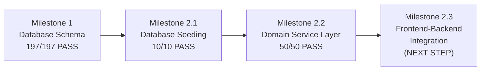

# Avencis Workforce Management (WFM)
# Milestone 2.3 Integration Readiness Assessment

**Document Reference:** `docs/SERVICE_INTEGRATION_READINESS.md`  
**Milestone:** 2.2 Completion & Handover to Milestone 2.3  
**Status:** **READY FOR MILESTONE 2.3 FRONTEND-BACKEND INTEGRATION**  
**Date:** 2026-11-14  

---

## 1. Executive Readiness Status

The foundation for Avencis Workforce Management is complete, validated, and verified across all four structural tiers:

| Component | Target Object | Verification Result | Health Status |
| :--- | :--- | :--- | :--- |
| **Relational Database** | 20 Tables, 8 Functions, 8 Triggers | `POST_MIGRATION_VERIFICATION.sql` | **197 / 197 PASS (100%)** |
| **Security Layer** | 33 Multi-Tenant RLS Policies | Migration 09 Catalog Audit | **100% Policy Coverage** |
| **Foundation Seed Data** | 3 Clients, 4 Entities, 8 Locations, 14 Staff | `SEED_DATA_VERIFICATION.sql` | **10 / 10 PASS (100%)** |
| **Domain Service Layer** | 7 Services, 11 Files, 44 Methods | `scripts/testServices.ts` | **50 / 50 PASS (100%)** |
| **Frontend Production Build** | TypeScript Compiler & Vite Bundler | `npm run build` | **0 Errors (7.34s build)** |
| **Design Integrity** | 29 Approved Stitch UI Screens | Source Component Audit | **0 UI Drift / 100% Preserved** |

---

## 2. Milestone 2.2 Artifacts Delivered

### 2.1. Service Modules (`src/services/`)
1. [`src/services/serviceConfig.ts`](file:///c:/Avencis%20Management/src/services/serviceConfig.ts): Mode routing (`supabase` vs `mock`) and production freeze guard.
2. [`src/services/serviceErrors.ts`](file:///c:/Avencis%20Management/src/services/serviceErrors.ts): PostgREST/PostgreSQL error code mapper, field-level validation errors, and user-facing message formatter.
3. [`src/services/serviceTypes.ts`](file:///c:/Avencis%20Management/src/services/serviceTypes.ts): Strongly typed request/response contracts and Haversine geofence math calculator.
4. [`src/services/authService.ts`](file:///c:/Avencis%20Management/src/services/authService.ts): GoTrue auth, session management, RBAC profile resolution, and dev persona switcher.
5. [`src/services/policyService.ts`](file:///c:/Avencis%20Management/src/services/policyService.ts): Client organisations, legal entities, work locations, departments, and 20 operational parameters.
6. [`src/services/employeeService.ts`](file:///c:/Avencis%20Management/src/services/employeeService.ts): Employee directory, salary structures, and bank details.
7. [`src/services/attendanceService.ts`](file:///c:/Avencis%20Management/src/services/attendanceService.ts): Geofenced punch recording, append-only telemetry, and regularisation approvals.
8. [`src/services/leaveService.ts`](file:///c:/Avencis%20Management/src/services/leaveService.ts): Leave balances, application validation, and anti-self-approval protection.
9. [`src/services/payrollService.ts`](file:///c:/Avencis%20Management/src/services/payrollService.ts): Compensation runs, line items, Form XIX payslips, divisor proration, and locked run tamper guards.
10. [`src/services/reportingService.ts`](file:///c:/Avencis%20Management/src/services/reportingService.ts): Security audit logs, attendance summaries, and statutory Form XIX registers.
11. [`src/services/index.ts`](file:///c:/Avencis%20Management/src/services/index.ts): Barrel export.

### 2.2. Validation & Documentation
- [`scripts/testServices.ts`](file:///c:/Avencis%20Management/scripts/testServices.ts): Automated 50-check test suite (`npx tsx --env-file=.env scripts/testServices.ts`).
- [`docs/SERVICE_LAYER_ARCHITECTURE.md`](file:///c:/Avencis%20Management/docs/SERVICE_LAYER_ARCHITECTURE.md): Architecture, sequence diagrams, and design principles.
- [`docs/SERVICE_METHOD_REFERENCE.md`](file:///c:/Avencis%20Management/docs/SERVICE_METHOD_REFERENCE.md): Comprehensive API method documentation.
- [`docs/SERVICE_TEST_REPORT.md`](file:///c:/Avencis%20Management/docs/SERVICE_TEST_REPORT.md): Test scorecard and execution audit.
- [`docs/SERVICE_INTEGRATION_READINESS.md`](file:///c:/Avencis%20Management/docs/SERVICE_INTEGRATION_READINESS.md): This integration guide.

---

## 3. Strict UI Preservation Status

During Milestone 2.2:
- **Zero changes** were made to `src/app/`, `src/components/`, or page templates.
- **Zero styles** were modified in Tailwind configuration or CSS stylesheets.
- **Zero routes** were changed in `src/App.tsx`.
- All 29 Stitch screens remain visually identical to their approved state.

---

## 4. Step-by-Step Implementation Roadmap for Milestone 2.3

Milestone 2.3 will connect the frontend application contexts and screens to the newly implemented service layer:

### Phase 1: Authentication & Workspace Context Wiring
1. Update `src/context/AuthContext.tsx`:
   - Replace in-memory mock user login with `authService.signIn()` and `authService.resolveUserContext()`.
   - Maintain the developer persona selector when running in `mock` or `development` mode.
   - Listen to `authService.onAuthStateChange()` to synchronize auth state with Supabase GoTrue.
2. Update `src/context/WorkspaceContext.tsx`:
   - Replace hardcoded client state with `policyService.getAccessibleClients()`.
   - Dynamically load legal entities, locations, and departments from `policyService`.

### Phase 2: Page-Level Service Integration
Connect existing UI pages to domain services while preserving 100% of the UI design:
- **Clients & Onboarding:** Connect `ClientList` and `ClientDetail` to `policyService`.
- **Policy Configuration:** Connect `PolicyConfiguration` to `policyService.getClientPolicy()` and `updateClientPolicy()`.
- **Employee Directory:** Connect `EmployeeList` and `EmployeeDetail` to `employeeService`.
- **Attendance & Clock-In:** Connect `AttendanceMuster` and `ClockInOut` to `attendanceService.recordPunch()`.
- **Leave Management:** Connect `LeaveManagement` to `leaveService.getLeaveBalances()` and `submitLeaveRequest()`.
- **Payroll Processing:** Connect `PayrollRunList` and `PayrollRunDetail` to `payrollService`.
- **Compliance & Audit:** Connect `AuditLogs` and `StatutoryRegisters` to `reportingService`.

### Phase 3: Error Toast & Notification Polish
- Connect `ServiceError` formatting (`formatErrorMessage(err)`) to existing notification/toast UI components so PostgreSQL constraint rejections (e.g. duplicate PAN, geofence violations) display clear, actionable feedback to users.

---

## 5. Safety & Verification Protocol for Milestone 2.3

1. **Incremental Verification:** Wire one context/module at a time, followed by `npx tsc --noEmit` and `npm run build`.
2. **Never Break Mock Mode:** Ensure developers can continue previewing all 29 screens offline with `VITE_DATA_SOURCE_MODE=mock`.
3. **Database Guardrails:** Never alter existing migrations or table schemas without explicit verification scripts.
