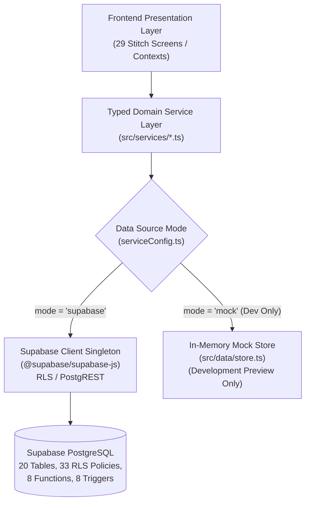
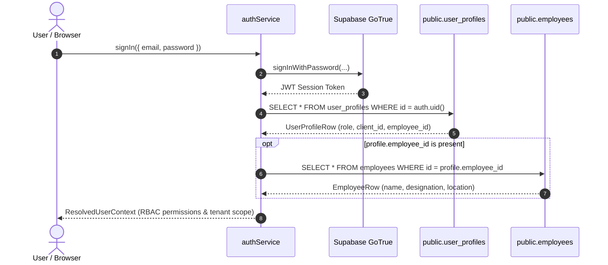
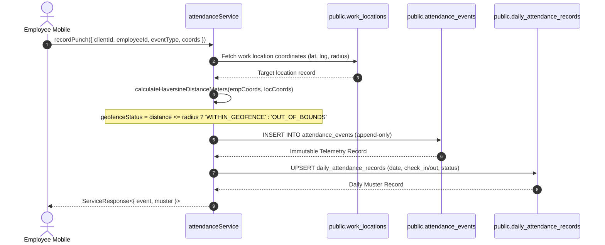

# Avencis Workforce Management (WFM)
# Typed Domain Service Layer Architecture

**Document Reference:** `docs/SERVICE_LAYER_ARCHITECTURE.md`  
**Milestone:** 2.2 — Typed Domain Service Layer  
**Status:** IMPLEMENTED & VERIFIED (50/50 Automated Tests Passing, 100% Build Clean)  
**Target Environment:** Supabase PostgreSQL with Multi-Tenant RLS  

---

## 1. Architectural Overview & Design Philosophy

The Avencis Workforce Management Service Layer provides a strongly typed, decoupled intermediary layer between frontend presentation components (the 29 approved Stitch screens) and backend persistence engines (Supabase PostgreSQL with Row Level Security).



### Core Tenets
1. **Strict Type Safety & Zero Any:** Every database interaction is governed by `Database` schema types defined in `src/types/database.types.ts`, matching the verified 20 tables and constraints.
2. **Explicit Operational Mode Control:** Services operate in either `supabase` or `mock` mode via `src/services/serviceConfig.ts`. In production (`PROD`), mock mode is strictly prohibited.
3. **Structured Error Contract (`ServiceResponse<T>`):** Services never throw raw runtime exceptions or return untyped results. All methods return `{ success: true, data: T }` or `{ success: false, error: ServiceError }`.
4. **Zero UI Drift:** The service layer introduces zero visual changes to existing screens, components, layout, or styling.
5. **Fail-Closed Security:** In `supabase` mode, database or network failures are never silently swallowed or masked with mock data. Errors are explicitly surfaced with structured error classifications.

---

## 2. Directory Structure & Module Responsibilities

The service layer resides in `src/services/`:

```
src/services/
├── index.ts                 # Central barrel export
├── serviceConfig.ts         # Operational mode toggling & production protection
├── serviceErrors.ts         # Categorized error model & PostgreSQL error code mapper
├── serviceTypes.ts          # Unified payload types, domain filters, & Haversine math
├── authService.ts           # GoTrue session management & RBAC profile resolution
├── policyService.ts         # Multi-tenant clients, legal entities, locations & policies
├── employeeService.ts       # Employee directory, compensation structures & bank details
├── attendanceService.ts     # GPS geofencing, append-only punch logging & regularisations
├── leaveService.ts          # Leave balances, application validation & anti-self-approval
├── payrollService.ts        # Compensation runs, line items, Form XIX & locked tamper guards
└── reportingService.ts      # Compliance audit logs, attendance summaries & statutory registers
```

---

## 3. Operational Modes & Production Security Boundary

`src/services/serviceConfig.ts` controls data source routing:

| Mode | Environment | Behavior |
| :--- | :--- | :--- |
| `supabase` | Production / Live Dev | All reads and mutations target PostgreSQL tables via PostgREST and RLS. |
| `mock` | Local Dev Preview Only | Reads and mutations target `src/data/store.ts` for offline UI testing. |

### Production Safeguard
```typescript
if (isProd()) {
  return 'supabase'; // Mock mode strictly prohibited in production builds
}
```
In production Vite builds (`npm run build`), `getDataSourceMode()` unconditionally returns `'supabase'` regardless of environment variables or client-side storage overrides.

---

## 4. Security & Governance Architectural Boundaries

### 4.1. Row Level Security (RLS) Alignment
All service calls execute with the user's Supabase JWT (`authenticated` role) or the anonymous key (`anon` role). As verified in test suite check 11:
- Unauthenticated (`anon`) queries against tenant tables (`clients`, `employees`, `attendance_events`, `payroll_runs`) return zero rows.
- Data isolation between client tenants is enforced at the database kernel level by Migration 09 policies (`id = public.get_user_client_id()`).

### 4.2. GPS Telemetry & Geofence Verification
`attendanceService` evaluates mobile punches against authorized work locations using the Haversine formula:
$$\Delta\sigma = 2 \arcsin \sqrt{\sin^2\left(\frac{\Delta\phi}{2}\right) + \cos\phi_1 \cos\phi_2 \sin^2\left(\frac{\Delta\lambda}{2}\right)}$$
$$d = R \cdot \Delta\sigma \quad (R = 6,371,000 \text{ m})$$

- Telemetry is written directly to the append-only `attendance_events` table.
- Database triggers reject any `UPDATE` or `DELETE` statements on `attendance_events`.

### 4.3. Anti-Self-Approval Restriction
In `leaveService`, manager approval logic strictly validates that the approving employee ID is not identical to the applicant's employee ID:
```typescript
if (decision.reviewerEmployeeId && decision.reviewerEmployeeId === request.employee_id) {
  return errorResponse(createPermissionError('Security Violation: Employees are prohibited from approving their own leave requests.'));
}
```

### 4.4. Locked Payroll Run Tamper Guard
In `payrollService`, before updating or recalculating batches, `assertPayrollNotLocked()` verifies the run status:
```typescript
if (run.status === 'locked') {
  return errorResponse(createPermissionError('CRITICAL TAMPER GUARD: This payroll run is finalized and locked. Modifications are prohibited.'));
}
```
This is mirrored at the database level by PostgreSQL trigger `trg_guard_locked_payroll_run`.

---

## 5. End-to-End Domain Workflows

### 5.1. Authentication & Context Resolution


### 5.2. Geofenced Punch Workflow


---

## 6. Error Handling Architecture

PostgreSQL error codes are mapped into standardized, typed categories:

| PostgreSQL Code | Category | HTTP Status | Description |
| :--- | :--- | :--- | :--- |
| `42501` | `PERMISSION_ERROR` | 403 | RLS policy rejection or cross-tenant query attempt. |
| `PGRST116` | `NOT_FOUND` | 404 | Query expected single row but received 0 rows. |
| `23505` | `VALIDATION_ERROR` | 400 | Unique key constraint violation (e.g. duplicate PAN or employee code). |
| `23503` | `VALIDATION_ERROR` | 400 | Foreign key constraint violation. |
| `22003` | `VALIDATION_ERROR` | 400 | Numeric overflow (precision/scale exceeded). |
| `P0001` | `DATABASE_ERROR` | 400 | Database trigger business rule violation (e.g. locked payroll update). |
| Fetch/Network | `NETWORK_ERROR` | 503 | Internet connectivity or backend unreachable. |

---

## 7. Next Phase: Milestone 2.3 Integration

The service layer is complete, fully typed, verified with 50 automated tests, and production-build clean. Milestone 2.3 will proceed to connect `src/context/AuthContext.tsx` and `src/context/WorkspaceContext.tsx` to `authService` and `policyService`, transitioning the frontend from mock store state to live Supabase backend data without altering any of the 29 UI screens.
