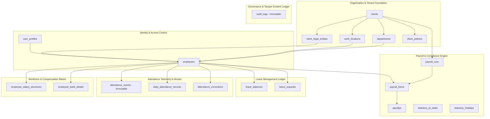

# AVENCIS WORKFORCE MANAGEMENT (WFM)
## MILESTONE 1 — SUPABASE FOUNDATION & SECURITY ARCHITECTURE REPORT

**Project:** Avencis ERP / Business Management Platform  
**Module:** Workforce Management (WFM) — Attendance & Payroll  
**Milestone:** Milestone 1 — Supabase Foundation & Database Implementation  
**Status:** **PHASE A & B COMPLETED — AWAITING MIGRATION APPROVAL**  

---

## 1. Executive Summary

Milestone 1 establishes the enterprise database foundation and security architecture for Avencis Workforce Management (WFM).

Following a production-conscious, controlled implementation approach:
1. **Phase A (Environment & Security)** has been completely executed:
   - Official `@supabase/supabase-js` SDK installed (`package.json`).
   - Production-grade Supabase client singleton implemented in [`src/lib/supabase.ts`](file:///c:/Avencis%20Management/src/lib/supabase.ts).
   - Strict TypeScript database schema types generated in [`src/types/database.types.ts`](file:///c:/Avencis%20Management/src/types/database.types.ts).
   - `.env.example` sanitized with generic placeholders; live project references isolated strictly to private `.env`.
   - `.gitignore` created to prevent accidental exposure of `.env`, `.env.local`, and secrets.
   - Zero exposure of service-role or secret keys to frontend JavaScript bundles.
   - Environment validation and graceful offline fallback implemented.
2. **Phase B (Database Architecture)** has been completely designed:
   - 20 relational tables architected across organisations, legal entities, work locations, employees, decoupled salary structures, secure banking details, immutable attendance telemetry, leave ledgers, payroll batches, payslips, state PT schedules, and tamper-evident audit logs.
   - 10 version-controlled, numbered SQL migration scripts generated in [`supabase/migrations/`](file:///c:/Avencis%20Management/supabase/migrations/).
3. **Execution Guard:** In strict adherence to your instructions, **no migrations have been executed against the live Supabase project**. The complete plan is presented for review and approval.

---

## 2. Phase A Verification & Security Checklist

| Requirement | Implementation Details | Status | File Reference |
|---|---|:---:|---|
| **1. Install `@supabase/supabase-js`** | Added to `package.json` dependencies; verified with `npm list`. | **COMPLETE** | [`package.json`](file:///c:/Avencis%20Management/package.json) |
| **2. Create `src/lib/supabase.ts`** | Instantiates Supabase client with auth session persistence and headers. | **COMPLETE** | [`src/lib/supabase.ts`](file:///c:/Avencis%20Management/src/lib/supabase.ts) |
| **3. Typed Client Singleton** | Fully typed using `SupabaseClient<Database>` mapped to all 20 tables. | **COMPLETE** | [`src/types/database.types.ts`](file:///c:/Avencis%20Management/src/types/database.types.ts) |
| **4. Configure Environment Variables** | Read via `import.meta.env.VITE_SUPABASE_URL` and `VITE_SUPABASE_ANON_KEY`. | **COMPLETE** | [`.env`](file:///c:/Avencis%20Management/.env) |
| **5. Sanitize `.env.example`** | All live project references replaced with generic placeholder values. | **COMPLETE** | [`.env.example`](file:///c:/Avencis%20Management/.env.example) |
| **6. Verify `.gitignore`** | Created root `.gitignore` ignoring `.env`, `.env.*.local`, `dist`, `node_modules`. | **COMPLETE** | [`.gitignore`](file:///c:/Avencis%20Management/.gitignore) |
| **7. Zero Secret Key Exposure** | Only `VITE_` prefixed public anon keys bundled; service role key isolated. | **COMPLETE** | [`src/lib/supabase.ts`](file:///c:/Avencis%20Management/src/lib/supabase.ts) |
| **8. Environment Validation** | `validateSupabaseEnv()` checks URL syntax, placeholder detection, and alerts. | **COMPLETE** | [`src/lib/supabase.ts`](file:///c:/Avencis%20Management/src/lib/supabase.ts#L18-L45) |

---

## 3. Database Architecture Overview

To satisfy enterprise compliance, Indian labour law (Factories Act Form XIX), and tenant isolation, the database expands from the initial 12-table proposal to **20 dedicated relational tables**:

---

## 4. Critical Architectural Rules Compliance

1. **Employer / Legal Entity Separation:**  
   `client_legal_entities` represents the registered legal employer holding PAN, TAN, GSTIN, and PF/ESIC codes. `employees` explicitly references `legal_entity_id`, preserving separation from the deployed client account.
2. **Payroll Responsibility Explicitly Modelled:**  
   `client_legal_entities.payroll_responsibility` enum (`SELF_MANAGED`, `AVENCIS_MANAGED`, `HYBRID`) designates statutory disbursement ownership.
3. **Flexible Employment Arrangements:**  
   `employees.employment_arrangement` enum (`DIRECT_PERMANENT`, `DIRECT_CONTRACT`, `DEPUTED_STAFFING`, `INTERN`) supports direct hires, third-party contractors, and deputed agency workers.
4. **Tenant Ownership Integrity:**  
   Every client-scoped table enforces foreign key `client_id REFERENCES clients(id) ON DELETE CASCADE`.
5. **Raw Attendance Telemetry Immutability:**  
   PostgreSQL trigger `trg_guard_attendance_events_immutability` strictly denies `UPDATE` and `DELETE` queries on `attendance_events`.
6. **Audited Regularisations:**  
   `attendance_corrections` preserves original punch timestamps (`original_check_in`, `original_check_out`) alongside requested modifications and reviewer signatures.
7. **Strict Payroll State Machine:**  
   `payroll_runs.status` transitions across `draft` $\to$ `under_review` $\to$ `approved` $\to$ `locked`.
8. **Locked Payroll Tamper Guard:**  
   PostgreSQL triggers `trg_guard_payroll_run_lock` and `trg_guard_payroll_items_lock` raise critical runtime exceptions if any modification is attempted on a locked run.
9. **Salary & Banking Data Shielding:**  
   Compensation (`employee_salary_structures`) and bank accounts (`employee_bank_details`) are decoupled into separate tables with dedicated Row Level Security policies.
10. **Tamper-Evident Security Ledger:**  
    `audit_logs` records all sensitive tenant mutations and is guarded against retroactive alterations.

---

## 5. Migration Artifacts Summary

Ten versioned migration scripts have been created in `supabase/migrations/`:

1. `20261103000001_initial_schema_clients_and_entities.sql`
2. `20261103000002_locations_departments_and_policies.sql`
3. `20261103000003_auth_profiles_and_rbac.sql`
4. `20261103000004_employees_and_compensation.sql`
5. `20261103000005_attendance_and_regularisations.sql`
6. `20261103000006_leave_management.sql`
7. `20261103000007_payroll_engine_and_payslips.sql`
8. `20261103000008_statutory_and_audit_ledgers.sql`
9. `20261103000009_row_level_security_policies.sql`
10. `20261103000010_database_triggers_and_guards.sql`

*These migrations will remain in local review status until explicit executive authorization is granted.*
