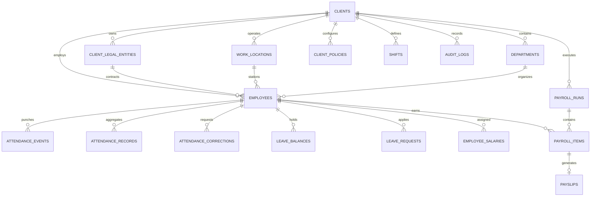

# Avencis Workforce Management (Module 01)
# Technical Architecture Baseline & Data Model

---

**Document Reference:** `docs/TECHNICAL_ARCHITECTURE_BASELINE.md`  
**Architecture Date:** 03 November 2026  
**Stack Baseline:** React 18 + TypeScript + Vite + Tailwind CSS + Supabase / PostgreSQL  
**System Topology:** Modular Enterprise Web Application (Multi-Tenant Scoped)  

---

## 1. System Topology & Directory Architecture

The application is structured as a clean modular monolith adhering to domain-driven design principles:

```
src/
├── app/                              # Route views and page components
│   ├── admin/                        # Avencis Master Administration pages
│   ├── workspace/                    # Client Workspace pages (scoped by clientId)
│   ├── portal/                       # Employee Self-Service portal & mobile check-in
│   └── auth/                         # Enterprise login and session recovery
├── components/                       # Shared UI component library
│   ├── layout/                       # AppShell, Sidebar, TopNav, ClientSwitcher
│   ├── ui/                           # Button, Input, Select, Badge, Card, Modal, Table
│   └── feedback/                     # Alert, Spinner, Toast notifications
├── modules/                          # Domain business logic & services
│   ├── clients/                      # Client onboarding, profiles, workspace switcher
│   ├── employees/                    # Master records, onboarding wizard, KYC
│   ├── attendance/                   # Telemetry, GPS calculation, regularisation engine
│   ├── leave/                        # Leave ledger, requests, accrual rules
│   ├── payroll/                      # Salary divisor, calculation engine, locking, payslips
│   ├── policies/                     # Client-level 20 policy domain engine
│   └── audit/                        # Forensics event capture & security loggers
├── context/                          # Global React contexts (AuthContext, WorkspaceContext)
├── types/                            # Core TypeScript interfaces and database schemas
├── data/                             # Data access layer, in-memory repository & seed data
└── utils/                            # Currency formatters, date math, GPS validators
```

---

## 2. Core Relational Data Model (PostgreSQL & Supabase)

All tables strictly enforce multi-tenancy by including `client_id` (foreign key to `clients.id`), with the exception of the global `clients` and `system_users` tables.



### 2.1 Table Schemas & Key Constraints

#### 1. `clients` (Master Organisations)
* `id`: UUID (Primary Key)
* `name`: VARCHAR(255) (e.g., "Suman", "Maha India")
* `code`: VARCHAR(50) UNIQUE (e.g., "SUMAN", "MAHA")
* `industry`: VARCHAR(100)
* `status`: VARCHAR(20) (`ONBOARDING`, `ACTIVE`, `SUSPENDED`)
* `created_at`: TIMESTAMPTZ

#### 2. `client_legal_entities` (Client Employer & Statutory Entities)
* `id`: UUID (Primary Key)
* `client_id`: UUID (Foreign Key -> `clients.id`)
* `legal_name`: VARCHAR(255) (e.g., "Maha India Logistics Pvt Ltd")
* `pan`: VARCHAR(20)
* `gstin`: VARCHAR(30)
* `pf_establishment_code`: VARCHAR(50)
* `esic_registration_code`: VARCHAR(50)
* `registered_address`: TEXT
* `is_primary`: BOOLEAN

#### 3. `client_policies` (The 20 Mandatory Client Policy Areas)
* `id`: UUID (Primary Key)
* `client_id`: UUID UNIQUE (Foreign Key -> `clients.id`)
* `overtime_calculation_method`: VARCHAR(30) (`MULTIPLIER`, `FLAT_RATE`, `COMP_OFF`, `DISABLED`)
* `overtime_rate`: NUMERIC(5,2) (e.g., 1.50)
* `late_arrival_grace_minutes`: INTEGER (e.g., 10)
* `late_arrival_penalty_rule`: VARCHAR(50) (`NONE`, `DEDUCT_HALF_DAY_PER_3`, `DEDUCT_CL`)
* `overnight_shift_attribution`: VARCHAR(30) (`SHIFT_START_DATE`, `SHIFT_END_DATE`)
* `standard_working_hours`: NUMERIC(4,2) (e.g., 9.0)
* `half_day_minimum_hours`: NUMERIC(4,2) (e.g., 4.5)
* `weekly_off_days`: TEXT[] (e.g., `["SUNDAY"]` or `["SATURDAY", "SUNDAY"]`)
* `require_gps_verification`: BOOLEAN (e.g., true)
* `require_selfie_verification`: BOOLEAN (e.g., false)
* `enforce_strict_geofence`: BOOLEAN (e.g., true)
* `monthly_paid_leave_accrual`: NUMERIC(4,2) (e.g., 2.0)
* `max_leave_carry_forward`: INTEGER (e.g., 30)
* `allow_leave_encashment`: BOOLEAN
* `salary_calculation_divisor`: VARCHAR(20) (`DIVISOR_26`, `DIVISOR_30`, `CALENDAR_DAYS`)
* `pf_enabled`: BOOLEAN
* `esic_enabled`: BOOLEAN
* `pt_enabled`: BOOLEAN
* `updated_at`: TIMESTAMPTZ
* `updated_by`: UUID

#### 4. `employees` (Client-Scoped Master)
* `id`: UUID (Primary Key)
* `client_id`: UUID (Foreign Key -> `clients.id`)
* `legal_entity_id`: UUID (Foreign Key -> `client_legal_entities.id`)
* `work_location_id`: UUID (Foreign Key -> `work_locations.id`)
* `department_id`: UUID (Foreign Key -> `departments.id`)
* `employee_code`: VARCHAR(50) (e.g., "MI-001")
* `first_name`: VARCHAR(100)
* `last_name`: VARCHAR(100)
* `email`: VARCHAR(255)
* `mobile`: VARCHAR(20)
* `joining_date`: DATE
* `employment_type`: VARCHAR(30) (`FULL_TIME`, `CONTRACT`, `INTERN`)
* `status`: VARCHAR(20) (`ACTIVE`, `ON_NOTICE`, `TERMINATED`)

#### 5. `attendance_events` (Immutable Punch Stream)
* `id`: UUID (Primary Key)
* `client_id`: UUID (Foreign Key -> `clients.id`)
* `employee_id`: UUID (Foreign Key -> `employees.id`)
* `event_type`: VARCHAR(20) (`CHECK_IN`, `CHECK_OUT`, `BREAK_START`, `BREAK_END`)
* `event_timestamp`: TIMESTAMPTZ
* `latitude`: NUMERIC(10,7)
* `longitude`: NUMERIC(10,7)
* `accuracy_meters`: NUMERIC(8,2)
* `geofence_status`: VARCHAR(30) (`WITHIN_GEOFENCE`, `OUT_OF_BOUNDS`, `EXCEPTION_ALLOWED`)
* `ip_address`: VARCHAR(45)
* `device_info`: TEXT

#### 6. `attendance_records` (Daily Classified Sessions)
* `id`: UUID (Primary Key)
* `client_id`: UUID (Foreign Key -> `clients.id`)
* `employee_id`: UUID (Foreign Key -> `employees.id`)
* `work_date`: DATE
* `shift_id`: UUID
* `first_check_in`: TIMESTAMPTZ
* `last_check_out`: TIMESTAMPTZ
* `total_hours_worked`: NUMERIC(4,2)
* `status`: VARCHAR(20) (`PRESENT`, `HALF_DAY`, `ABSENT`, `PAID_LEAVE`, `UNPAID_LEAVE`, `WEEKLY_OFF`, `HOLIDAY`)
* `is_regularised`: BOOLEAN DEFAULT false

#### 7. `leave_requests` & `leave_balances`
* `leave_balances`: Tracks `opening_balance`, `credited`, `used`, `closing_balance` per leave type (`PL`, `CL`, `SL`, `COMP_OFF`).
* `leave_requests`: Lifecycle (`SUBMITTED`, `APPROVED`, `REJECTED`, `CANCELLED`) with reason, date range, and manager decision remarks.

#### 8. `payroll_runs` & `payroll_items`
* `payroll_runs`: Aggregates pay period (month/year), client ID, total gross, total statutory deductions, net payable, status (`DRAFT`, `VALIDATED`, `HR_APPROVED`, `LOCKED`).
* `payroll_items`: Stores per-employee breakdown: `paid_days`, `unpaid_days`, `gross_earnings`, `pf_deduction`, `esic_deduction`, `pt_deduction`, `tds_deduction`, `net_salary`.
* `payroll_snapshots`: JSON snapshot preserving the exact salary structure and policy rules at the moment of locking.

---

## 3. Data Access Layer & Supabase/PostgreSQL RLS

### 3.1 Dual-Mode Repository Pattern
To guarantee instant out-of-the-box execution without waiting for external cloud provisioning, the data layer implements a **Dual-Mode Repository**:
1. **Local Persistent Repository (`localStorage` + In-Memory):** Fully pre-seeded with multi-tenant demonstration data (Suman and Maha India, complete legal entities, departments, employees, policies, live attendance events, leave ledgers, and sample payroll runs).
2. **Supabase Client Connector:** Modular connector ready to swap in Supabase environment variables (`VITE_SUPABASE_URL`, `VITE_SUPABASE_ANON_KEY`) for PostgreSQL cloud persistence.

### 3.2 Row-Level Security (RLS) Specification
```sql
-- Client isolation policy for tenant users
ALTER TABLE employees ENABLE ROW LEVEL SECURITY;
CREATE POLICY client_isolation_policy ON employees
  FOR ALL
  USING (
    auth.jwt() ->> 'role' = 'super_admin' OR
    client_id = (auth.jwt() ->> 'client_id')::uuid
  );
```
