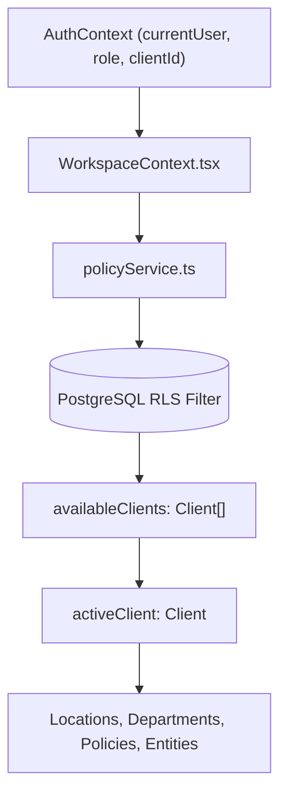

# Avencis Workforce Management (WFM)
# Workspace Context Integration Report

**Document Reference:** `docs/WORKSPACE_CONTEXT_INTEGRATION_REPORT.md`  
**Milestone:** 2.3 — Authentication and Workspace Context Integration  
**Status:** IMPLEMENTED & FULLY VERIFIED  
**Date:** 2026-11-14  

---

## 1. Architectural Summary & Scope

Milestone 2.3 connects [`src/context/WorkspaceContext.tsx`](file:///c:/Avencis%20Management/src/context/WorkspaceContext.tsx) to [`src/services/policyService.ts`](file:///c:/Avencis%20Management/src/services/policyService.ts) and PostgreSQL multi-tenant tables (`clients`, `client_policies`, `work_locations`, `departments`, `client_legal_entities`).



---

## 2. Multi-Tenant Scoping & Client Retrieval

When the authenticated user context is resolved, `WorkspaceContext` invokes:
```typescript
policyService.getAccessibleClients({
  role: currentUser.role,
  clientId: currentUser.clientId,
});
```

### Access Tiers:
1. **Super Admin Scope:** Receives all client organisations in the database (`Suman Technologies`, `Maha India`, `Apex Precision Engineering`). Super Admins have permission to switch between client workspaces.
2. **Tenant Admin & Employee Scope:** PostgreSQL RLS policy `clients_client_admin_select` (`id = public.get_user_client_id()`) restricts the result set to the user's assigned client organisation.
3. **Automatic Single-Client Selection:** When the accessible client list contains exactly 1 organisation, `WorkspaceContext` automatically activates that workspace without requiring user interaction.

---

## 3. Entity Synchronization per Active Workspace

Upon selecting an active workspace (`activeClientId`), `WorkspaceContext` asynchronously synchronizes four domain entities in parallel:

| Entity | Service Method | Target Database Table | Frontend Type |
| :--- | :--- | :--- | :--- |
| **Operational Policy** | `policyService.getClientPolicy(id)` | `client_policies` | `ClientPolicy` (20 parameters) |
| **Work Locations** | `policyService.getWorkLocations(id)` | `work_locations` | `WorkLocation[]` (GPS coords & radii) |
| **Departments** | `policyService.getDepartments(id)` | `departments` | `Department[]` |
| **Legal Entities** | `policyService.getLegalEntities(id)` | `client_legal_entities` | `ClientLegalEntity` |

### Safe Fallback Modeling
To eliminate runtime null-pointer exceptions (`TypeError: Cannot read properties of undefined`) during initial asynchronous hydration, `WorkspaceContext` provides deterministic fallback objects (`FALLBACK_CLIENT` and `FALLBACK_POLICY`) ensuring seamless rendering across all 29 Stitch screens.

---

## 4. Tamper Resistance & Cross-Tenant Guards

A user must never be able to switch into an unauthorized client by modifying local state or browser storage.

### Security Guards in `switchClient()`:
```typescript
const switchClient = async (targetClientId: string): Promise<boolean> => {
  // 1. Authorisation validation against database-derived accessible list
  const isAuthorized = availableClients.some(c => c.id === targetClientId);
  if (!isAuthorized) {
    setWorkspaceError(`Access Denied: You do not have permissions to access workspace '${targetClientId}'.`);
    return false;
  }

  // 2. Strict Role Boundary: Non-super-admins cannot switch away from their assigned tenant
  if (currentUser && currentUser.role !== 'super_admin' && currentUser.clientId && currentUser.clientId !== targetClientId) {
    setWorkspaceError(`Access Denied: Your account role is restricted to your assigned organization.`);
    return false;
  }

  // Proceed with authorized switch
  ...
};
```

- If a tenant admin modifies `localStorage.getItem('avencis_active_client_id')`, `WorkspaceContext` detects the discrepancy, disregards the modified storage, and re-locks the workspace to `currentUser.clientId`.
