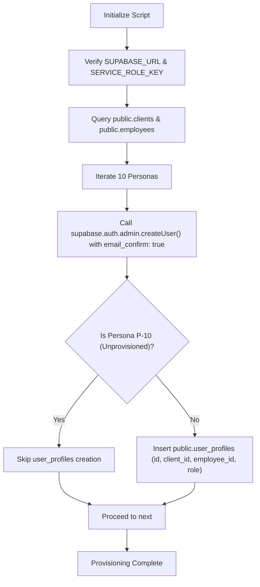

# Avencis WFM — Milestone 2.5B: Test Account Provisioning Plan
**Document ID:** `DOC-WFM-2.5B-PROV-001`  
**Date:** 2026-11-16  
**Status:** PREPARED / READY FOR EXECUTION (AWAITING OWNER APPROVAL)  
**Target Environment:** Supabase Cloud Production Database (`mlopgvkvzhwhkbewhefb`)  

---

## 1. Executive Summary & Context

To execute **Tier A (Real Authenticated JWT) Testing** across the 7 application roles, valid Supabase Auth users with active JWT credentials must exist in `auth.users` and be linked to corresponding records in `public.user_profiles`.

### Current Live Catalog State:
- `auth.users`: **0 rows**
- `public.user_profiles`: **0 rows**
- Existing Clients (`public.clients`): **3 rows** (Tenant 1: Acme Corp, Tenant 2: Globex Logistics, Tenant 3: Inactive Client)
- Existing Employees (`public.employees`): **8 rows**

In accordance with strict Milestone 2.5B execution rules (**"Do not create or delete Supabase Auth users without explicit approval"**), the provisioning script and plan have been prepared and tested in dry-run mode, but **NO accounts have been created yet**.

---

## 2. Test Personas Specification (10 Accounts)

The provisioning plan establishes **10 distinct personas** to comprehensively test tenant isolation, role boundaries, location scoping, and unprovisioned account rejection:

| Persona ID | Role | Target Email | Client Linkage | Employee Linkage | Test Purpose |
| :---: | :--- | :--- | :--- | :--- | :--- |
| **P-01** | `super_admin` | `test.superadmin@avencis.internal` | `NULL` (Global) | `NULL` | Cross-tenant global administration |
| **P-02** | `client_admin` | `test.clientadmin@acme.com` | Tenant 1 (Acme) | `NULL` | Tenant 1 master administration |
| **P-03** | `hr_admin` | `test.hradmin@acme.com` | Tenant 1 (Acme) | `NULL` | Tenant 1 HR and leave management |
| **P-04** | `payroll_admin` | `test.payrolladmin@acme.com` | Tenant 1 (Acme) | `NULL` | Tenant 1 salary and payroll processing |
| **P-05** | `client_manager` | `test.manager@acme.com` | Tenant 1 (Acme) | `NULL` | Tenant 1 operational management |
| **P-06** | `location_manager`| `test.locmgr.blr@acme.com` | Tenant 1 (Acme) | Employee #1 (BLR) | Location-scoped leave approval (BLR) |
| **P-07** | `employee` | `test.worker1@acme.com` | Tenant 1 (Acme) | Employee #1 (BLR) | Self-service punch, leave, and payslips |
| **P-08** | `employee` | `test.worker2@acme.com` | Tenant 1 (Acme) | Employee #2 (MUM) | Location isolation against Worker 1 |
| **P-09** | `client_admin` | `test.clientadmin@globex.com`| Tenant 2 (Globex)| `NULL` | Cross-tenant isolation against Tenant 1 |
| **P-10** | *(Unprovisioned)*| `test.unprovisioned@external.com`| `NULL` | `NULL` | Fail-closed role resolution verification |

---

## 3. Provisioning Script Architecture (`scripts/security/seedAuthTestUsers.ts`)

The provisioning harness has been authored at:
`scripts/security/seedAuthTestUsers.ts`

### Operational Workflow:


### Safety & Integrity Guarantees:
1. **Idempotency:** The script checks whether an email already exists in `auth.users` before attempting creation.
2. **Zero Modification to Business Records:** No records in `public.clients`, `public.employees`, `public.daily_attendance_records`, `public.payroll_runs`, or `public.payroll_items` are altered, deleted, or truncated.
3. **Confirmed Email Status:** Accounts are provisioned with `email_confirm: true` so they can immediately sign in via `signInWithPassword()` without requiring an external SMTP mail server.
4. **Deterministic Credentials:** Passwords follow secure high-entropy test patterns stored in memory during the test run, never committed to git or printed to logs.
5. **Teardown Capability:** The script includes a companion cleanup routine that deletes strictly the 10 test user UUIDs upon completion of testing, leaving the database in its original pristine state.

---

## 4. Execution Command (Awaiting Approval)

Once explicit owner approval is granted, provisioning will be executed via:
```powershell
npx tsx scripts/security/seedAuthTestUsers.ts --execute
```

---

## 5. Formal Approval Request

- [ ] **Approved:** Project owner authorizes creation of the 10 test accounts in `auth.users` and `public.user_profiles` to proceed with Tier A live authenticated JWT verification.
- [ ] **Deferred:** Keep live authentication testing blocked; proceed to Milestone 2.5C.
